# synshell

[Русский](README.ru.md)

[](#licence)
[-informational)](#build-and-run)

A Wayland desktop environment written in Rust. It is split the way KDE Plasma is: a compositor
(the KWin role), a separate shell process for panels, dock, launcher and notifications (the
plasmashell role) and a System Settings app — plus a file manager and a screenshot tool. All of
the UI is built with my own GUI framework, [syngui](https://github.com/VitaminDB/syngui); the
compositor is built on [smithay](https://github.com/Smithay/smithay).

Almost everything is configured in one file, `~/.config/synshell/config.toml`. The compositor
and the shell watch it and apply changes live; System Settings edits the same file in place and
keeps your comments.

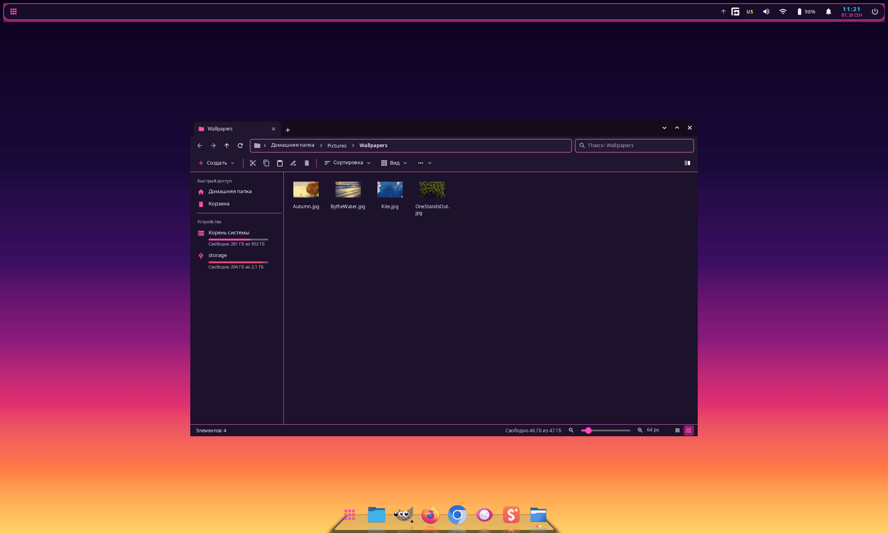

## Status

Early. One developer, one machine. The first commit is from September 2026, and the pace since
then has been fast, so expect rough edges and config keys that still move. It runs as my login
session on Arch Linux on a hybrid laptop (Intel Arrow Lake iGPU driving the internal 2560×1600
240 Hz panel at 1.4× scale, plus an NVIDIA RTX 5090 Laptop GPU). Multiple GPUs, monitor hotplug and
other distributions are handled in the code, but no configuration other than this one has been
tested. The phone build (aarch64) runs on a Xiaomi 12T Pro.

The interface is translated into 14 languages — English, Russian, German, Spanish, French,
Italian, Japanese, Kazakh, Korean, Polish, Brazilian Portuguese, Turkish, Ukrainian and
Simplified Chinese; it follows the system language or the one picked in System Settings. The
documentation in `docs/` is in Russian.

## What is in the box

| Binary | What it does |
|---|---|
| `synwm` | Compositor on smithay 0.7: DRM/KMS (multiple GPUs, hotplug, DPMS) or a nested window for development. Server-side decorations, workspaces, floating / tile / columns / grid / monocle layouts, snapping to edges and halves, window overview, Alt+Tab, window rules, Xwayland, a JSON IPC socket and the `synwm msg` CLI. |
| `syndesktop-shell` | The shell (layer-shell surfaces): wallpaper, panels with applets, dock, launcher, notification server (D-Bus), OSD, power menu, window switcher, system tray (StatusNotifierItem), lock screen (ext-session-lock + PAM). If it crashes, the compositor restarts it and your windows stay. |
| `synmobile-shell` | The phone shell (status bar, navigation bar, home screen). The compositor picks it automatically on a phone form factor; see `docs/MOBILE.md`. |
| `syngame-shell` | Game mode (gameshell): a fullscreen console-style launcher with the Steam library, covers, gamepad navigation and an in-game quick menu; every app runs fullscreen without frames. Switched on the fly with Super+G; see `docs/GAMESHELL.md`. |
| `synkeyboard` | On-screen keyboard with wide keys and layers (?123, =\\<, emoji), optional number row, an extra strip for terminals (Esc/Tab/Ctrl/Alt/arrows/paste): EN/RU, F1–F12, arrows, sticky Ctrl/Alt/Super, auto-show via input-method; `synkeyboard type/key` CLI. |
| `synsettings` | System Settings: 18 pages. Edits `config.toml` through `toml_edit`, so comments and ordering survive. |
| `synfiles` | A file manager modelled on Windows 11 Explorer: tabs in the title bar, dual pane, icons / tiles / list / details views, thumbnails, rubber-band selection, drag and drop, background operations with pause and cancel, Ctrl+Z, freedesktop trash, search. `--viewer` is a built-in image viewer (zoom, EXIF rotation, HEIC, folder filmstrip). |
| `synlink` | Links synshell devices (phone ↔ computer) over USB and Wi-Fi: QUIC with pinned keys, pairing (one tap over USB, code over Wi-Fi), screen, remote input, files (FUSE), notifications, a shared clipboard, `ssh phone` without knowing addresses, a CLI and an MCP server for Claude Code. See `docs/LINK.md`. |
| `synpass` | «Пароли» — password manager: a vault under a master password (Argon2id + XChaCha20-Poly1305), big copy buttons and a large character-by-character view, a generator, auto-lock and clipboard clearing; syncs with linked devices through synlink. See `docs/PASSWORDS.md`. |
| `synlink-view` | Shows and controls the screen of a linked device (damage-only frames, mouse as a finger on the phone). |
| `synshot` | Region / window / monitor screenshot on Print: the screen freezes, you drag a frame (handles, magnifier, arrow-key nudging) or click a window; copy, save, copy path or open. |

## Features

- **Dock** (`mode = "dock"` on any panel), in the spirit of the macOS dock and Latte Dock: the
  icon under the cursor grows above the bar, window indicators, launch bounce and particles,
  3D tilt and spin on hover, a 3D shelf with reflections, groups (a popup with a grid, list or
  fan of icons), folders, autohide and intellihide. Everything is added and rearranged with the
  mouse in edit mode (right-click the panel → Edit). See [docs/DOCK.md](docs/DOCK.md).
- **Adaptive panel** (`defloat`): a floating panel snaps to the screen edge at full length when a
  window is maximized or touches it, as in Plasma 6.
- **Panel as a title bar**: the window-title, window-buttons and global-menu applets, together
  with `borderless_maximized`, turn the top panel into the title bar of the maximized window.
  The global menu reads Qt/KDE menus (`org_kde_kwin_appmenu`, dbusmenu) and GTK 3 menus
  (`gtk_shell1`, `org.gtk.Menus`) — GIMP 3 included.
- **Themes**: 14 built-in (Nord, Catppuccin, Tokyo Night, Gruvbox, Rosé Pine, Everforest, Dracula,
  Kanagawa, Solarized, Synthwave, Aurora, Sakura, Neobrutalism, Terminal), each with dark and/or
  light variants, a wallpaper and its own stylesheet; your own themes are a `theme.toml` plus
  MSS. Switching themes cross-fades colours without rebuilding surfaces. The palette is also
  exported to GTK 3/4, Qt/KDE (`kdeglobals`) and GIMP so that applications match. See
  [docs/THEMES.md](docs/THEMES.md).
- **Shell animations**: popups flow out of the panel they belong to, notifications slide and
  re-stack, the launcher morphs between sections — all drawn by the shell with syngui animation
  primitives.
- **Lock screen** built into the shell (ext-session-lock, password checked through PAM), idle
  handling, its own screen-sharing and screenshot portal (ScreenCast/Screenshot: monitor picked in a
  shell dialog, frames from synwm over `wlr-screencopy` straight into PipeWire buffers by
  `syn-screencast`) for browsers, OBS and other apps.

### Layouts

Panels, the dock and their applets are set up in `config.toml` or with the mouse in edit mode (right-click a panel → Edit): any number of panels on any edge, horizontal or vertical.

| Top panel + dock | Classic taskbar (the default) | Vertical panel |
|---|---|---|
|  | 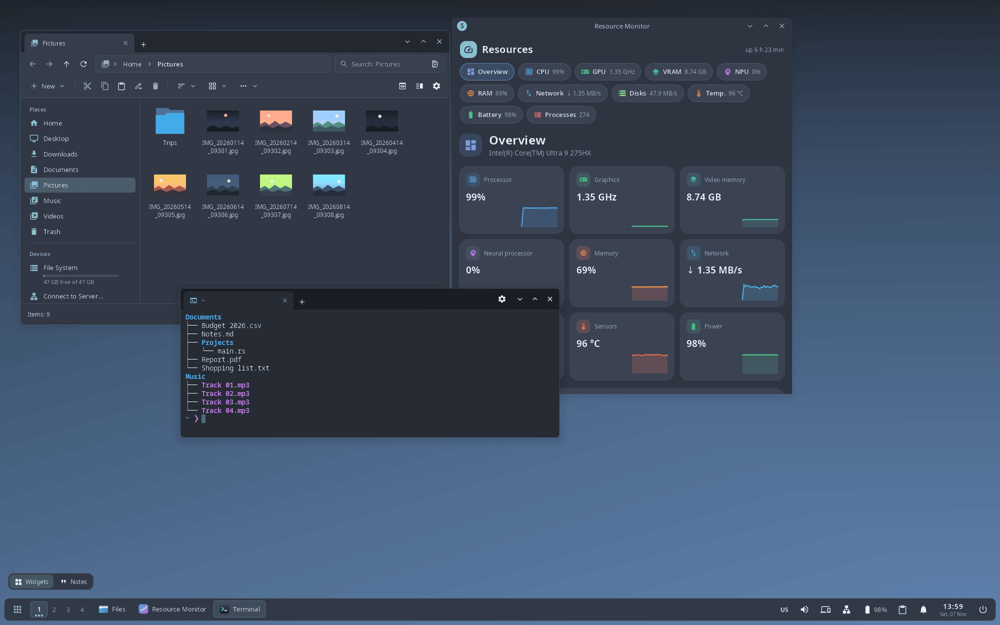 | 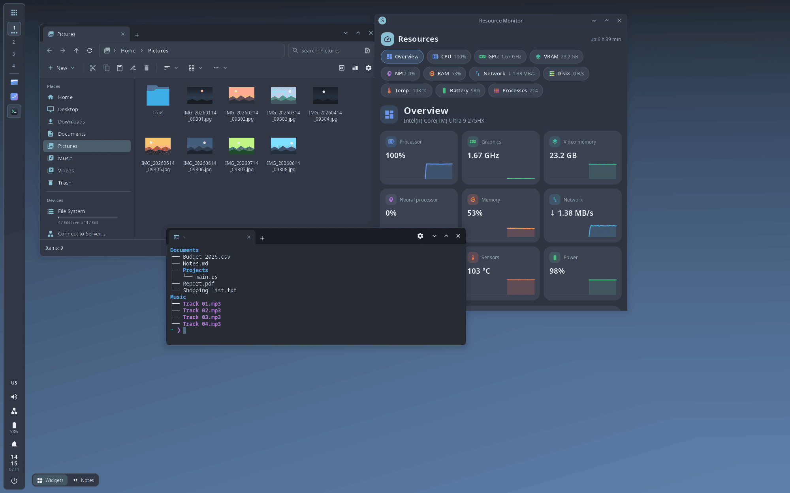 |

| Launcher | Tile layout |
|---|---|
| 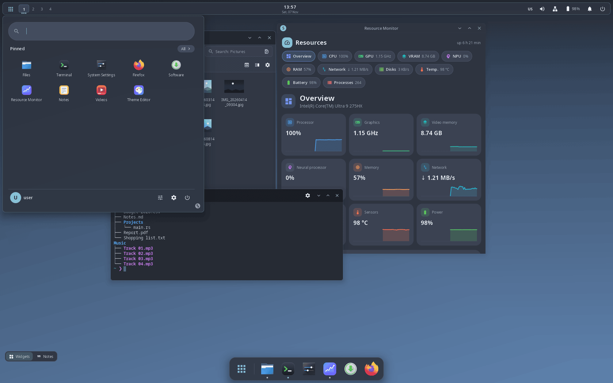 | 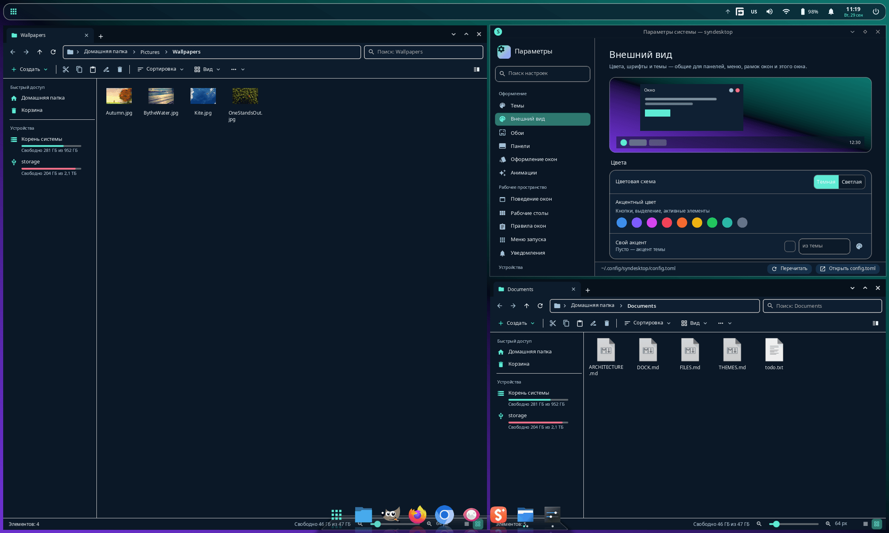 |

| System Settings — Themes | Screenshot tool |
|---|---|
| 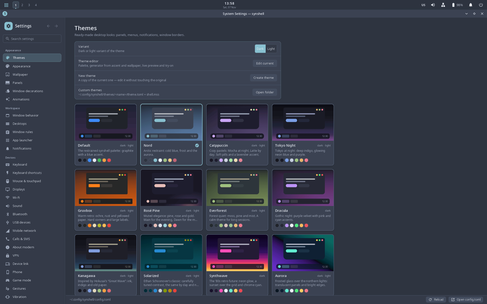 | 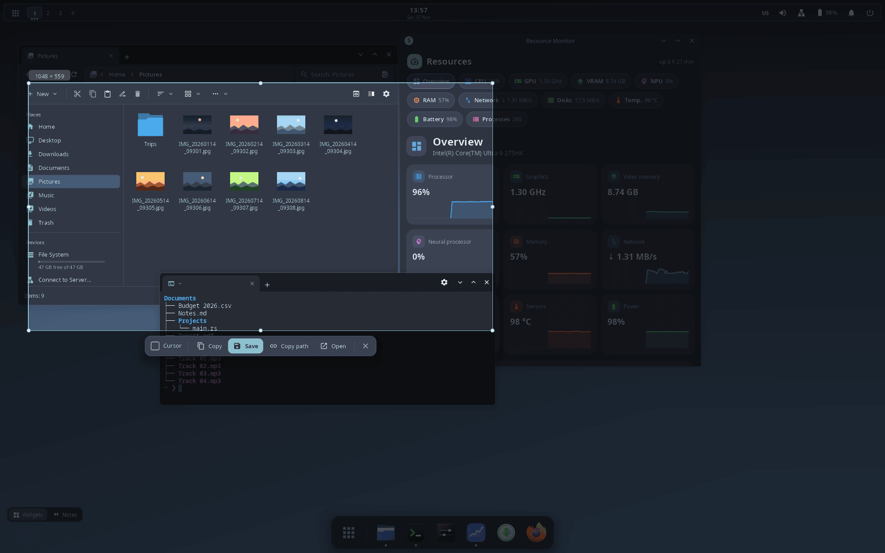 |

| Window overview | Power menu |
|---|---|
| 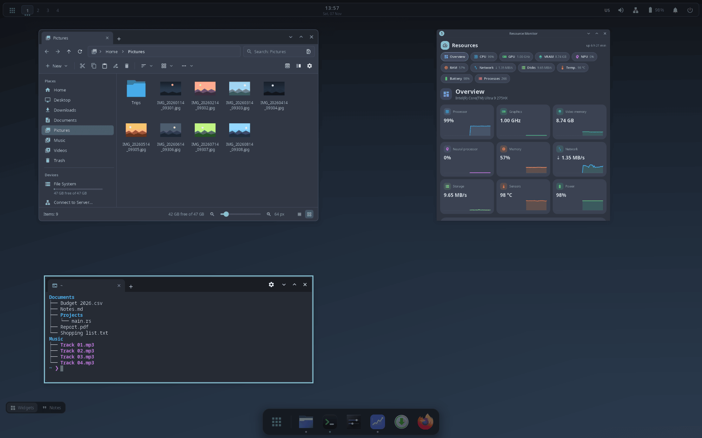 | 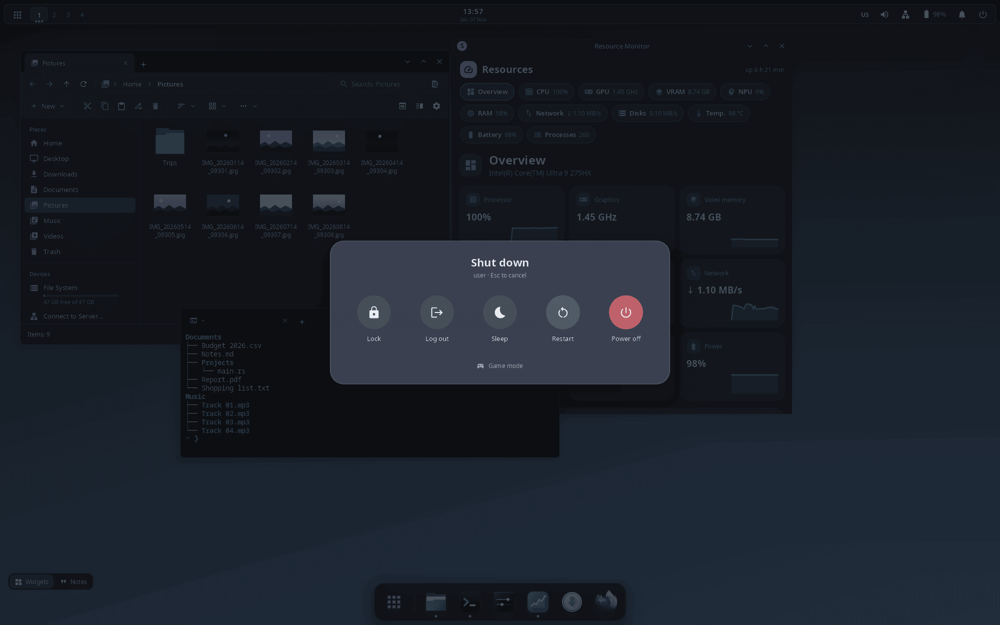 |

## Applications

Every application has its own README with screenshots and a command-line reference.

**Desktop**

| Application | What it does |
|---|---|
| [synsettings](crates/syn-settings/README.md) | **System settings.** Themes, wallpaper, panels, input, displays, network, sound and the rest of `config.toml` in one window. |
| [synfiles](crates/syn-files/README.md) | **File manager.** Tabs, two panes, archives as folders, network locations, phones and drives, a built-in image viewer. |
| [syn-terminal](crates/syn-terminal/README.md) | **Terminal.** Tabs in the title bar, color schemes, font settings; on a phone, a row of keys the on-screen keyboard lacks. |
| [synshot](crates/syn-shot/README.md) | **Screenshots.** The screen freezes, you select an area or click a window, then copy, save or open it. |
| [synpkg](crates/syn-pkg/README.md) | **Software center.** Browse, install, remove and update programs from the Arch Linux repositories and AUR. |
| [syn-systeminfo](crates/syn-systeminfo/README.md) | **System monitor.** Processor, graphics and video memory, NPU, memory, network, storage, sensors, power and processes. |
| [syn-themeeditor](crates/syn-themeeditor/README.md) | **Theme editor.** Palette, shape and MSS styles with a live preview of the desktop and System Settings. |

**Work**

| Application | What it does |
|---|---|
| [syn-notes](crates/syn-notes/README.md) | **Notes.** Pages and free canvases with kanban boards, Gantt charts, mind maps, a calendar and charts, handwriting and a book reader, all in one `.syn` project file. |
| [synpass](crates/syn-pass/README.md) | **Password manager.** An encrypted vault under one master password, synced with your other synshell devices. |
| [synassistant](crates/syn-assistant/README.md) | **The synshell assistant.** Chat and voice conversations with local neural networks that can control the system, files, notes and the web. |
| [syn-vm](crates/syn-vm/README.md) | **Virtual machines.** QEMU/KVM with a native UI, a scriptable CLI and an MCP server for AI agents. |

**Media**

| Application | What it does |
|---|---|
| [syn-video-player](crates/syn-video-player/README.md) | **Video player.** Hardware decoding, subtitles with full styling, a simple cut-and-join editor and neural filters. |
| [syn-audio-player](crates/syn-audio-player/README.md) | **Music player.** Your Music folder as a library, any audio format through ffmpeg. |
| [syn-audio-recorder](crates/syn-audio-recorder/README.md) | **Voice recorder.** Live waveform, microphone choice, phone noise suppression, Opus/FLAC/WAV. |
| [syn-maps](crates/syn-maps/README.md) | **Maps.** OpenStreetMap with search, routes and your own location, on computers and phones. |

**Phone**

The phone shell (`synmobile-shell`): the home screen with application icons laid out in pages, and the quick settings shade.

To put Arch Linux with synshell next to Android on a phone, use [synport](https://github.com/VitaminDB/synport) — an installer for Windows and Linux, one USB cable. Video: [Arch Linux on an Android phone in 4 minutes](https://youtu.be/a1eQKbndKZ0).

| Home screen | Quick settings |
|---|---|
| 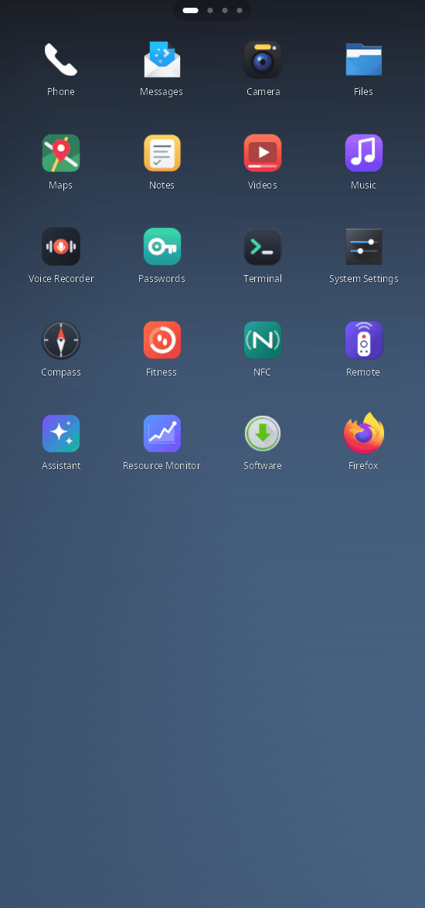 | 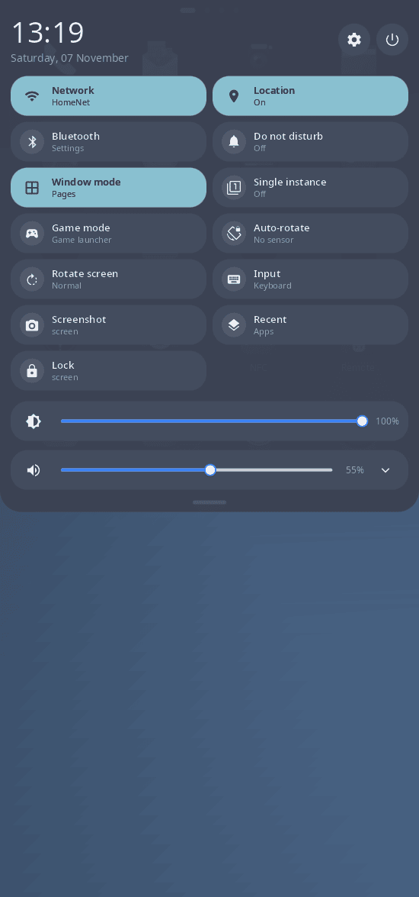 |

| Application | What it does |
|---|---|
| [synphone](crates/syn-phone/README.md) | **Phone app.** Keypad, call log and the in-call screen, on top of the synshell modem daemon. |
| [synsms](crates/syn-sms/README.md) | **Messages app.** SMS conversations through the synshell modem daemon, laid out for a phone or a wide window. |
| [syncamera](crates/syn-camera/README.md) | **Camera.** Photo, night, pro, video and time-lapse, with zoom, tap-to-focus and a built-in viewer. |
| [syn-nfc](crates/syn-nfc/README.md) | **NFC app.** Read tags, keep them, write your own and let the phone act as a tag. |
| [syn-compass](crates/syn-compass/README.md) | **Compass.** Magnetometer and accelerometer, a level, a bearing mark and figure-eight calibration. |
| [syn-health](crates/syn-health/README.md) | **Steps and activity.** The phone's pedometer, distance, calories, by hour and by week. |
| [synlink](crates/syn-link/README.md) | **Linking a phone and a computer.** Over USB and Wi-Fi: screen, input, sound, files, notifications, a shared clipboard, `ssh phone`, a CLI and an MCP server for AI agents. |
| [synlink-view](crates/syn-link-view/README.md) | **The screen of a linked device in a window.** Watch and control your phone from the computer, or the computer from the phone. |
| [syn-remote](crates/syn-remote/README.md) | **IR remote control.** A phone with an IR LED controls TVs, air conditioners, projectors and more. |

**Compatibility**

| Application | What it does |
|---|---|
| [syndroid](crates/syn-droid/README.md) | **Android apps.** A LineageOS container (Waydroid images) with its own runtime, a daemon, a management window and a CLI. |
| [syn-wine-helper](crates/syn-wine-helper/README.md) | **Wine components.** DLLs that Wine itself does not have (MFC, Visual Basic runtimes, OpenAL), installed once for all prefixes and offered when a program needs them. |
| [syn-wine](crates/syn-wine/README.md) | **Wine for Windows programs and games.** Touch input, the Steam API bridge from Proton, DXVK, Wine Mono and Gecko in the package; ARM64EC with FEX on phones. |
| [syn-steam](crates/syn-steam/README.md) | **Steam on computers and phones.** Valve's bootstrap on x86_64; on aarch64 the native ARM64 client is installed on first start, with Big Picture under the phone shell. |
| [syn-dlss](crates/syn-dlss/README.md) | **DLSS 5 neural rendering.** NVIDIA's model for Linux games, Wine games and the video player: switch it on, tune the picture, run the NGX helper. |

**Health and games**

| Application | What it does |
|---|---|
| [syn-woman-cycle](crates/syn-woman-cycle/README.md) | **Cycle tracker.** Periods, fertile window and ovulation, symptoms and mood; the data stays on the device. |
| [syn-quitsmoke](crates/syn-quitsmoke/README.md) | **QuitSmoke.** A tracker for quitting smoking or vaping, all at once or gradually: smoke-free time, savings, health milestones, cravings and awards. |
| [Syn Blocks](crates/syn-blocks/README.md) | **An 8×8 block puzzle.** Place pieces, clear rows and columns, build combos. |

**Developer tools**

| Application | What it does |
|---|---|
| [syn-epdtest](crates/syn-epdtest/README.md) | **E Ink screen profiles and test patterns.** A tool for developers and for tuning the panel. |

| | | |
|---|---|---|
| [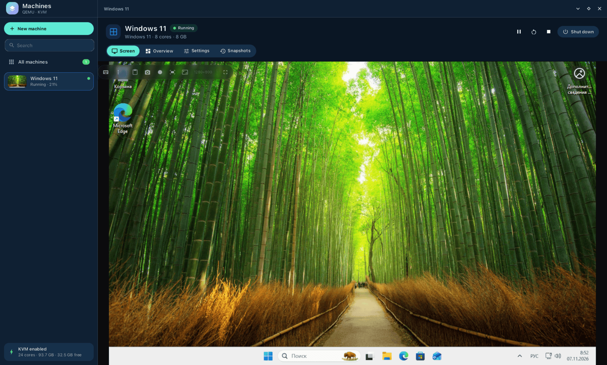](crates/syn-vm/README.md) | [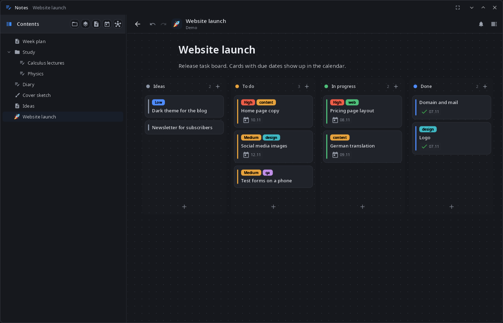](crates/syn-notes/README.md) | [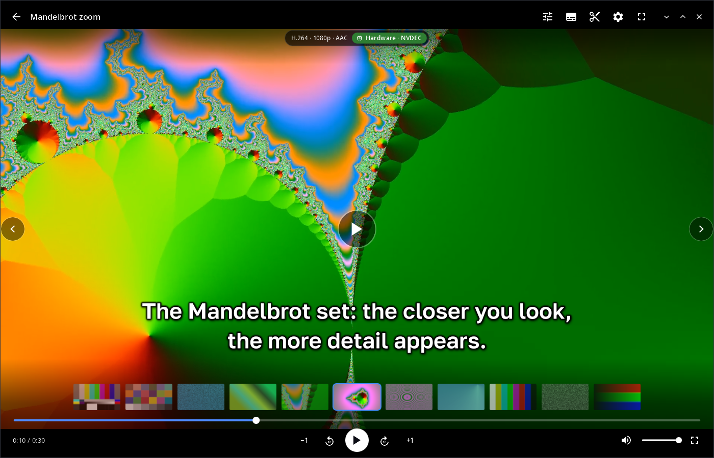](crates/syn-video-player/README.md) |
| [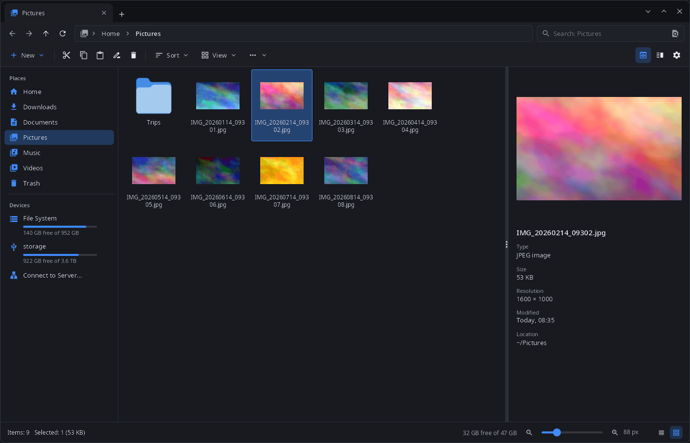](crates/syn-files/README.md) | [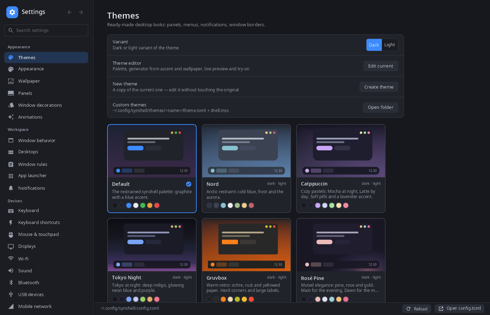](crates/syn-settings/README.md) | [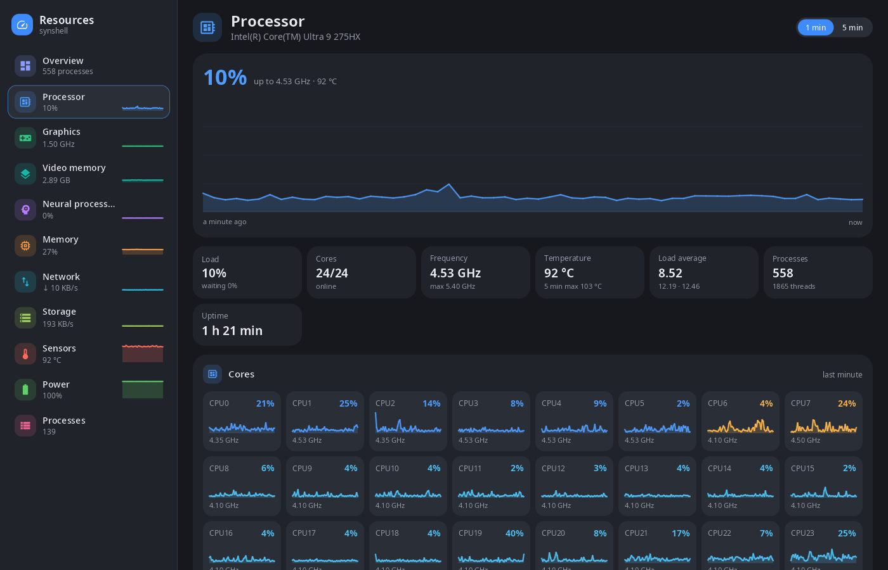](crates/syn-systeminfo/README.md) |

## Install from AUR

Arch Linux, x86_64 and aarch64. Every package comes as `-bin` (prebuilt) and `-git` (built from this repository):

```sh
yay -S synshell-bin          # the desktop and all applications, without neural networks
yay -S synshell-core-bin     # the minimum: compositor, shell, settings, file manager, terminal
yay -S syn-vm-bin            # or any single application by its package name
```

Package names are in the table under “As a real session” below; the phone shell is `synshell-mobile`, neural networks are `synaptix` and `synshell-ai`.

## Build and run

syngui and synaptix are pulled from GitHub as git dependencies, so a plain clone builds on its own:

```sh
git clone https://github.com/VitaminDB/synshell
cd synshell
cargo build --profile fast-release        # quick local build → target/fast-release
cargo build --release                     # LTO build → target/release
```

Working on syngui or synaptix at the same time? Check them out next to synshell and point Cargo
at the local copies with an untracked `.cargo/config.toml` in the synshell root:

```toml
[patch."https://github.com/VitaminDB/syngui.git"]
syngui = { path = "../syngui/syngui" }
mss-analysis = { path = "../syngui/mss-analysis" }

[patch."https://github.com/VitaminDB/synaptix.git"]
synaptix = { path = "../synaptix/crates/synaptix" }
# …one line per synaptix crate listed in Cargo.toml
```

The workspace sets `rust-version = "1.85"`. Build and runtime dependencies (Arch package names):
mesa, libinput, seatd, systemd-libs, libxkbcommon, libdrm, pixman, vulkan-icd-loader, fontconfig,
freetype2, a font (`ttf-font`), the default icon and cursor themes (breeze-icons, breeze-cursors), dbus, pam, alsa-lib, ffmpeg, sqlite, libarchive, pipewire, xdg-desktop-portal. Optional ones — xorg-xwayland, wireplumber, brightnessctl, networkmanager,
playerctl, wl-clipboard, ffmpegthumbnailer, libheif, imagemagick — are listed with their purpose in [syngui-release.toml](syngui-release.toml) (packages are built with `syngui package -w -f arch`).

**Nested, inside your current Wayland or X11 session** (it runs in a window):

```sh
PATH="$PWD/target/fast-release:$PATH" target/fast-release/synwm --nested
```

The compositor starts `syndesktop-shell` from `PATH`, hence the `PATH` prefix. A nested
instance reads the same `~/.config/synshell/config.toml` (written with defaults on first
start) and, with the defaults, starts `~/.config/autostart/*.desktop` and writes the theme
colours into your GTK and KDE colour files (`app_colors`). To try it without touching your own
setup, point it at a separate config directory (`app_colors` is skipped then) whose
`config.toml` turns autostart off — every field is optional:

```sh
mkdir -p /tmp/synshell-test
printf '[general]\nxdg_autostart = false\n' > /tmp/synshell-test/config.toml
SYNSHELL_CONFIG_DIR=/tmp/synshell-test PATH="$PWD/target/fast-release:$PATH" \
    target/fast-release/synwm --nested
```

**As a real session** on Arch Linux — one build produces separate packages, install what you need:

```sh
# packages are described in syngui-release.toml and built with the syngui tool (cargo install --git https://github.com/VitaminDB/syngui syngui-cli)
syngui package -w -f arch                                    # release build (LTO) → target/syngui/dist
syngui package -w -f arch --fast --install                   # faster local build, installed in one transaction
syngui package -w -f arch --only synshell-core               # the minimum: a working desktop
syngui package -w -f arch -t linux-aarch64                   # packages for phones (aarch64)
```

| Package | Contents |
|---|---|
| `synshell-core` | compositor synwm, desktop shell, login screen synlogin, on-screen keyboard, screenshots and screen sharing portal, settings, file manager, terminal, software centre synpkg |
| `synshell-mobile` | phone shell and phone services: modem (calls, SMS, data), NFC, compass, step counter |
| `synshell-game` | game mode shell and on-screen game controller |
| `synshell-link` | link between computer and phone: screen, input, files, notifications (synlink) |
| `synshell-ai` | assistant (needs the `synaptix` service) |
| `synaptix` | neural network service synaptixd — one package for every device: NVIDIA GPU, Intel NPU or CPU (CUDA and NPU are loaded at run time) |
| `syn-notes`, `syn-vm`, `syn-video-player`, `syn-audio-player`, `syn-audio-recorder`, `synpass`, `syn-maps`, `syn-remote`, `syn-systeminfo`, `syn-themeeditor`, `syn-woman-cycle`, `syndroid`, `syn-wine-helper`, `syncamera`, `syn-blocks` | applications, one package each (group `synshell-apps`) |
| `synshell` | meta package: core plus the applications above, without neural networks |

Then pick “synshell” in your display manager, or use the bundled login screen: on a system
without another display manager run `systemctl enable synlogin.service` and reboot (the package
does not enable services by itself).

Logs go to `~/.local/state/synshell/` (`synwm.log`, `shell.log`).

## Controls

Main key bindings (any of them can be remapped in `[keybindings]`):

| Keys | Action |
|---|---|
| Super+Return | terminal |
| Super+D / Alt+F1 | launcher |
| Super+G | game mode (gameshell) and back |
| Alt+Space | run prompt |
| Super+1…9 / Super+Shift+1…9 | go to workspace / move window to workspace |
| Super+←/→/↑/↓ | snap to an edge, maximize, minimize |
| Super+T | cycle layout |
| Super+Tab | window overview |
| Alt+Tab | window switcher |
| Super+LMB / Super+RMB | move / resize a window |
| Print | screenshot of a region or window |
| Shift+Print / Alt+Print | screenshot of the screen / window straight to a file |
| Super+Escape | lock the screen |
| Super+Shift+E | power menu |

Everything is also scriptable over IPC:

```sh
synwm msg windows | workspaces | outputs | layouts | events
synwm msg action "workspace 2"
synwm msg action "layout tile"
synwm msg action "spawn firefox"
synwm msg action "shell launcher"      # any shell command: launcher, edit-dock, lock, …
synwm msg window 5 minimize            # activate | close | maximize | floating | workspace N …
synwm msg restart-shell                # restart panels and menus, windows stay
synwm msg restart                      # restart the compositor (application windows close)
```

## Documentation

The documentation in [`docs/`](docs/) is **in Russian**:

- [ARCHITECTURE.md](docs/ARCHITECTURE.md) — processes, crates, config loading, IPC protocol,
  shell commands, layer-shell namespaces, animations.
- [DOCK.md](docs/DOCK.md) — dock and panel icons, groups, folders, edit mode.
- [THEMES.md](docs/THEMES.md) — theme format, MSS variables, writing your own theme.
- [FILES.md](docs/FILES.md) — the file manager and image viewer.
- [LINK.md](docs/LINK.md) — linking the phone and the computer: screen, input, files, notifications, ssh, MCP.
- [SOUNDS.md](docs/SOUNDS.md) — event sounds and sound themes (own themes made by synthesis and ACE-Step, freedesktop themes).
- [GAMESHELL.md](docs/GAMESHELL.md) — game mode: switching modes on the fly, fullscreen window policy, game library (Steam, .desktop, custom), gamepad.

The fully commented default config is
[crates/synshell-common/default-config.toml](crates/synshell-common/default-config.toml).

## Related

- [syngui](https://github.com/VitaminDB/syngui) — the Rust GUI framework (wgpu, MSS stylesheets,
  reactive signals) that every window and panel here is drawn with.
- [synthos](https://github.com/VitaminDB/synthos) — a local AI desktop studio on the same
  framework; it picks up the synshell theme and window buttons when running in a synshell
  session.

## How it is tested

I use synshell as my own desktop session, so what is described here is what I run daily. Developed with the help of [Claude Code](https://claude.com/claude-code).

## Support

synshell is free and open source, written by one person. If it is useful to you, you can support its development with a donation via [PayPal](https://paypal.me/vitamindbnfkz).

## Licence

synshell is dual-licensed: free under the [GNU GPL v3.0](LICENSE) (with an [additional permission](LICENSE-EXCEPTION.md) for proprietary GPU/NPU runtime libraries), or under a [commercial licence](LICENSE-COMMERCIAL.md) for companies that ship it in closed-source products. Versions up to 15 October 2026 remain under MIT OR Apache-2.0.
