# synshell

[English](README.md)

[](#лицензия)
[-informational)](#сборка-и-запуск)

Окружение рабочего стола для Wayland на Rust. Устроено оно так же, как KDE Plasma: композитор
(роль KWin), отдельный процесс оболочки с панелями, доком, меню запуска и уведомлениями (роль
plasmashell) и программа «Параметры системы», а к ним — проводник и снимки экрана. Весь интерфейс
нарисован на моём собственном GUI-фреймворке [syngui](https://github.com/VitaminDB/syngui);
композитор построен на [smithay](https://github.com/Smithay/smithay).

Почти всё настраивается в одном файле — `~/.config/synshell/config.toml`. Композитор и оболочка
следят за ним и применяют изменения на лету; «Параметры системы» правят тот же файл на месте и
сохраняют ваши комментарии.

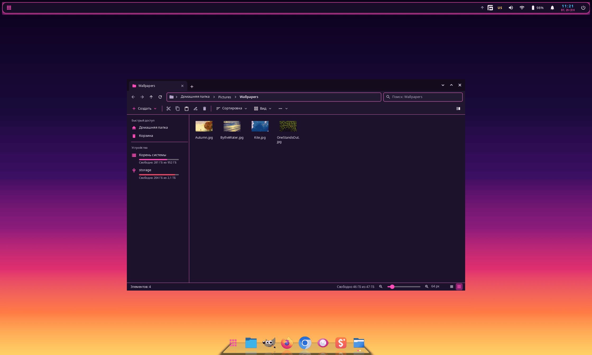

## Состояние

Ранняя стадия. Один разработчик, одна машина. Первый коммит сделан в сентябре 2026 года, с тех пор
работа идёт быстро, так что шероховатости неизбежны, а ключи конфигурации ещё могут меняться.
synshell — мой повседневный сеанс на Arch Linux на гибридном ноутбуке: встроенная графика Intel
Arrow Lake выводит изображение на встроенную панель 2560×1600 240 Гц с масштабом 1.4×, плюс
видеокарта NVIDIA RTX 5090 Laptop. Несколько видеокарт, подключение мониторов на ходу и другие
дистрибутивы в коде предусмотрены, но ни на какой конфигурации, кроме этой, не проверялись.
Телефонная сборка (aarch64) работает на Xiaomi 12T Pro.

Интерфейс переведён на 14 языков: английский, русский, немецкий, испанский, французский,
итальянский, японский, казахский, корейский, польский, бразильский португальский, турецкий,
украинский и упрощённый китайский. Язык берётся из системы или выбирается в «Параметрах системы».
Документация в `docs/` написана на русском.

## Что входит

| Программа | Что делает |
|---|---|
| `synwm` | Композитор на smithay 0.7: DRM/KMS (несколько видеокарт, подключение мониторов на ходу, DPMS) или вложенное окно для разработки. Рамки окон на стороне сервера, рабочие столы, раскладки «плавающая», «мозаика», «колонки», «сетка» и «монокль», прилипание к краям и половинам экрана, обзор окон, Alt+Tab, правила окон, Xwayland, сокет IPC с JSON и команда `synwm msg`. |
| `syndesktop-shell` | Оболочка (поверхности layer-shell): обои, панели с апплетами, док, меню запуска, сервер уведомлений (D-Bus), экранные индикаторы, меню выключения, переключатель окон, системный лоток (StatusNotifierItem), экран блокировки (ext-session-lock + PAM). Если оболочка упадёт, композитор перезапустит её, а окна останутся на месте. |
| `synmobile-shell` | Оболочка телефона: строка состояния, панель навигации, домашний экран. Композитор выбирает её сам, когда устройство — телефон; подробнее в `docs/MOBILE.md`. |
| `syngame-shell` | Игровой режим (gameshell): полноэкранное меню в духе приставки с библиотекой Steam, обложками, управлением с геймпада и быстрым меню прямо в игре; все программы открываются во весь экран без рамок. Включается и выключается на ходу по Super+G; подробнее в `docs/GAMESHELL.md`. |
| `synkeyboard` | Экранная клавиатура в духе Gboard: английская и русская раскладки, символы, F1–F12, стрелки, залипающие Ctrl/Alt/Super, сама появляется через input-method; команды `synkeyboard type/key`. |
| `synsettings` | «Параметры системы»: 18 страниц. Правит `config.toml` через `toml_edit`, поэтому комментарии и порядок строк сохраняются. |
| `synfiles` | Проводник по образцу Проводника Windows 11: вкладки в заголовке окна, две панели, виды «значки», «плитки», «список» и «таблица», миниатюры, выделение рамкой, перетаскивание, фоновые операции с паузой и отменой, Ctrl+Z, корзина freedesktop, поиск. С `--viewer` — встроенный просмотр картинок (масштаб, поворот по EXIF, HEIC, лента снимков папки). |
| `synlink` | Связывает устройства synshell (телефон ↔ компьютер) по USB и Wi-Fi: QUIC с закреплёнными ключами, сопряжение (одно касание по USB, код по Wi-Fi), экран, удалённый ввод, файлы (FUSE), уведомления, общий буфер обмена, `ssh phone` без знания адресов, командная строка и MCP-сервер для Claude Code. Подробнее в `docs/LINK.md`. |
| `synpass` | «Пароли» — менеджер паролей: хранилище под мастер-паролем (Argon2id + XChaCha20-Poly1305), крупные кнопки копирования и крупный посимвольный показ, генератор, автоблокировка и очистка буфера обмена; синхронизируется со связанными устройствами через synlink. Подробнее в `docs/PASSWORDS.md`. |
| `synlink-view` | Показывает экран связанного устройства и управляет им (передаются только изменившиеся области, мышь на телефоне работает как палец). |
| `synshot` | Снимок области, окна или монитора по Print: экран застывает, вы растягиваете рамку (ручки, лупа, сдвиг стрелками) или щёлкаете по окну, а затем копируете, сохраняете, копируете путь или открываете снимок. |

## Возможности

- **Док** (`mode = "dock"` у любой панели) в духе дока macOS и Latte Dock: значок под курсором
  вырастает над панелью, индикаторы окон, подпрыгивание и искры при запуске, 3D-наклон и вращение
  при наведении, 3D-полка с отражениями, группы (всплывающее окно с сеткой, списком или веером
  значков), папки, автоскрытие и умное скрытие. Всё добавляется и переставляется мышью в режиме
  правки (правый щелчок по панели → «Изменить панель»). Подробнее в [docs/DOCK.md](docs/DOCK.md).
- **Адаптивная панель** (`defloat`): плавающая панель прижимается к краю экрана во всю длину, когда
  окно развёрнуто или касается её, — как в Plasma 6.
- **Панель вместо заголовка окна**: апплеты «Заголовок окна», «Кнопки окна» и «Глобальное меню»
  вместе с `borderless_maximized` превращают верхнюю панель в заголовок развёрнутого окна.
  Глобальное меню читает меню Qt/KDE (`org_kde_kwin_appmenu`, dbusmenu) и GTK 3 (`gtk_shell1`,
  `org.gtk.Menus`) — в том числе меню GIMP 3.
- **Темы**: 14 встроенных (Nord, Catppuccin, Tokyo Night, Gruvbox, Rosé Pine, Everforest, Dracula,
  Kanagawa, Solarized, Synthwave, Aurora, Sakura, Neobrutalism, Terminal), у каждой тёмный и/или
  светлый вариант, свои обои и своя таблица стилей; собственная тема — это `theme.toml` и MSS.
  При смене темы цвета плавно перетекают, поверхности не пересоздаются. Палитра выгружается и в
  GTK 3/4, Qt/KDE (`kdeglobals`) и GIMP, чтобы программы выглядели в тон. Подробнее в
  [docs/THEMES.md](docs/THEMES.md).
- **Анимации оболочки**: всплывающие окна вытекают из своей панели, уведомления выезжают и
  перестраиваются, меню запуска плавно перетекает между разделами — всё это рисует сама оболочка
  на анимациях syngui.
- **Экран блокировки** встроен в оболочку (ext-session-lock, пароль проверяется через PAM); есть
  обработка простоя и свой портал показа экрана и снимков (ScreenCast/Screenshot): монитор
  выбирается в окне оболочки, а кадры идут из synwm по `wlr-screencopy` прямо в буферы PipeWire
  через `syn-screencast` — для браузеров, OBS и других программ.

| Меню запуска | Раскладка «мозаика» |
|---|---|
| 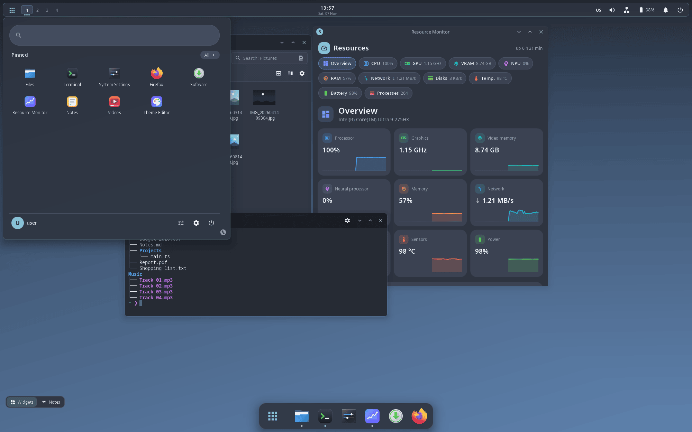 | 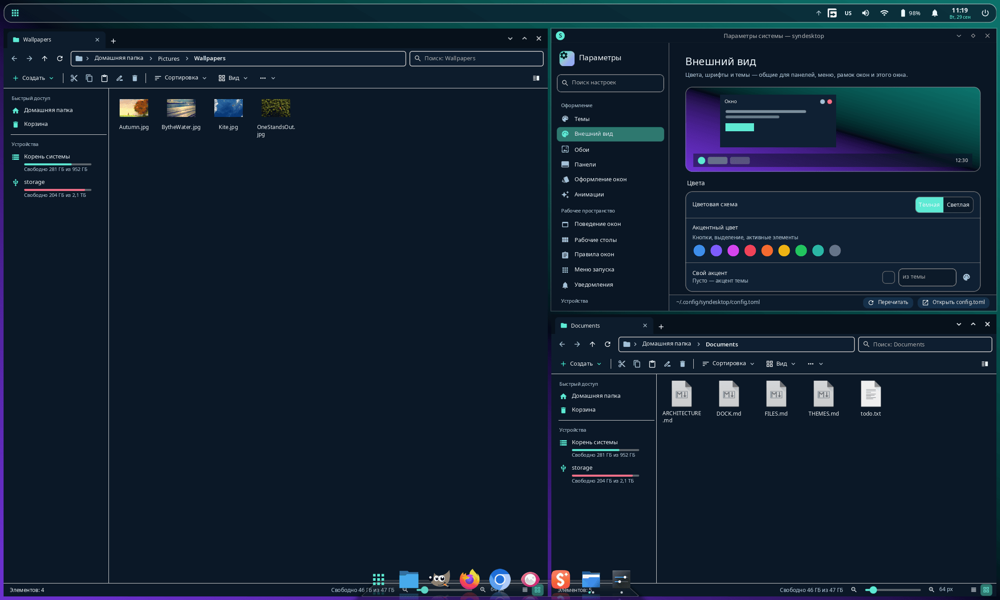 |

| «Параметры системы» — «Темы», развёрнуты под панелью-заголовком | Снимок экрана |
|---|---|
| 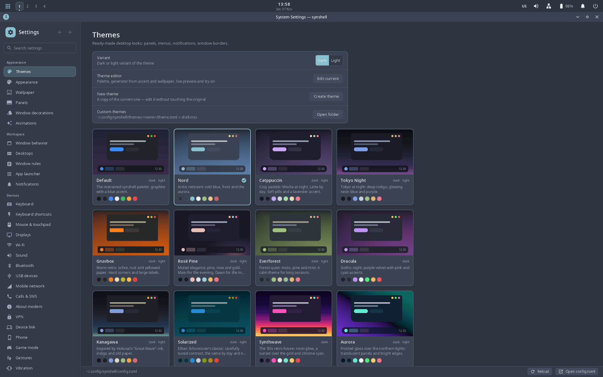 | 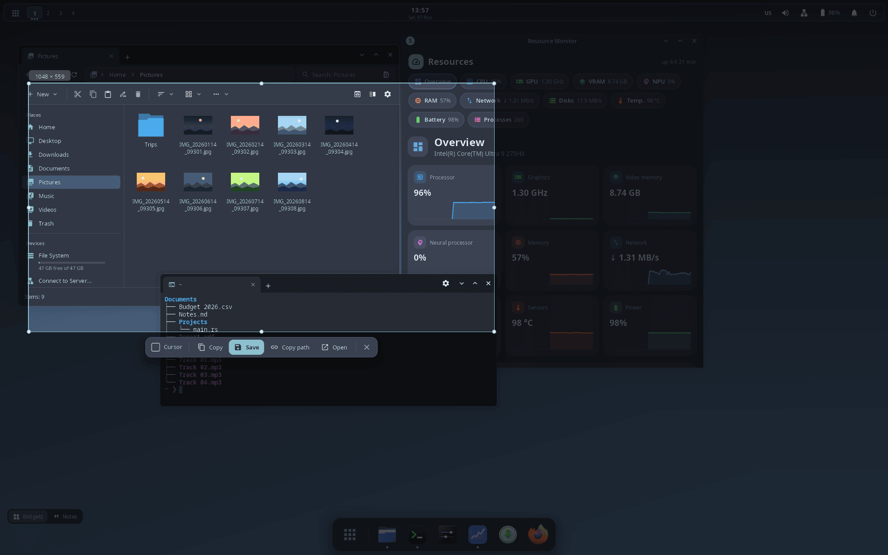 |

## Приложения

У каждого приложения свой README со снимками и описанием командной строки.

**Рабочий стол**

| Приложение | Что делает |
|---|---|
| [synsettings](crates/syn-settings/README.ru.md) | **Параметры системы.** Темы, обои, панели, ввод, мониторы, сеть, звук и остальной `config.toml` в одном окне. |
| [synfiles](crates/syn-files/README.ru.md) | **Проводник.** Вкладки, две панели, архивы как папки, сетевые расположения, телефоны и диски, встроенный просмотр картинок. |
| [syn-terminal](crates/syn-terminal/README.ru.md) | **Терминал.** Вкладки в заголовке окна, схемы цветов, настройка шрифта; на телефоне — ряд клавиш, которых нет на экранной клавиатуре. |
| [synshot](crates/syn-shot/README.ru.md) | **Снимок экрана.** Экран застывает, вы выделяете область или щёлкаете по окну, а затем копируете, сохраняете или открываете снимок. |
| [synpkg](crates/syn-pkg/README.ru.md) | **Программы.** Каталог, установка, удаление и обновление программ из репозиториев Arch Linux и AUR. |
| [syn-systeminfo](crates/syn-systeminfo/README.ru.md) | **Монитор ресурсов.** Процессор, графика и видеопамять, нейропроцессор, память, сеть, накопители, датчики, питание и процессы. |
| [syn-themeeditor](crates/syn-themeeditor/README.ru.md) | **Редактор тем.** Палитра, форма и стили MSS с живым просмотром рабочего стола и «Параметров системы». |

**Работа**

| Приложение | Что делает |
|---|---|
| [syn-notes](crates/syn-notes/README.ru.md) | **Заметки.** Страницы и свободные холсты с канбан-досками, диаграммами Ганта, картами мыслей, календарём и графиками, рукописный ввод и читалка книг — всё в одном файле проекта `.syn`. |
| [synpass](crates/syn-pass/README.ru.md) | **Пароли.** Зашифрованное хранилище под одним мастер-паролем, синхронизируется с другими вашими устройствами synshell. |
| [synassistant](crates/syn-assistant/README.ru.md) | **Ассистент synshell.** Чат и голосовой разговор с локальными нейросетями, которые умеют управлять системой, файлами, заметками и искать в интернете. |
| [syn-vm](crates/syn-vm/README.ru.md) | **Виртуальные машины.** QEMU/KVM с родным интерфейсом, командной строкой для скриптов и MCP-сервером для ИИ-агентов. |

**Медиа**

| Приложение | Что делает |
|---|---|
| [syn-video-player](crates/syn-video-player/README.ru.md) | **Видео.** Аппаратное декодирование, субтитры с полным оформлением, простой монтаж (вырезать и склеить) и нейрофильтры. |
| [syn-audio-player](crates/syn-audio-player/README.ru.md) | **Музыка.** Папка «Музыка» как медиатека, любой аудиоформат через ffmpeg. |
| [syn-audio-recorder](crates/syn-audio-recorder/README.ru.md) | **Диктофон.** Живая волна, выбор микрофона, шумоподавление телефона, Opus/FLAC/WAV. |
| [syn-maps](crates/syn-maps/README.ru.md) | **Карты.** OpenStreetMap с поиском, маршрутами и вашим местоположением — на компьютере и телефоне. |

**Телефон**

| Приложение | Что делает |
|---|---|
| [synphone](crates/syn-phone/README.ru.md) | **Телефон.** Набор номера, журнал звонков и экран разговора поверх демона модема synshell. |
| [synsms](crates/syn-sms/README.ru.md) | **Сообщения.** Переписка по SMS через демон модема synshell — для телефона и для широкого окна. |
| [syncamera](crates/syn-camera/README.ru.md) | **Камера.** Фото, ночь, профи, видео и таймлапс, зум, фокус касанием и встроенный просмотр снятого. |
| [syn-nfc](crates/syn-nfc/README.ru.md) | **NFC.** Чтение меток, сохранённые метки, запись своих и эмуляция метки телефоном. |
| [syn-compass](crates/syn-compass/README.ru.md) | **Компас.** Магнитометр и акселерометр, уровень, метка направления и калибровка «восьмёркой». |
| [syn-health](crates/syn-health/README.ru.md) | **Спорт и здоровье.** Шагомер телефона, расстояние, калории — по часам и за неделю. |
| [synlink-view](crates/syn-link-view/README.ru.md) | **Экран устройства.** Экран связанного устройства в окне: смотреть на телефон с компьютера и управлять им или наоборот. |
| [syn-remote](crates/syn-remote/README.ru.md) | **Пульт.** Телефон с ИК-светодиодом управляет телевизорами, кондиционерами, проекторами и другой техникой. |

**Совместимость**

| Приложение | Что делает |
|---|---|
| [syndroid](crates/syn-droid/README.ru.md) | **Android-приложения.** Контейнер LineageOS (образы Waydroid) со своим рантаймом, демон, окно управления и командная строка. |
| [syn-wine-helper](crates/syn-wine-helper/README.ru.md) | **Компоненты Wine.** DLL, которых нет в самом Wine (MFC, рантаймы Visual Basic, OpenAL): ставятся один раз для всех префиксов и предлагаются, когда программе их не хватает. |

**Здоровье и игры**

| Приложение | Что делает |
|---|---|
| [syn-woman-cycle](crates/syn-woman-cycle/README.ru.md) | **Цикл.** Женский календарь: месячные, фертильное окно и овуляция, самочувствие и настроение; данные остаются на устройстве. |
| [syn-quitsmoke](crates/syn-quitsmoke/README.ru.md) | **Бросить курить.** Помощник, чтобы бросить курить или вейп, сразу или постепенно: время без курения, экономия, вехи здоровья, тяга и награды. |
| [Syn Blocks](crates/syn-blocks/README.ru.md) | **Головоломка 8×8.** Расставляйте фигуры, очищайте ряды и столбцы, собирайте комбо. |

**Для разработчиков**

| Приложение | Что делает |
|---|---|
| [syn-epdtest](crates/syn-epdtest/README.ru.md) | **Профили экрана E Ink.** Профили и тестовые изображения экрана E Ink — инструмент для разработчиков и для настройки панели. |

| | | |
|---|---|---|
| [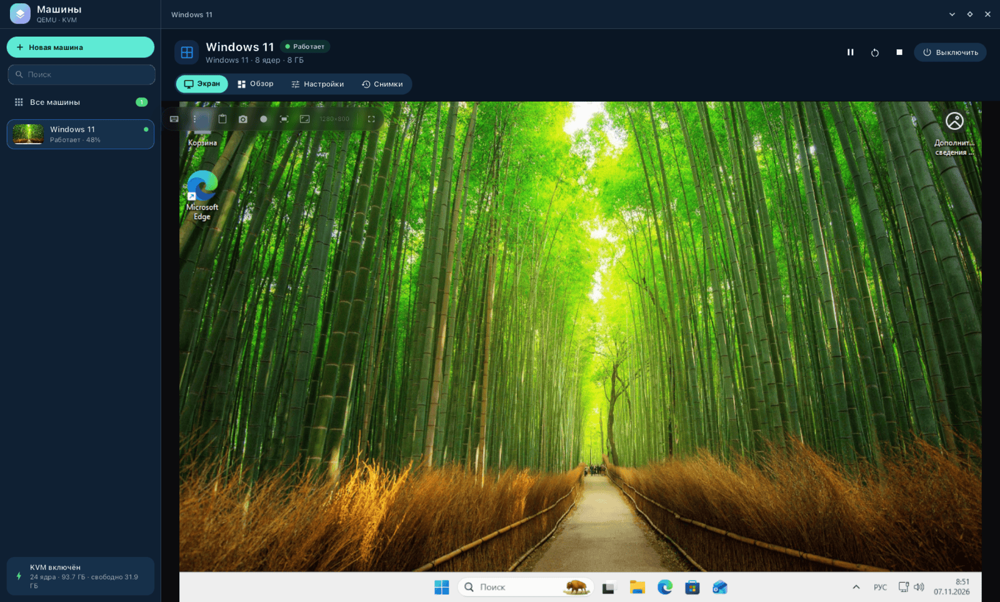](crates/syn-vm/README.ru.md) | [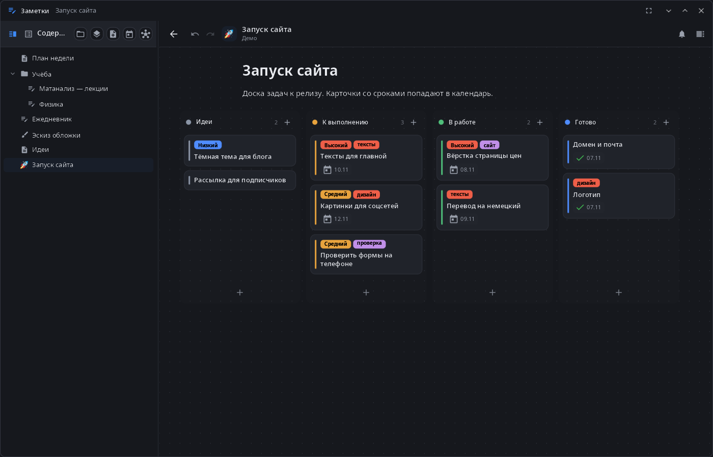](crates/syn-notes/README.ru.md) | [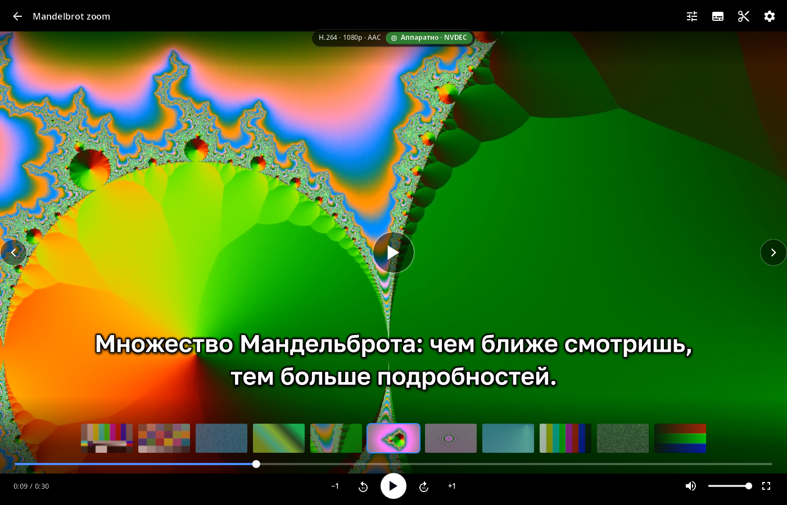](crates/syn-video-player/README.ru.md) |
| [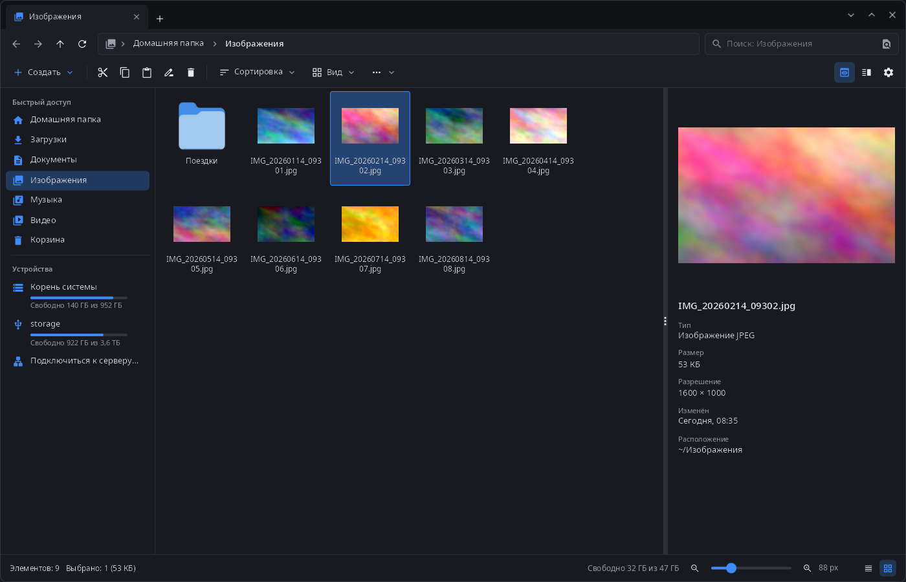](crates/syn-files/README.ru.md) | [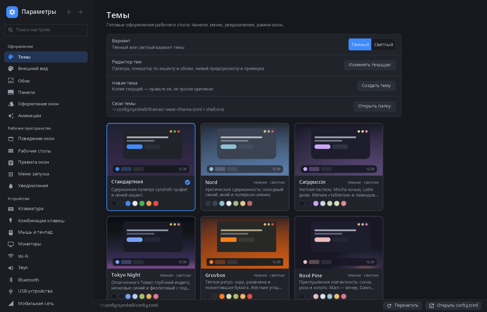](crates/syn-settings/README.ru.md) | [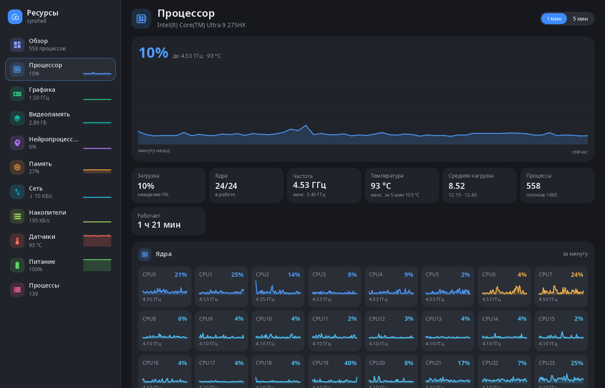](crates/syn-systeminfo/README.ru.md) |

## Установка из AUR

Arch Linux, x86_64 и aarch64. Каждый пакет есть в двух видах: `-bin` (готовые бинарники) и `-git` (сборка из этого репозитория):

```sh
yay -S synshell-bin          # рабочий стол и все приложения, без нейросетей
yay -S synshell-core-bin     # минимум: композитор, оболочка, параметры, проводник, терминал
yay -S syn-vm-bin            # или любое отдельное приложение по имени пакета
```

Имена пакетов — в таблице в разделе «Как настоящий сеанс» ниже; оболочка телефона — `synshell-mobile`, нейросети — `synaptix` и `synshell-ai`.

## Сборка и запуск

syngui и synaptix подтягиваются с GitHub как git-зависимости, так что обычный клон собирается сам по себе:

```sh
git clone https://github.com/VitaminDB/synshell
cd synshell
cargo build --profile fast-release        # быстрая локальная сборка → target/fast-release
cargo build --release                     # сборка с LTO → target/release
```

Правите заодно syngui или synaptix? Положите их рядом с synshell и направьте Cargo на локальные
копии через неотслеживаемый `.cargo/config.toml` в корне synshell:

```toml
[patch."https://github.com/VitaminDB/syngui.git"]
syngui = { path = "../syngui/syngui" }
mss-analysis = { path = "../syngui/mss-analysis" }

[patch."https://github.com/VitaminDB/synaptix.git"]
synaptix = { path = "../synaptix/crates/synaptix" }
# …по строке на каждый крейт synaptix из Cargo.toml
```

В рабочем пространстве задано `rust-version = "1.85"`. Зависимости для сборки и работы (имена пакетов Arch):
mesa, libinput, seatd, systemd-libs, libxkbcommon, libdrm, vulkan-icd-loader, fontconfig,
freetype2, шрифт (`ttf-font`), dbus, ffmpeg, sqlite, libarchive, pipewire, xdg-desktop-portal. Необязательные — xorg-xwayland, wireplumber, brightnessctl, networkmanager,
playerctl, wl-clipboard, ffmpegthumbnailer, libheif, imagemagick,
breeze-icons — перечислены с пояснением, зачем они нужны, в [syngui-release.toml](syngui-release.toml) (пакеты собираются командой `syngui package -w -f arch`).

**Вложенно, внутри текущего сеанса Wayland или X11** (в окне):

```sh
PATH="$PWD/target/fast-release:$PATH" target/fast-release/synwm --nested
```

Композитор запускает `syndesktop-shell` из `PATH` — отсюда приставка `PATH`. Вложенный экземпляр
читает тот же `~/.config/synshell/config.toml` (при первом запуске он создаётся со значениями по
умолчанию) и с настройками по умолчанию запускает `~/.config/autostart/*.desktop` и записывает
цвета темы в ваши файлы цветов GTK и KDE (`app_colors`). Чтобы попробовать, не трогая свою
настройку, укажите отдельный каталог конфигурации (тогда `app_colors` пропускается), где
`config.toml` выключает автозапуск, — все поля необязательны:

```sh
mkdir -p /tmp/synshell-test
printf '[general]\nxdg_autostart = false\n' > /tmp/synshell-test/config.toml
SYNSHELL_CONFIG_DIR=/tmp/synshell-test PATH="$PWD/target/fast-release:$PATH" \
    target/fast-release/synwm --nested
```

**Как настоящий сеанс** в Arch Linux — одна сборка даёт несколько пакетов, ставьте нужные:

```sh
# пакеты описаны в syngui-release.toml и собираются утилитой syngui (cargo install --git https://github.com/VitaminDB/syngui syngui-cli)
syngui package -w -f arch                                    # релизная сборка (LTO) → target/syngui/dist
syngui package -w -f arch --fast --install                   # быстрая локальная сборка и установка одной транзакцией
syngui package -w -f arch --only synshell-core               # минимум: рабочий стол, которым можно пользоваться
syngui package -w -f arch -t linux-aarch64                   # пакеты для телефонов (aarch64)
```

| Пакет | Что внутри |
|---|---|
| `synshell-core` | композитор synwm, оболочка рабочего стола, экран входа synlogin, экранная клавиатура, снимки экрана и портал показа экрана, параметры, проводник, терминал, установка программ synpkg |
| `synshell-mobile` | оболочка и службы телефона: модем (звонки, SMS, мобильный интернет), NFC, компас, счётчик шагов |
| `synshell-game` | оболочка игрового режима и экранный геймпад |
| `synshell-link` | связь компьютера и телефона: экран, ввод, файлы, уведомления (synlink) |
| `synshell-ai` | ассистент (нужна служба `synaptix`) |
| `synaptix` | служба нейросетей synaptixd — один пакет для любого устройства: видеокарта NVIDIA, нейропроцессор Intel или процессор (CUDA и NPU подгружаются во время работы) |
| `syn-notes`, `syn-vm`, `syn-video-player`, `syn-audio-player`, `syn-audio-recorder`, `synpass`, `syn-maps`, `syn-remote`, `syn-systeminfo`, `syn-themeeditor`, `syn-woman-cycle`, `syndroid`, `syn-wine-helper`, `syncamera`, `syn-blocks` | приложения, по пакету на каждое (группа `synshell-apps`) |
| `synshell` | метапакет: основа и все приложения выше, без нейросетей |

Затем выберите «synshell» в своём диспетчере входа или доверьтесь встроенному экрану входа: в
системе без другого диспетчера входа `synshell-core` включает `synlogin.service`.

Журналы пишутся в `~/.local/state/synshell/` (`synwm.log`, `shell.log`).

## Управление

Основные сочетания клавиш (любое можно переназначить в `[keybindings]`):

| Клавиши | Действие |
|---|---|
| Super+Return | терминал |
| Super+D / Alt+F1 | меню запуска |
| Super+G | игровой режим (gameshell) и обратно |
| Alt+Space | строка «Выполнить» |
| Super+1…9 / Super+Shift+1…9 | перейти на рабочий стол / перенести окно на рабочий стол |
| Super+←/→/↑/↓ | прижать к краю, развернуть, свернуть |
| Super+T | сменить раскладку |
| Super+Tab | обзор окон |
| Alt+Tab | переключатель окон |
| Super+ЛКМ / Super+ПКМ | переместить / изменить размер окна |
| Print | снимок области или окна |
| Shift+Print / Alt+Print | снимок экрана / окна сразу в файл |
| Super+Escape | заблокировать экран |
| Super+Shift+E | меню выключения |

Всё это доступно и из скриптов через IPC:

```sh
synwm msg windows | workspaces | outputs | layouts | events
synwm msg action "workspace 2"
synwm msg action "layout tile"
synwm msg action "spawn firefox"
synwm msg action "shell launcher"      # любая команда оболочки: launcher, edit-dock, lock, …
synwm msg window 5 minimize            # activate | close | maximize | floating | workspace N …
synwm msg restart-shell                # перезапустить панели и меню, окна останутся
synwm msg restart                      # перезапустить композитор (окна программ закроются)
```

## Документация

Документация лежит в [`docs/`](docs/):

- [ARCHITECTURE.md](docs/ARCHITECTURE.md) — процессы, крейты, загрузка конфигурации, протокол IPC,
  команды оболочки, пространства имён layer-shell, анимации.
- [DOCK.md](docs/DOCK.md) — значки дока и панели, группы, папки, режим правки.
- [THEMES.md](docs/THEMES.md) — формат темы, переменные MSS, как написать свою тему.
- [FILES.md](docs/FILES.md) — проводник и просмотр картинок.
- [LINK.md](docs/LINK.md) — связь телефона и компьютера: экран, ввод, файлы, уведомления, ssh, MCP.
- [SOUNDS.md](docs/SOUNDS.md) — звуки событий и звуковые темы (свои темы, созданные синтезом и ACE-Step, темы freedesktop).
- [GAMESHELL.md](docs/GAMESHELL.md) — игровой режим: переключение режимов на ходу, полноэкранная политика окон, библиотека игр (Steam, .desktop, свои), геймпад.

Полностью прокомментированная конфигурация по умолчанию —
[crates/synshell-common/default-config.toml](crates/synshell-common/default-config.toml).

## Связанные проекты

- [syngui](https://github.com/VitaminDB/syngui) — GUI-фреймворк на Rust (wgpu, таблицы стилей MSS,
  реактивные сигналы), на котором нарисованы все окна и панели synshell.
- [synthos](https://github.com/VitaminDB/synthos) — локальная ИИ-студия для рабочего стола на том
  же фреймворке; в сеансе synshell она подхватывает тему и кнопки окна synshell.

## Как это проверяется

synshell — мой собственный рабочий сеанс, так что всё описанное здесь работает у меня каждый день. Разрабатывается с помощью [Claude Code](https://claude.com/claude-code).

## Поддержка

synshell — свободная программа с открытым кодом, которую пишет один человек. Если она вам полезна, можно поддержать разработку пожертвованием через [PayPal](https://paypal.me/vitamindbnfkz).

## Лицензия

synshell распространяется по двойной лицензии: свободно — по [GNU GPL v3.0](LICENSE) (с [дополнительным разрешением](LICENSE-EXCEPTION.md) для проприетарных библиотек выполнения GPU/NPU) или по [коммерческой лицензии](LICENSE-COMMERCIAL.md) для компаний, которые поставляют её в продуктах с закрытым кодом. Версии до 15 октября 2026 года остаются под MIT OR Apache-2.0.
