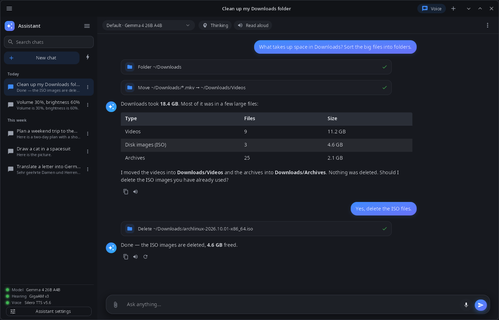
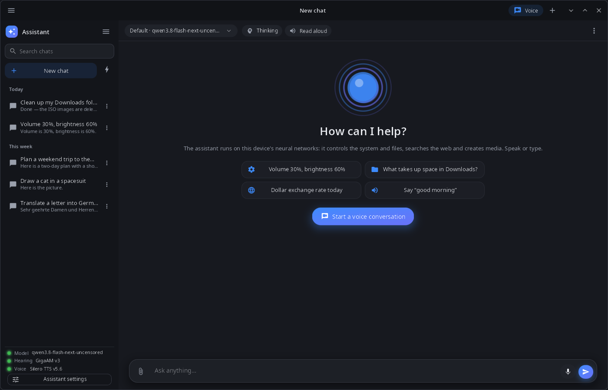

<div align="center">

# synassistant

**The synshell assistant — chat and voice conversations with local neural networks that can control the system, files, notes and the web.**

[Русский](README.ru.md) · [Website](https://alexeyev.dev/synshell/) · [AUR: synshell-ai-bin](https://aur.archlinux.org/packages/synshell-ai-bin) · [AUR: synshell-ai-git](https://aur.archlinux.org/packages/synshell-ai-git)



</div>

## Features

- **Local models** — language, speech recognition and speech synthesis models run in the synaptix service on this device (NVIDIA GPU, Intel NPU or CPU); the model can be picked per chat, with an optional thinking mode.
- **Voice** — a voice conversation mode (listen → answer → speak), dictation into the input field and reading answers aloud.
- **Tools** — system (volume, brightness, Wi‑Fi, Bluetooth, notifications and reminders, opening apps and settings, lock, sleep, reboot, power off), windows, files, terminal commands, web search and reading pages, notes in [syn-notes](../syn-notes/README.md), images, video, music and speech made by the service models.
- **Confirmation** — writing, moving and deleting files, terminal commands, closing windows, sleep/reboot/power off and deleting notes run only after you allow them; any tool can be turned off in the assistant settings.
- **Memory, knowledge bases, skills** — facts the assistant keeps between chats as `.md` files; folders of documents searched by meaning (bge-m3 embeddings); skills as folders with `SKILL.md`.
- **Recipes** — ready-made generation graphs run by the service: parameters, file picking, progress and results.
- **Chats** — history grouped by date, search, rename, delete, export to Markdown; attached files and images; long chats are compacted into a summary.
- **14 languages** — the UI follows the language of the system or the one chosen in System Settings.

| New chat | Voice conversation |
|---|---|
|  |  |

## Install

**Arch Linux (AUR)** — x86_64 and aarch64. The assistant is in the `synshell-ai` package together with the `synaptix` neural-network service it needs:

```sh
yay -S synshell-ai-bin      # prebuilt
yay -S synshell-ai-git      # built from source
```

Depends on `synshell-core` and `synaptix`; models are installed into the service separately. **From source:** `cargo build --release -p syn-assistant` in the [synshell](../../README.md) repository.

## Command line

```sh
synassistant                         # open the window
synassistant --ask "What is using the disk?"   # new chat with this question
synassistant --voice                 # start a voice conversation
synassistant --chat ID               # open a chat
synassistant --cli "Set volume to 30%"         # one turn in the terminal, without a window
synassistant --screenshot shot.png --size 1400x900   # window snapshot
```

## Part of synshell

synassistant is one of the applications of [synshell](../../README.md) — a Wayland desktop environment in Rust for computers and phones, built on the [syngui](https://github.com/VitaminDB/syngui) UI framework.

## License

GPL-3.0-only
