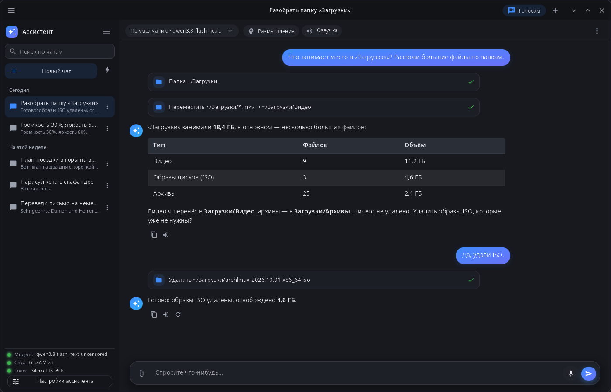
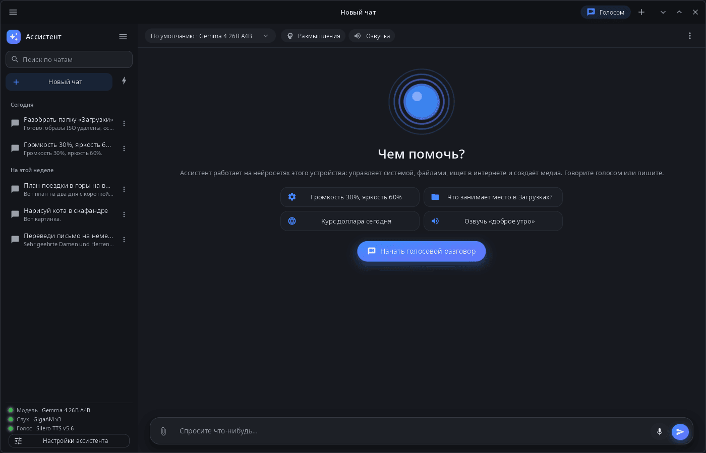

<div align="center">

# synassistant

**Ассистент synshell — чат и голосовой разговор с локальными нейросетями, которые управляют системой, файлами, заметками и ищут в интернете.**

[English](README.md) · [Сайт](https://alexeyev.dev/ru/synshell/syn-assistant/) · [AUR: synshell-ai-bin](https://aur.archlinux.org/packages/synshell-ai-bin) · [AUR: synshell-ai-git](https://aur.archlinux.org/packages/synshell-ai-git)



</div>

## Возможности

- **Локальные модели** — языковая модель, распознавание и синтез речи работают в службе synaptix на этом устройстве (видеокарта NVIDIA, Intel NPU или процессор); модель выбирается для каждого чата, режим размышлений — по желанию.
- **Голос** — голосовой разговор (слушает → отвечает → говорит), диктовка в поле ввода и чтение ответов вслух.
- **Инструменты** — система (громкость, яркость, Wi‑Fi, Bluetooth, уведомления и напоминания, запуск программ и разделов параметров, блокировка, сон, перезагрузка, выключение), окна, файлы, команды терминала, поиск в интернете и чтение страниц, заметки в [syn-notes](../syn-notes/README.ru.md), картинки, видео, музыка и речь моделями службы.
- **Подтверждение** — запись, перенос и удаление файлов, команды терминала, закрытие окон, сон, перезагрузка, выключение и удаление заметок выполняются только после вашего разрешения; любой инструмент можно отключить в настройках ассистента.
- **Память, базы знаний, навыки** — факты, которые ассистент помнит между чатами, в файлах `.md`; папки с документами и поиск по смыслу (эмбеддинги bge-m3); навыки — папки с `SKILL.md`.
- **Рецепты** — готовые графы генерации, которые исполняет служба: параметры, выбор файлов, ход выполнения и результаты.
- **Чаты** — история по дням, поиск, переименование, удаление, экспорт в Markdown; вложения — файлы и картинки; длинные чаты сжимаются в сводку.
- **14 языков** — как в системе или язык, выбранный в «Параметрах системы».

| Новый чат | Голосовой разговор |
|---|---|
|  |  |

## Установка

**Arch Linux (AUR)** — x86_64 и aarch64. Ассистент входит в пакет `synshell-ai` вместе с нужной ему службой нейросетей `synaptix`:

```sh
yay -S synshell-ai-bin      # готовые бинарники
yay -S synshell-ai-git      # сборка из исходников
```

Зависит от `synshell-core` и `synaptix`; модели ставятся в службу отдельно. **Из исходников:** `cargo build --release -p syn-assistant` в репозитории [synshell](../../README.md).

## Командная строка

```sh
synassistant                         # открыть окно
synassistant --ask "Что занимает место на диске?"   # новый чат с этим вопросом
synassistant --voice                 # начать голосовой разговор
synassistant --chat ID               # открыть чат
synassistant --cli "Громкость 30%"   # один ход в терминале, без окна
synassistant --screenshot shot.png --size 1400x900   # снимок окна
```

## Часть synshell

synassistant — одно из приложений [synshell](../../README.md): окружения рабочего стола для Wayland на Rust для компьютеров и телефонов, на UI-фреймворке [syngui](https://github.com/VitaminDB/syngui).

## Лицензия

GPL-3.0-only
