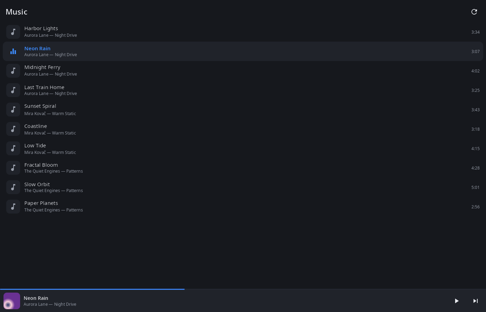
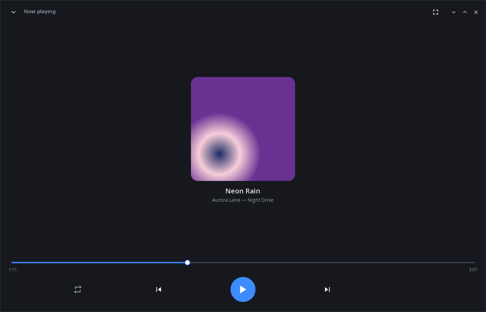
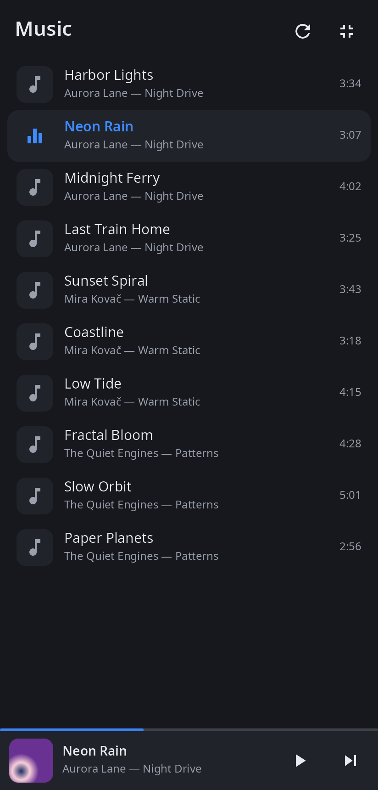
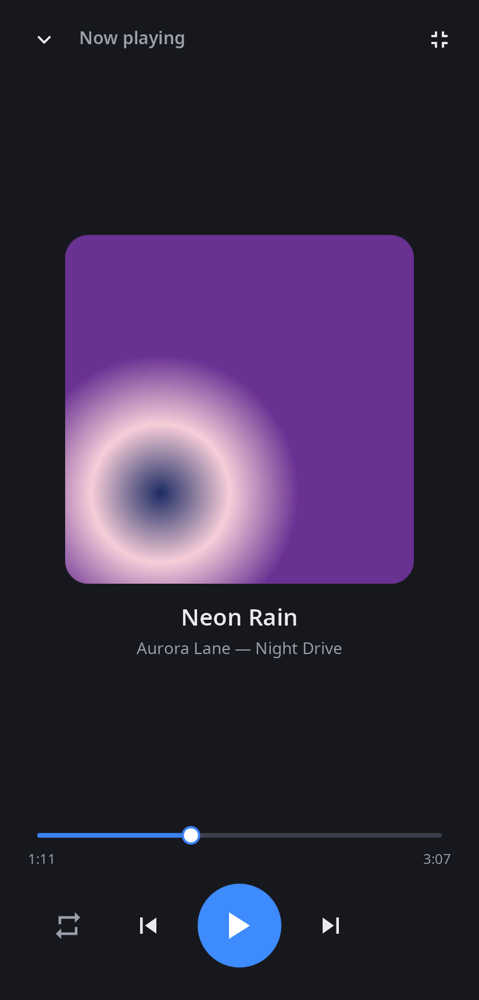

<div align="center">

# syn-audio-player

**Music player for the synshell desktop — your Music folder as a library, any audio format through ffmpeg.**

[Русский](README.ru.md) · [Website](https://alexeyev.dev/synshell/) · [AUR: syn-audio-player-bin](https://aur.archlinux.org/packages/syn-audio-player-bin) · [AUR: syn-audio-player-git](https://aur.archlinux.org/packages/syn-audio-player-git)



</div>

## Features

- **Library** — audio files from Music (`XDG_MUSIC_DIR`, six levels deep) and Downloads (two levels), sorted by artist, album and track number; tags and durations are read in the background.
- **Formats** — whatever ffmpeg plays: MP3, FLAC, Ogg/Opus, M4A/AAC, WAV, AIFF, WMA, APE, WavPack, DSD, MIDI, tracker modules and more.
- **Now playing** — album cover from the file, title, artist and album, seek bar, previous/next, repeat (off, all, one).
- **Queue** — the library order, or the files given on the command line; the next track starts when one ends.
- **Mini player** — at the bottom of the library: cover, progress, play/pause and next.
- **Computer and phone** — the same window fits a monitor and a phone screen; 14 languages.

| Now playing | Phone: library | Phone: now playing |
|---|---|---|
|  |  |  |

## Install

**Arch Linux (AUR)** — x86_64 and aarch64:

```sh
yay -S syn-audio-player-bin      # prebuilt
yay -S syn-audio-player-git      # built from source
```

Depends on `synshell-core` and `ffmpeg`. Part of the `synshell` metapackage: `yay -S synshell-bin` installs the whole desktop. **From source:** `cargo build --release -p syn-audio-player` in the [synshell](../../README.md) repository.

## Command line

```sh
syn-audio-player                         # library
syn-audio-player song.flac other.mp3     # these files as the queue, the first one plays
syn-audio-player --screenshot shot.png --size 1400x900 --page player
                                         # window snapshot without sound (pages: library, player)
```

## Part of synshell

syn-audio-player is one of the applications of [synshell](../../README.md) — a Wayland desktop environment in Rust for computers and phones, built on the [syngui](https://github.com/VitaminDB/syngui) UI framework.

## License

GPL-3.0-only
