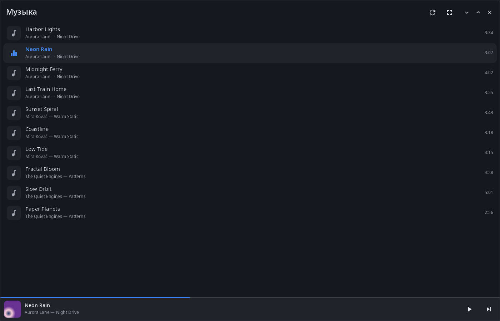
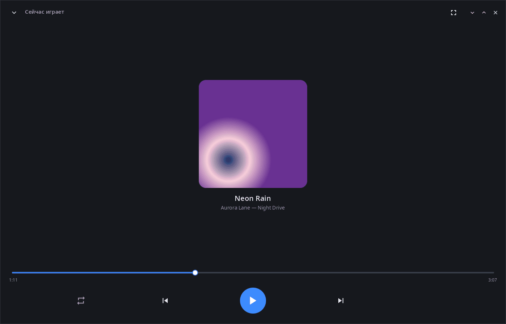
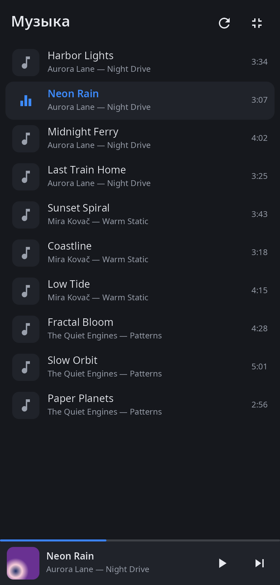
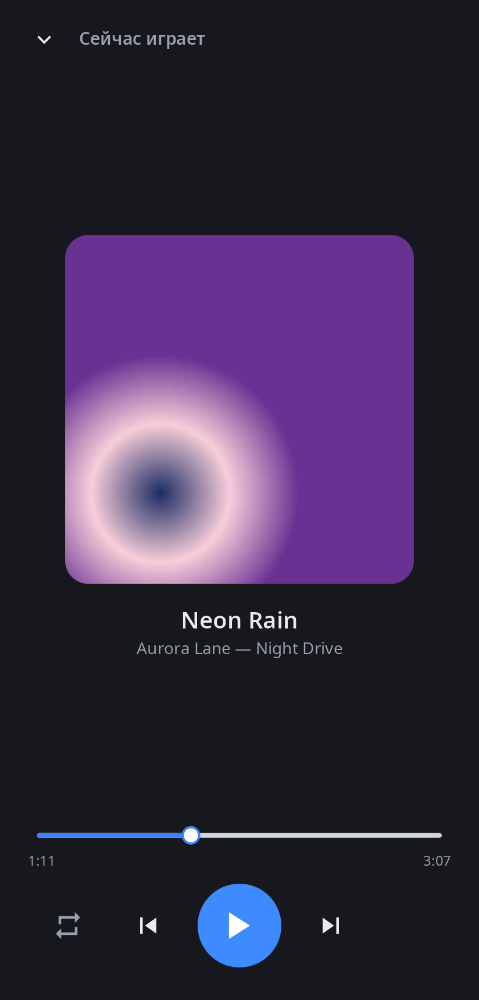

<div align="center">

# syn-audio-player

**Музыкальный плеер рабочего стола synshell — папка «Музыка» как медиатека, любой аудиоформат через ffmpeg.**

[English](README.md) · [Сайт](https://alexeyev.dev/ru/synshell/) · [AUR: syn-audio-player-bin](https://aur.archlinux.org/packages/syn-audio-player-bin) · [AUR: syn-audio-player-git](https://aur.archlinux.org/packages/syn-audio-player-git)



</div>

## Возможности

- **Медиатека** — аудиофайлы из «Музыки» (`XDG_MUSIC_DIR`, на шесть уровней вглубь) и «Загрузок» (на два уровня), по исполнителю, альбому и номеру дорожки; теги и длительность читаются в фоне.
- **Форматы** — всё, что играет ffmpeg: MP3, FLAC, Ogg/Opus, M4A/AAC, WAV, AIFF, WMA, APE, WavPack, DSD, MIDI, трекерные модули и другие.
- **Сейчас играет** — обложка из файла, название, исполнитель и альбом, перемотка, предыдущий/следующий, повтор (выкл., всё, один трек).
- **Очередь** — порядок медиатеки или файлы из командной строки; по концу трека играет следующий.
- **Мини-плеер** — внизу медиатеки: обложка, ход трека, пауза и следующий.
- **Компьютер и телефон** — одно и то же окно на мониторе и на экране телефона; 14 языков.

| Сейчас играет | Телефон: медиатека | Телефон: сейчас играет |
|---|---|---|
|  |  |  |

## Установка

**Arch Linux (AUR)** — x86_64 и aarch64:

```sh
yay -S syn-audio-player-bin      # готовые бинарники
yay -S syn-audio-player-git      # сборка из исходников
```

Зависит от `synshell-core` и `ffmpeg`. Входит в метапакет `synshell`: `yay -S synshell-bin` ставит весь рабочий стол. **Из исходников:** `cargo build --release -p syn-audio-player` в репозитории [synshell](../../README.md).

## Командная строка

```sh
syn-audio-player                         # медиатека
syn-audio-player song.flac other.mp3     # эти файлы — очередь, первый играет
syn-audio-player --screenshot shot.png --size 1400x900 --page player
                                         # снимок окна без звука (страницы: library, player)
```

## Часть synshell

syn-audio-player — одно из приложений [synshell](../../README.md): окружения рабочего стола для Wayland на Rust для компьютеров и телефонов, на UI-фреймворке [syngui](https://github.com/VitaminDB/syngui).

## Лицензия

GPL-3.0-only
