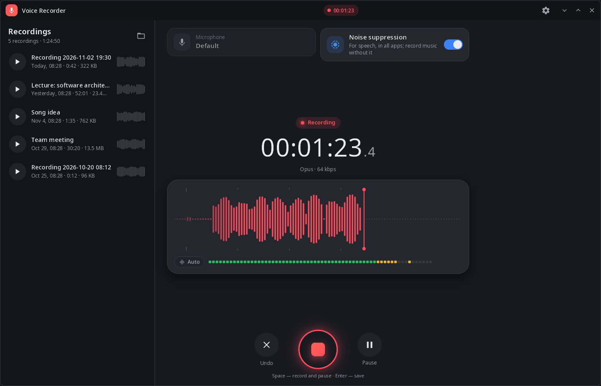
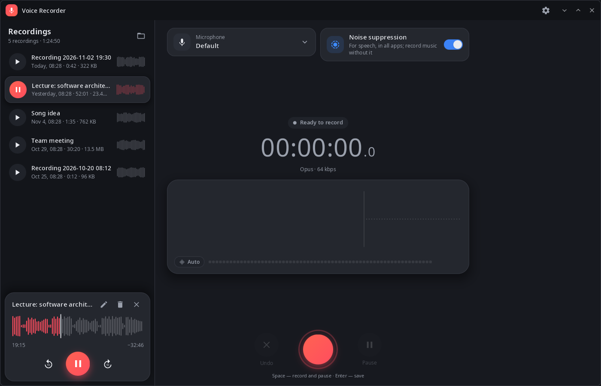
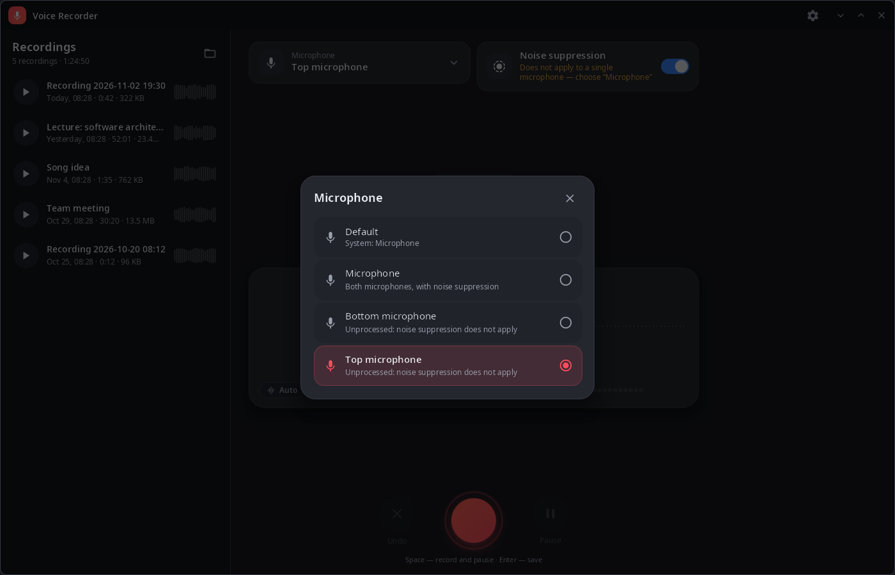
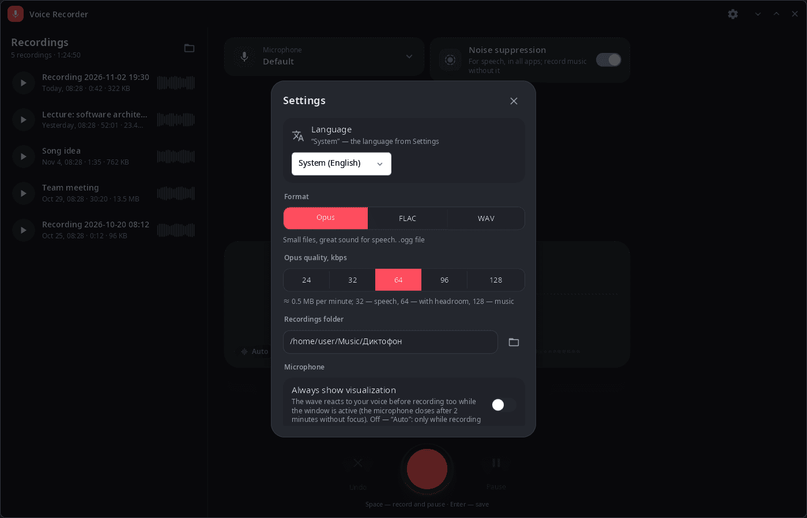

<div align="center">

# syn-audio-recorder

**Voice recorder for the synshell desktop — live waveform, microphone choice, phone noise suppression, Opus/FLAC/WAV.**

[Русский](README.ru.md) · [Website](https://alexeyev.dev/synshell/syn-audio-recorder/) · [AUR: syn-audio-recorder-bin](https://aur.archlinux.org/packages/syn-audio-recorder-bin) · [AUR: syn-audio-recorder-git](https://aur.archlinux.org/packages/syn-audio-recorder-git)



</div>

## Features

- **Recording** — live waveform and level meter, pause and resume, discard, save with Enter; Space starts and pauses.
- **Formats** — Opus (24–128 kbps, `.ogg`), FLAC (lossless) or WAV (uncompressed); Opus and FLAC are encoded with ffmpeg.
- **Microphone** — any PipeWire source; on a phone, each built-in microphone separately or both together.
- **Noise suppression** — the phone's system noise suppression, switched right from the recorder.
- **Recordings list** — duration, size and a waveform preview for each; play with ±10 s seek, rename, delete to the trash with undo.
- **Visualization** — the wave reacts only while recording (“Auto”) or always, also before recording.
- **Recordings folder** — `Диктофон` inside the Music folder (`XDG_MUSIC_DIR`) by default, can be changed in settings.
- **Closing is safe** — closing the window during a recording saves it.
- **Computer and phone** — two-pane layout on a wide window, one column on a phone; 14 languages.

| Player | Microphone | Settings |
|---|---|---|
|  |  |  |

## Install

**Arch Linux (AUR)** — x86_64 and aarch64:

```sh
yay -S syn-audio-recorder-bin      # prebuilt
yay -S syn-audio-recorder-git      # built from source
```

Depends on `synshell-core` (it brings PipeWire and ffmpeg; without ffmpeg only WAV is recorded).

Part of the `synshell` metapackage: `yay -S synshell-bin` installs the whole desktop. **From source:** `cargo build --release -p syn-audio-recorder` in the [synshell](../../README.md) repository.

## Command line

```sh
syn-audio-recorder                                        # open the recorder
syn-audio-recorder --screenshot shot.png --size 1400x900 --scale 1 --page list
                                                          # window snapshot without a microphone
                                                          # (pages: record, rec, paused, list, player, mics, settings)
```

## Part of synshell

syn-audio-recorder is one of the applications of [synshell](../../README.md) — a Wayland desktop environment in Rust for computers and phones, built on the [syngui](https://github.com/VitaminDB/syngui) UI framework.

## License

GPL-3.0-only
