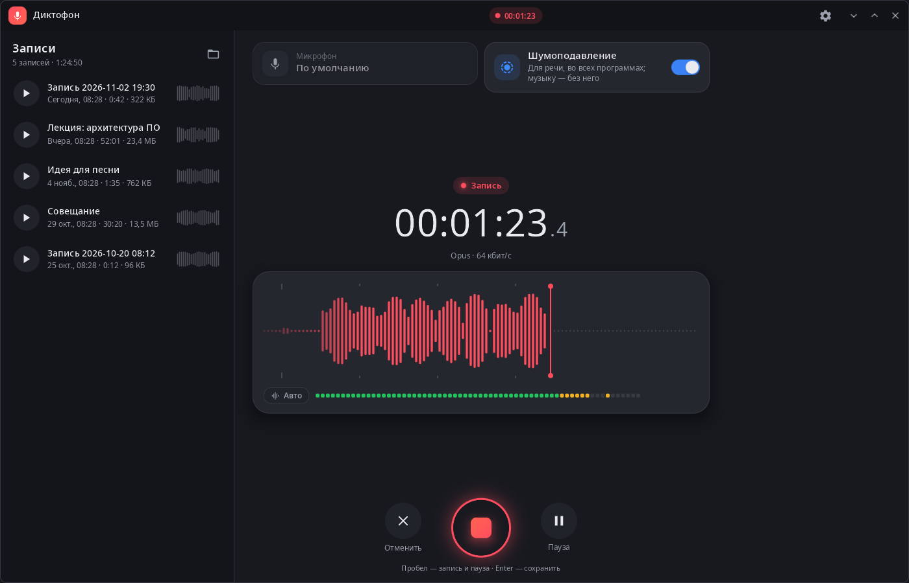
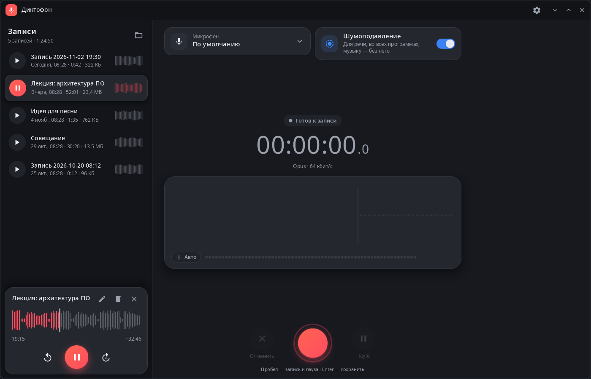
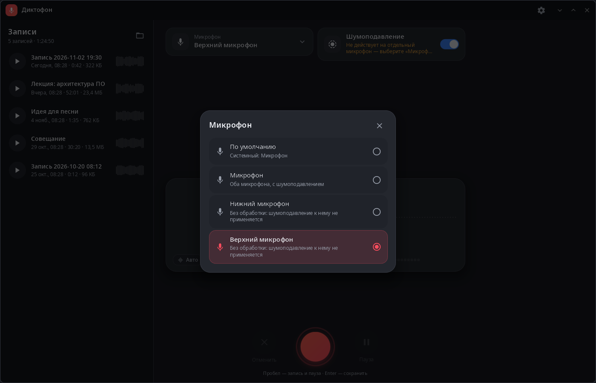
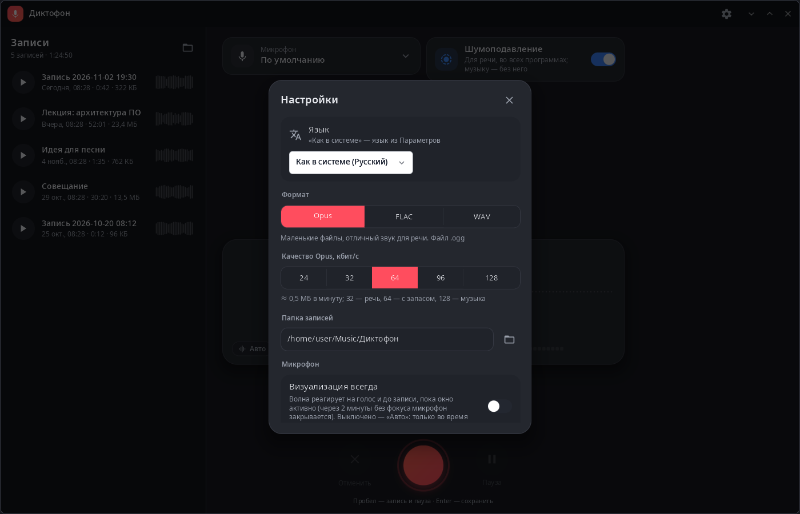

<div align="center">

# syn-audio-recorder

**Диктофон рабочего стола synshell — живая волна, выбор микрофона, шумоподавление телефона, Opus/FLAC/WAV.**

[English](README.md) · [Сайт](https://alexeyev.dev/ru/syndesktop/) · [AUR: syn-audio-recorder-bin](https://aur.archlinux.org/packages/syn-audio-recorder-bin) · [AUR: syn-audio-recorder-git](https://aur.archlinux.org/packages/syn-audio-recorder-git)



</div>

## Возможности

- **Запись** — живая волна и индикатор уровня, пауза и продолжение, отмена записи, сохранение по Enter; Пробел — начать и поставить на паузу.
- **Форматы** — Opus (24–128 кбит/с, `.ogg`), FLAC (без потерь) или WAV (без сжатия); Opus и FLAC кодирует ffmpeg.
- **Микрофон** — любой источник PipeWire; на телефоне — каждый встроенный микрофон отдельно или оба вместе.
- **Шумоподавление** — системное шумоподавление телефона включается прямо из диктофона.
- **Список записей** — длительность, размер и волна каждой записи; прослушивание с перемоткой на ±10 с, переименование, удаление в корзину с отменой.
- **Визуализация** — волна только во время записи («Авто») или всегда, и до записи.
- **Папка записей** — по умолчанию `Диктофон` в папке «Музыка» (`XDG_MUSIC_DIR`), меняется в настройках.
- **Закрытие без потерь** — если закрыть окно во время записи, она сохранится.
- **Компьютер и телефон** — на широком окне две панели, на телефоне — одна колонка; 14 языков.

| Плеер | Микрофон | Настройки |
|---|---|---|
|  |  |  |

## Установка

**Arch Linux (AUR)** — x86_64 и aarch64:

```sh
yay -S syn-audio-recorder-bin      # готовые бинарники
yay -S syn-audio-recorder-git      # сборка из исходников
```

Зависит от `synshell-core` (с ним ставятся PipeWire и ffmpeg; без ffmpeg пишется только WAV).

Входит в метапакет `synshell`: `yay -S synshell-bin` ставит весь рабочий стол. **Из исходников:** `cargo build --release -p syn-audio-recorder` в репозитории [synshell](../../README.md).

## Командная строка

```sh
syn-audio-recorder                                        # открыть диктофон
syn-audio-recorder --screenshot shot.png --size 1400x900 --scale 1 --page list
                                                          # снимок окна без микрофона
                                                          # (страницы: record, rec, paused, list, player, mics, settings)
```

## Часть synshell

syn-audio-recorder — одно из приложений [synshell](../../README.md): окружения рабочего стола для Wayland на Rust для компьютеров и телефонов, на UI-фреймворке [syngui](https://github.com/VitaminDB/syngui).

## Лицензия

GPL-3.0-only
