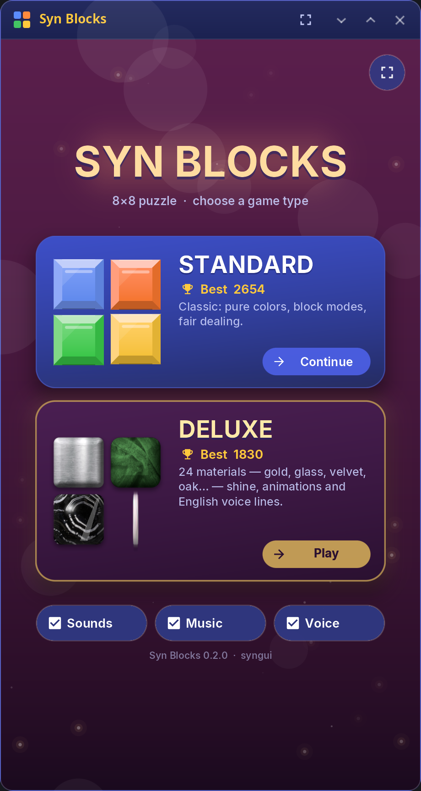
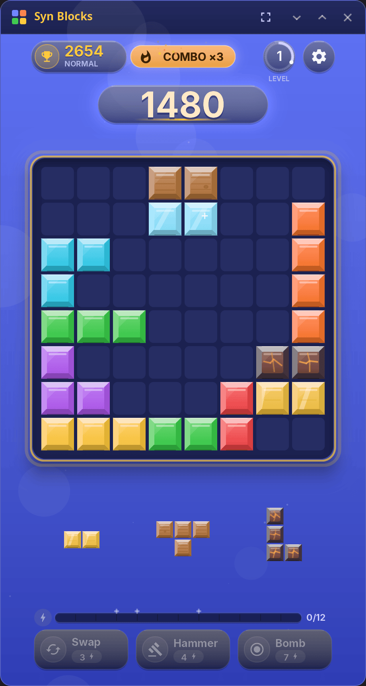
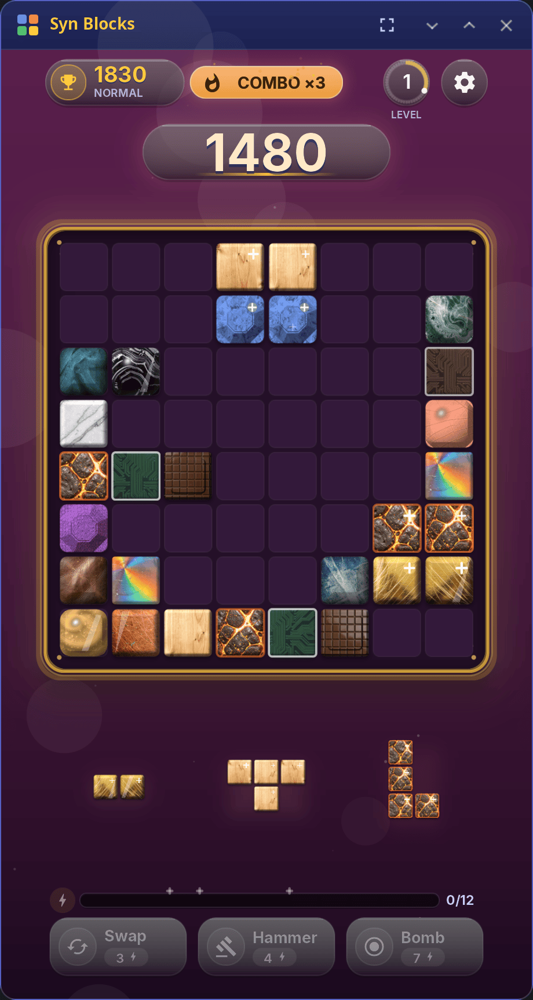

<div align="center">

# Syn Blocks

**An 8×8 block puzzle for the synshell desktop and phones — place pieces, clear rows and columns, build combos.**

[Русский](README.ru.md) · [Website](https://alexeyev.dev/synshell/syn-blocks/) · [AUR: syn-blocks-bin](https://aur.archlinux.org/packages/syn-blocks-bin) · [AUR: syn-blocks-git](https://aur.archlinux.org/packages/syn-blocks-git)



</div>

## Features

- **Two game types** — **Standard** with plain colors, and **Deluxe** with 24 material finishes (gold, glass, velvet, oak…), richer animations and English voice lines.
- **Fair dealing** — the three pieces of a deal always fit on the board together; sometimes a deal lets you clear the whole board.
- **Materials** — wood, crystal, gold and lava pieces with their own bonuses, particles and sounds.
- **Combos and abilities** — cleared lines charge energy for swap, hammer and bomb.
- **Levels and worlds** — the score opens new worlds with their own colors and background particles; for a few moves all blocks may turn into one material.
- **Three difficulties** — easy, normal, hard; best scores are kept per game type and difficulty, an unfinished game is saved.
- **Sound** — background music tracks and sound effects, each switchable.
- **Mouse, touch and keyboard** — keys 1–3 pick a piece, arrows move it, Enter places it; F11 toggles full screen, Esc leaves it.
- **14 languages** — the UI follows the system language.

| Standard | Deluxe |
|---|---|
|  |  |

## Install

**Arch Linux (AUR)** — x86_64 and aarch64:

```sh
yay -S syn-blocks-bin      # prebuilt
yay -S syn-blocks-git      # built from source
```

The whole desktop: `yay -S synshell-bin`. **From source:** `cargo build --release -p syn-blocks` in the [synshell](../../README.md) repository; `cargo test -p syn-blocks` runs the model and integration tests without a GPU.

## Android

An APK for Android 11 and newer (arm64) is attached to the [synshell releases](https://github.com/VitaminDB/synshell/releases) on GitHub: download it on the phone and open it to install. To build it yourself: `syngui build -t android -p syn-blocks` (the [syngui](https://github.com/VitaminDB/syngui) tool).

## Command line

```sh
syn-blocks                                              # play
syn-blocks --screenshot board.png --page board          # screenshot of a sample game
syn-blocks --screenshot deluxe.png --page board --deluxe
```

`--page` takes `start`, `board`, `drag`, `over`, `menu`, `clear`; `--size` and `--scale` set the size.

## Part of synshell

Syn Blocks is one of the applications of [synshell](../../README.md) — a Wayland desktop environment in Rust for computers and phones, built on the [syngui](https://github.com/VitaminDB/syngui) UI framework.

## License

GPL-3.0-only
