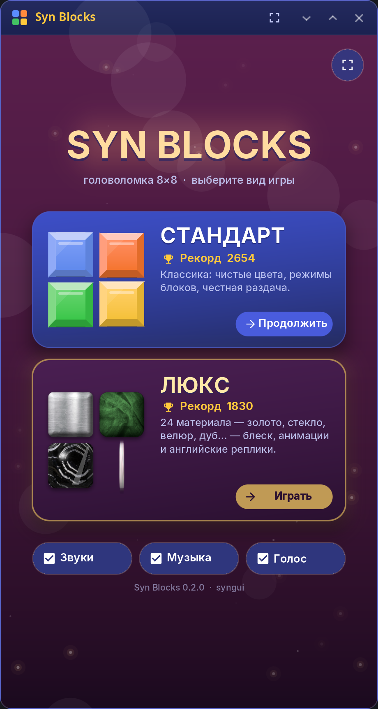
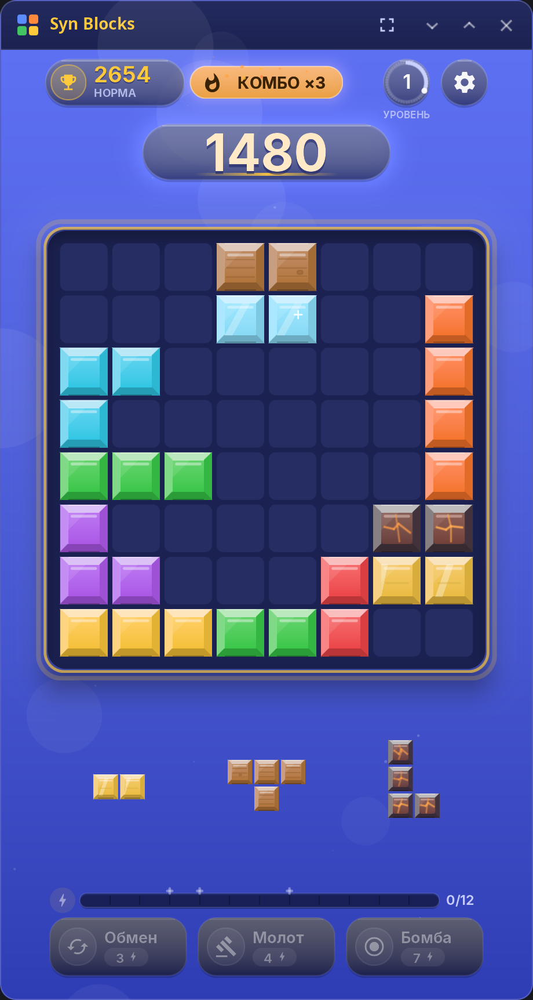
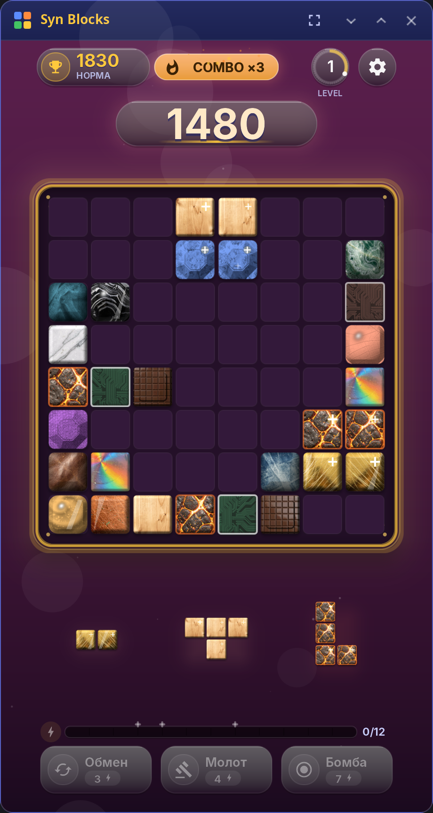

<div align="center">

# Syn Blocks

**Головоломка 8×8 для рабочего стола synshell и телефонов — расставляйте фигуры, очищайте ряды и столбцы, собирайте комбо.**

[English](README.md) · [Сайт](https://alexeyev.dev/ru/syndesktop/) · [AUR: syn-blocks-bin](https://aur.archlinux.org/packages/syn-blocks-bin) · [AUR: syn-blocks-git](https://aur.archlinux.org/packages/syn-blocks-git)



</div>

## Возможности

- **Два вида игры** — **Стандарт** с чистыми цветами и **Люкс** с 24 материалами-отделками (золото, стекло, велюр, дуб…), более богатыми анимациями и английскими репликами.
- **Честная раздача** — три фигуры раздачи всегда помещаются на поле вместе; иногда раздача позволяет очистить поле целиком.
- **Материалы** — фигуры из дерева, хрусталя, золота и лавы со своими бонусами, частицами и звуками.
- **Комбо и способности** — очищенные линии копят энергию на обмен, молот и бомбу.
- **Уровни и миры** — очки открывают новые миры со своими цветами и частицами фона; на несколько ходов все кубики могут стать одним материалом.
- **Три уровня сложности** — легко, норма, сложно; рекорды — отдельно по виду игры и сложности, незаконченная партия сохраняется.
- **Звук** — фоновая музыка и звуковые эффекты, каждое выключается отдельно.
- **Мышь, касания и клавиатура** — клавиши 1–3 выбирают фигуру, стрелки двигают, Enter ставит; F11 — полноэкранный режим, Esc — выход из него.
- **14 языков** — интерфейс на языке системы.

| Стандарт | Люкс |
|---|---|
|  |  |

## Установка

**Arch Linux (AUR)** — x86_64 и aarch64:

```sh
yay -S syn-blocks-bin      # готовые бинарники
yay -S syn-blocks-git      # сборка из исходников
```

Весь рабочий стол: `yay -S synshell-bin`. **Из исходников:** `cargo build --release -p syn-blocks` в репозитории [synshell](../../README.md); `cargo test -p syn-blocks` — тесты модели и интеграционные тесты без GPU.

## Командная строка

```sh
syn-blocks                                              # играть
syn-blocks --screenshot board.png --page board          # снимок партии-примера
syn-blocks --screenshot deluxe.png --page board --deluxe
```

`--page` — `start`, `board`, `drag`, `over`, `menu`, `clear`; `--size` и `--scale` задают размер.

## Часть synshell

Syn Blocks — одно из приложений [synshell](../../README.md): окружения рабочего стола для Wayland на Rust для компьютеров и телефонов, на UI-фреймворке [syngui](https://github.com/VitaminDB/syngui).

## Лицензия

GPL-3.0-only
