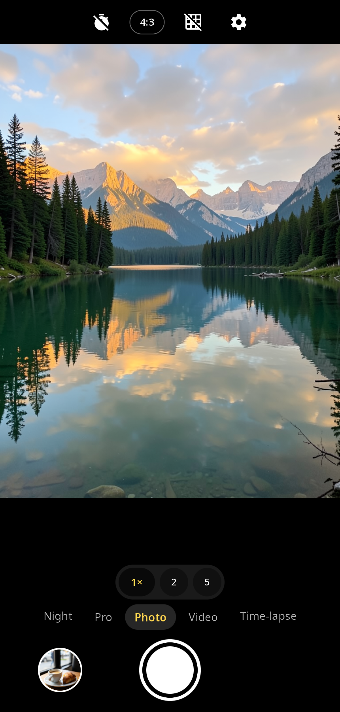
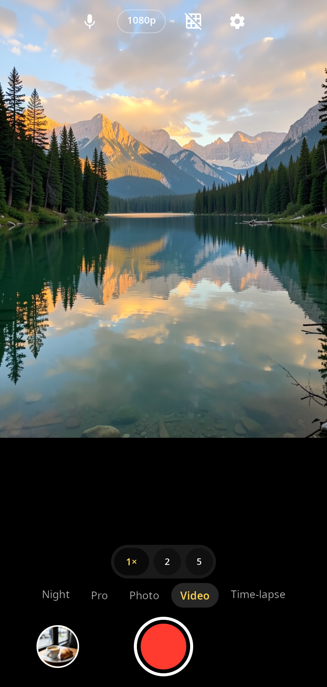
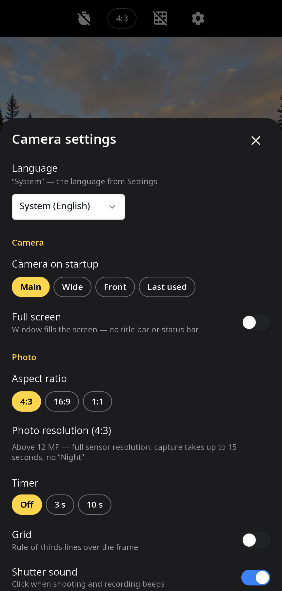
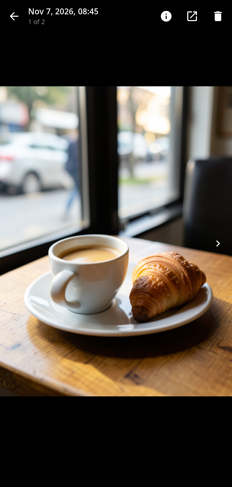

<div align="center">

# syncamera

**Camera for synshell on phones — photo, night, pro, video and time-lapse, with zoom, tap-to-focus and a built-in viewer.**

[Русский](README.ru.md) · [Website](https://alexeyev.dev/syndesktop/) · [AUR: syncamera-bin](https://aur.archlinux.org/packages/syncamera-bin) · [AUR: syncamera-git](https://aur.archlinux.org/packages/syncamera-git)



</div>

## Features

- **Photo** — flash, 3 s / 10 s timer, rule-of-thirds grid, 4:3, 16:9 or 1:1; above 12 MP — full sensor resolution (the shot takes up to 15 seconds).
- **Night** — a burst of full-size frames is aligned and merged (moving objects do not double), with a tone curve for dark scenes; the app suggests Night when it is dark.
- **Pro** — ISO, shutter speed, focus distance, white balance (auto, daylight, cloudy, fluorescent, tungsten) and exposure compensation.
- **Video** — 720p, 1080p or 4K, H.264 or HEVC through the phone's hardware encoder, microphone sound, stabilization, pause, a photo while recording, torch.
- **Time-lapse** — every N-th frame, adjustable speed-up, no sound.
- **Zoom and focus** — pinch or buttons (switches to the ultra-wide lens), tap to focus and meter, long press locks AE/AF, exposure slider; front/back camera and the list of back lenses (main, ultra-wide, macro; a faulty module is shown as unavailable).
- **QR codes** — in Photo mode a found code appears as a hint with “Copy” (and “Open” for links); `--scan-qr` returns the first code to the caller (Settings uses it for eSIM activation codes).
- **Viewer** — photos with pinch zoom, videos with playback, swipe between shots, details, open in another app, delete.
- **Settings** — camera at startup, full screen, storage folders (by default XDG “Pictures” and “Videos”), shutter sound, language.
- **14 languages** — follows the system or the language chosen in the app.

| Video | Settings | Viewer |
|---|---|---|
|  |  |  |

The preview and the photos in the screenshots are generated pictures shown through the `--screenshot` mode, not frames from a real camera.

## Requirements

The camera is driven by `syncamd`, the camera service of the synshell phone platform (socket `/run/syncam/syncam.sock`, frames as dma-buf). Without it the app opens and reports why no camera is available.

## Install

**Arch Linux (AUR)** — x86_64 and aarch64:

```sh
yay -S syncamera-bin      # prebuilt
yay -S syncamera-git      # built from source
```

Depends on `synshell-core`. syncamera is also part of the `synshell` meta-package: `yay -S synshell-bin`. **From source:** `cargo build --release -p syn-camera` in the [synshell](../../README.md) repository.

## Command line

```sh
syncamera                                   # the app
syncamera --scan-qr LPA:                    # print the first QR code starting with “LPA:” and exit
syncamera --screenshot out.png --preview frame.png --mode video   # window snapshot without a camera
syncamera --screenshot out.png --settings   # … with the settings sheet (or --viewer: the first shot)
```

## Part of synshell

syncamera is one of the applications of [synshell](../../README.md) — a Wayland desktop environment in Rust for computers and phones, built on the [syngui](https://github.com/VitaminDB/syngui) UI framework.

## License

GPL-3.0-only
