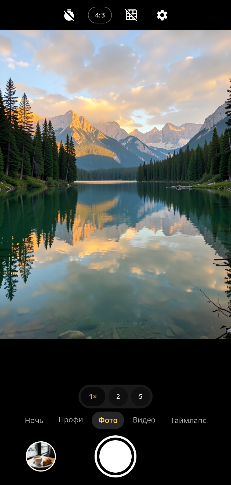
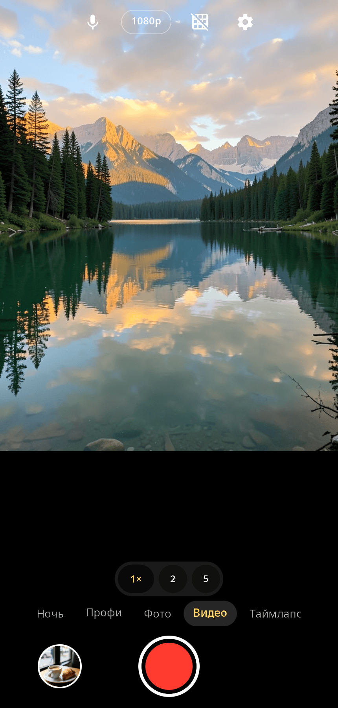
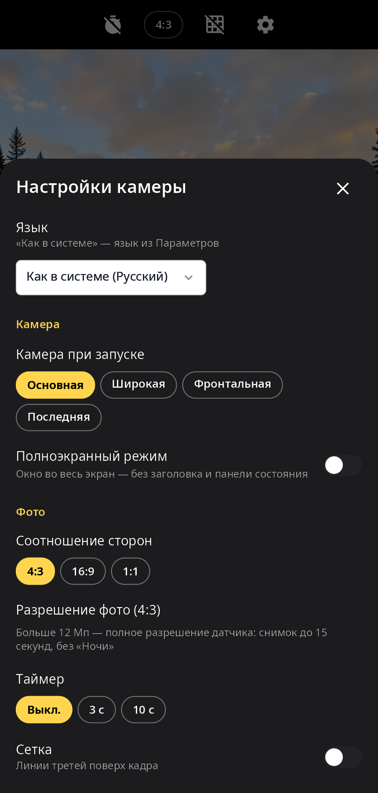
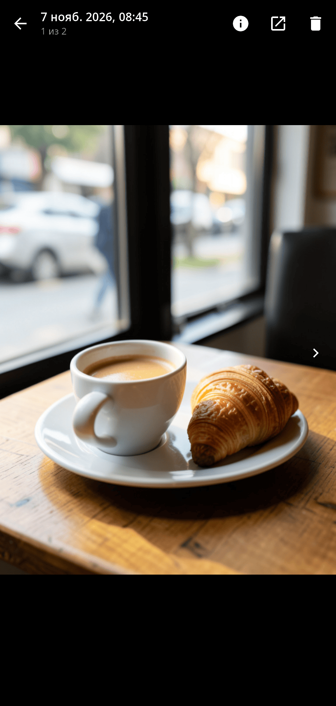

<div align="center">

# syncamera

**Камера synshell для телефонов — фото, ночь, профи, видео и таймлапс, зум, фокус касанием и просмотр снятого.**

[English](README.md) · [Сайт](https://alexeyev.dev/ru/synshell/syn-camera/) · [AUR: syncamera-bin](https://aur.archlinux.org/packages/syncamera-bin) · [AUR: syncamera-git](https://aur.archlinux.org/packages/syncamera-git)



</div>

## Возможности

- **Фото** — вспышка, таймер 3 и 10 с, сетка третей, 4:3, 16:9 или 1:1; больше 12 Мп — полное разрешение датчика (снимок до 15 секунд).
- **Ночь** — серия кадров полного размера выравнивается и сливается (движущееся в кадре не «двоится»), тоновая кривая для тёмных сцен; в темноте программа сама предлагает «Ночь».
- **Профи** — ISO, выдержка, расстояние фокуса, баланс белого (авто, день, облачно, флуоресцентный, лампа) и поправка экспозиции.
- **Видео** — 720p, 1080p или 4K, H.264 или HEVC аппаратным кодером телефона, звук с микрофона, стабилизация, пауза, снимок во время записи, фонарик.
- **Таймлапс** — каждый N-й кадр, ускорение настраивается, без звука.
- **Зум и фокус** — щипком или кнопками (с переходом на широкоугольную камеру), фокус и экспозиция касанием, удержание блокирует AE/AF, ползунок экспозиции; фронтальная и задняя камера, список задних объективов (основной, широкоугольный, макро; неисправный модуль виден как недоступный).
- **QR-коды** — в режиме «Фото» найденный код показывается подсказкой с кнопками «Копировать» (и «Открыть» для ссылок); `--scan-qr` отдаёт первый код вызвавшей программе («Параметры» так получают код активации eSIM).
- **Просмотр снятого** — фото с масштабом пальцами, видео с воспроизведением, листание смахиванием, сведения о файле, открыть в другой программе, удалить.
- **Настройки** — камера при запуске, полноэкранный режим, папки хранения (по умолчанию «Изображения» и «Видео» XDG), звук затвора, язык.
- **14 языков** — как в системе или свой язык в настройках программы.

| Видео | Настройки | Просмотр |
|---|---|---|
|  |  |  |

Превью и снимки на скриншотах — сгенерированные картинки, показанные режимом `--screenshot`, а не кадры настоящей камеры.

## Что нужно

Камеры три вида, интерфейс у всех один:

- `syncamd` — служба камеры платформы телефона synshell (сокет `/run/syncam/syncam.sock`, кадры через dma-buf, снимки полного размера и управление HAL);
- сенсор с сырым Bayer на mainline-ядре (Qualcomm camss и подобные): конвейер находится по media-графу (`/dev/media*`) и включается сам, кадр собирает программный ISP — чёрный уровень, дебайер, баланс белого, гамма, автоэкспозиция контролами сенсора, автофокус по контрасту мотором линзы, цифровой зум; снимок — кадр потока;
- веб-камера V4L2 (компьютер).

Если камер нет, программа открывается и сообщает об этом.

## Установка

**Arch Linux (AUR)** — x86_64 и aarch64:

```sh
yay -S syncamera-bin      # готовые бинарники
yay -S syncamera-git      # сборка из исходников
```

Зависит от `synshell-core`. syncamera входит и в метапакет `synshell`: `yay -S synshell-bin`. **Из исходников:** `cargo build --release -p syn-camera` в репозитории [synshell](../../README.md).

## Командная строка

```sh
syncamera                                   # программа
syncamera --scan-qr LPA:                    # напечатать первый QR-код, начинающийся с «LPA:», и выйти
syncamera --screenshot out.png --preview frame.png --mode video   # снимок окна без камеры
syncamera --screenshot out.png --settings   # … с настройками (или --viewer — первый снимок)
```

## Часть synshell

syncamera — одно из приложений [synshell](../../README.md): окружения рабочего стола для Wayland на Rust для компьютеров и телефонов, на UI-фреймворке [syngui](https://github.com/VitaminDB/syngui).

## Лицензия

GPL-3.0-only
