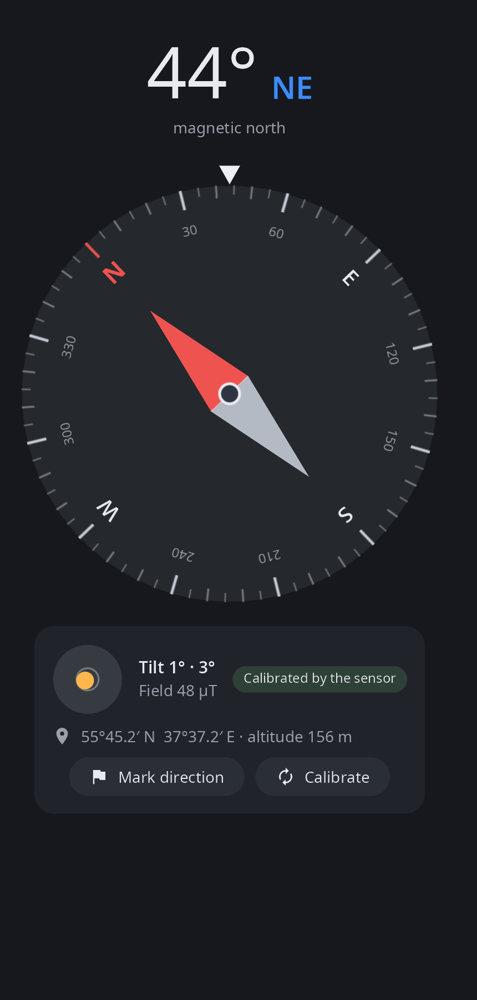
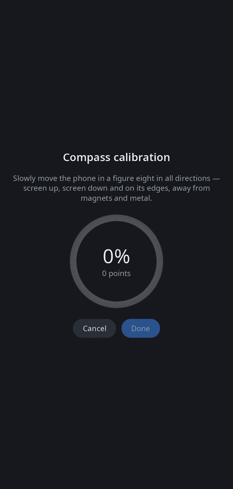

<div align="center">

# syn-compass

**Compass for synshell on phones — magnetometer and accelerometer, a level, a bearing mark and figure-eight calibration.**

[Русский](README.ru.md) · [Website](https://alexeyev.dev/synshell/) · [AUR: synshell-mobile-bin](https://aur.archlinux.org/packages/synshell-mobile-bin) · [AUR: synshell-mobile-git](https://aur.archlinux.org/packages/synshell-mobile-git)



</div>

## Features

- **Heading** — degrees and cardinal direction to magnetic north; the dial turns, the fixed mark on top shows where the phone points. Held upright, the phone shows the heading of the back camera.
- **Level** — tilt in two axes; the dot turns green when the phone lies flat.
- **Field and calibration state** — field strength in µT, whether the sensor calibrated itself, the app's own calibration is used or calibration is needed; a warning near magnets and metal.
- **Calibration** — figure-eight with a progress ring; the hard-iron offset is computed by a sphere fit and stored in `~/.config/synshell/compass.toml`.
- **Bearing mark** — remember a heading and see how far to turn left or right.
- **Coordinates** — latitude, longitude and altitude from GeoClue, if it is running.
- **Portrait and landscape** — in a wide window the dial and the details stand side by side.
- **14 languages** — follows the system language.

| Calibration |
|---|
|  |

## Requirements

A phone with Qualcomm SLPI sensors, read through the platform's sensor source `/usr/lib/syndroid/sensors-source`. On a computer without sensors the app shows “Compass unavailable”.

## Install

**Arch Linux (AUR)** — x86_64 and aarch64. syn-compass is part of the `synshell-mobile` package (phone shell, modem, calls, SMS, NFC, step counter):

```sh
yay -S synshell-mobile-bin      # prebuilt
yay -S synshell-mobile-git      # built from source
```

Depends on `synshell-core`. **From source:** `cargo build --release -p syn-compass` in the [synshell](../../README.md) repository.

## Command line

```sh
syn-compass                                 # the app
syn-compass --screenshot out.png            # window snapshot
SYN_COMPASS_DEMO=40 syn-compass             # without sensors: heading wanders around 40°
```

## Part of synshell

syn-compass is one of the applications of [synshell](../../README.md) — a Wayland desktop environment in Rust for computers and phones, built on the [syngui](https://github.com/VitaminDB/syngui) UI framework.

## License

GPL-3.0-only
