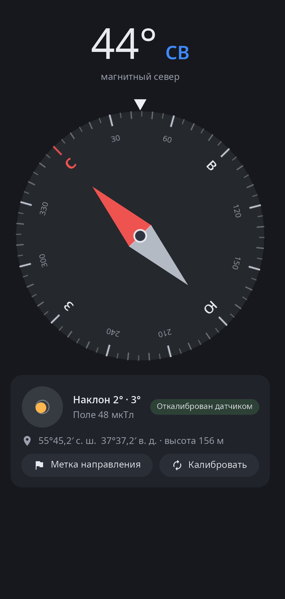
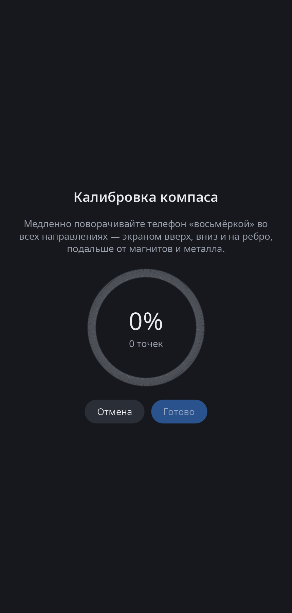

<div align="center">

# syn-compass

**Компас synshell для телефонов — магнитометр и акселерометр, уровень, метка направления и калибровка «восьмёркой».**

[English](README.md) · [Сайт](https://alexeyev.dev/ru/syndesktop/) · [AUR: synshell-mobile-bin](https://aur.archlinux.org/packages/synshell-mobile-bin) · [AUR: synshell-mobile-git](https://aur.archlinux.org/packages/synshell-mobile-git)



</div>

## Возможности

- **Курс** — градусы и сторона света относительно магнитного севера; картушка поворачивается, неподвижная метка сверху показывает, куда направлен телефон. Если держать телефон вертикально, показывается курс задней камеры.
- **Уровень** — наклон по двум осям; точка зеленеет, когда телефон лежит ровно.
- **Поле и калибровка** — сила поля в мкТл и состояние: откалиброван датчиком, своя калибровка или нужна калибровка; предупреждение рядом с магнитами и металлом.
- **Калибровка** — «восьмёркой» с кольцом хода; смещение от магнитов корпуса считается подгонкой сферы и хранится в `~/.config/synshell/compass.toml`.
- **Метка направления** — запомнить курс и видеть, на сколько градусов повернуть левее или правее.
- **Координаты** — широта, долгота и высота от GeoClue, если он запущен.
- **Вертикально и горизонтально** — в широком окне картушка и сведения стоят рядом.
- **14 языков** — как в системе.

| Калибровка |
|---|
|  |

## Что нужно

Телефон с датчиками Qualcomm SLPI, которые читаются через источник датчиков платформы `/usr/lib/syndroid/sensors-source`. На компьютере без датчиков программа показывает «Компас недоступен».

## Установка

**Arch Linux (AUR)** — x86_64 и aarch64. syn-compass входит в пакет `synshell-mobile` (оболочка телефона, модем, звонки, SMS, NFC, шагомер):

```sh
yay -S synshell-mobile-bin      # готовые бинарники
yay -S synshell-mobile-git      # сборка из исходников
```

Зависит от `synshell-core`. **Из исходников:** `cargo build --release -p syn-compass` в репозитории [synshell](../../README.md).

## Командная строка

```sh
syn-compass                                 # программа
syn-compass --screenshot out.png            # снимок окна
SYN_COMPASS_DEMO=40 syn-compass             # без датчиков: курс ходит около 40°
```

## Часть synshell

syn-compass — одно из приложений [synshell](../../README.md): окружения рабочего стола для Wayland на Rust для компьютеров и телефонов, на UI-фреймворке [syngui](https://github.com/VitaminDB/syngui).

## Лицензия

GPL-3.0-only
