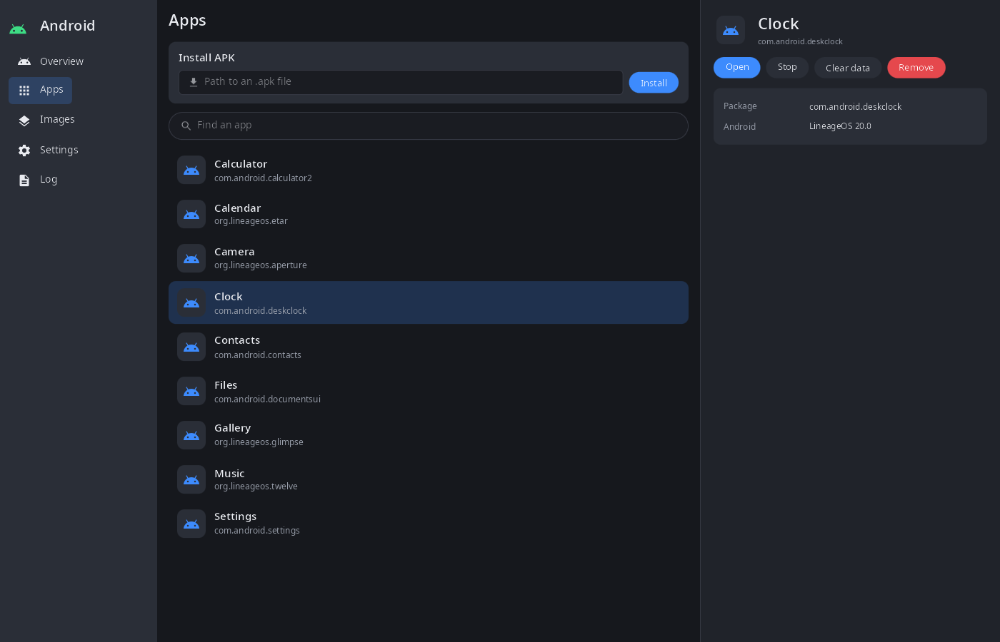
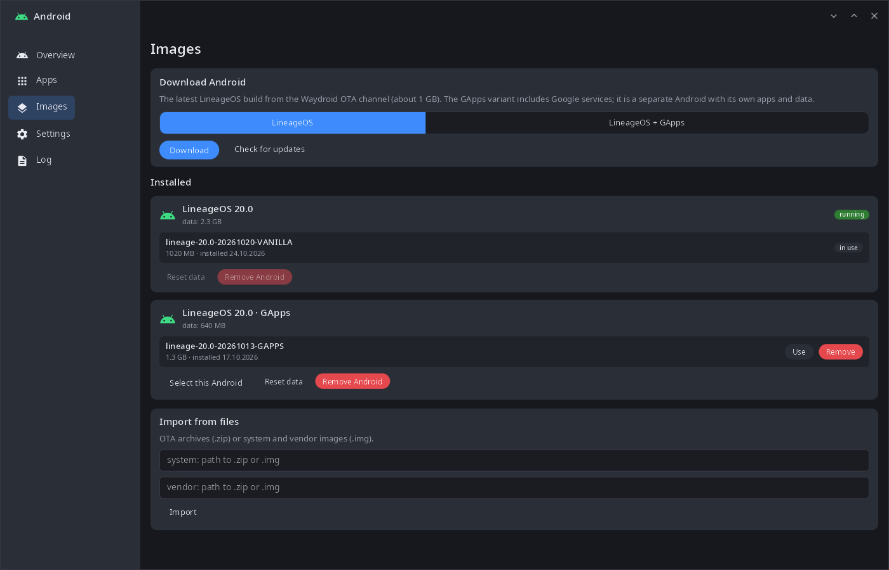
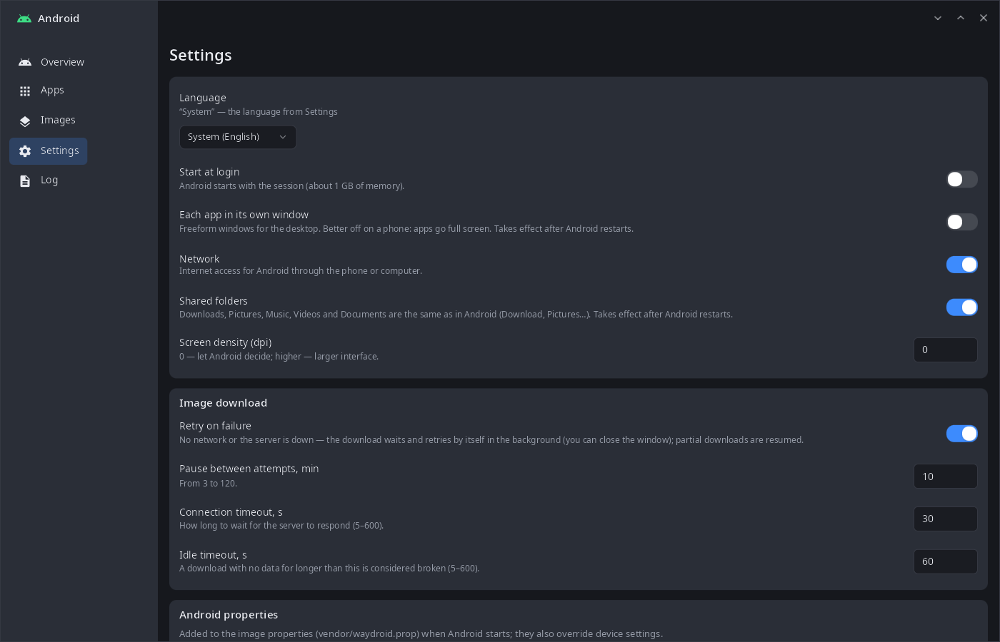
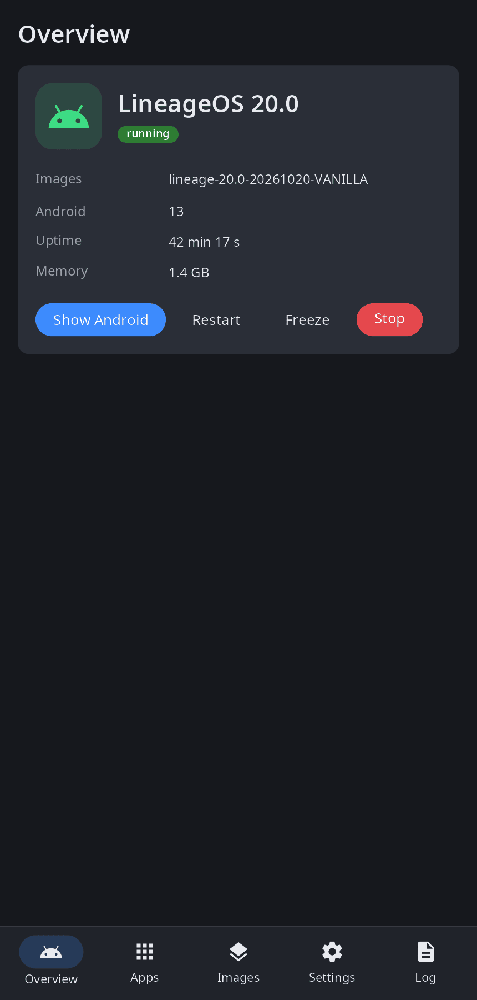

<div align="center">

# syndroid

**Android apps on the synshell desktop — a LineageOS container (Waydroid images) with its own runtime, a daemon, a management window and a CLI.**

[Русский](README.ru.md) · [Website](https://alexeyev.dev/synshell/syn-droid/) · [AUR: syndroid-bin](https://aur.archlinux.org/packages/syndroid-bin) · [AUR: syndroid-git](https://aur.archlinux.org/packages/syndroid-git)



</div>

## Features

- **Own container runtime** — `syndroidd` starts Android `/init` in its own namespaces and cgroup (no LXC, no Waydroid tools); system and vendor images are mounted through loop + overlay, and nothing is left mounted on the host after a stop.
- **Images** — download the latest LineageOS from the Waydroid OTA channel, with or without GApps; check for updates; import OTA `.zip` or `.img` files. Downloads continue in the background with a progress notification, retry on failure and resume.
- **Several Androids** — each image variant is a separate instance with its own apps and data; switch, reset data or remove an instance.
- **Apps in the desktop** — installed Android apps appear in the synshell app menu; open, stop, clear data, uninstall, install an APK. Each app in its own window or the whole Android in one window.
- **Integration** — Android notifications go to the desktop notifications (clicks go back), shared folders (Downloads, Pictures, Music, Videos, Documents), network through a bridge with NAT, gamepads (USB/Bluetooth and the on-screen one) and, on phones with a sensor source, the device sensors.
- **Freeze** — freeze Android to free the CPU and unfreeze it in a moment.
- **Settings** — start with the session, windows mode, network, screen density, Android properties, download retries and timeouts; logcat with a filter.
- **Phone and desktop** — the window has a sidebar on wide screens and bottom navigation on a phone.
- **14 languages** — the UI follows the system or the language chosen in the app.

| Images | Settings | Phone |
|---|---|---|
|  |  |  |

The screenshots show sample data.

## Install

**Arch Linux (AUR)** — x86_64 and aarch64:

```sh
yay -S syndroid-bin      # prebuilt
yay -S syndroid-git      # built from source
sudo systemctl enable --now syndroid    # the daemon
```

Needs a kernel with Android binder (binderfs); networking uses `dnsmasq` and `iptables` (`iptables-legacy` if present). Images (about 1 GB) are downloaded from the window or with `syndroid image fetch`.

The whole desktop: `yay -S synshell-bin`. **From source:** `cargo build --release -p syn-droid` in the [synshell](../../README.md) repository.

## Command line

```sh
syndroid                          # management window
syndroid status
syndroid start | stop | restart
syndroid freeze | unfreeze
syndroid show                     # the whole Android in one window
syndroid image fetch              # download the latest image set
syndroid image import system.zip vendor.zip
syndroid app list
syndroid app install app.apk
syndroid app launch org.lineageos.etar
syndroid shell getprop ro.build.version.release
syndroid logcat
syndroid --help                   # everything else
```

## Part of synshell

syndroid is one of the applications of [synshell](../../README.md) — a Wayland desktop environment in Rust for computers and phones, built on the [syngui](https://github.com/VitaminDB/syngui) UI framework.

## License

GPL-3.0-only
