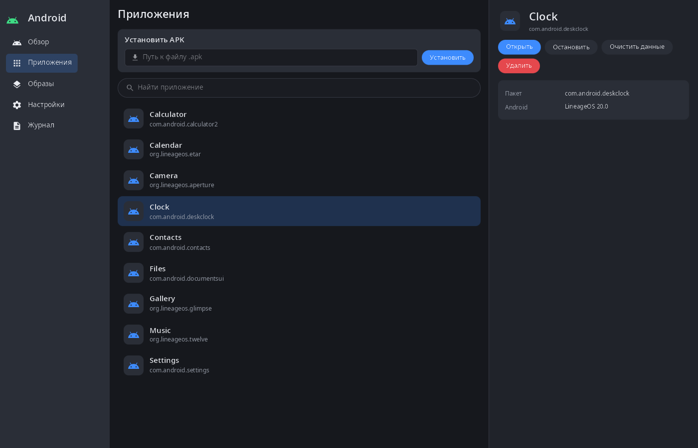
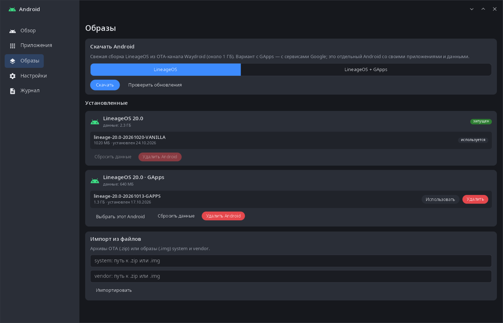
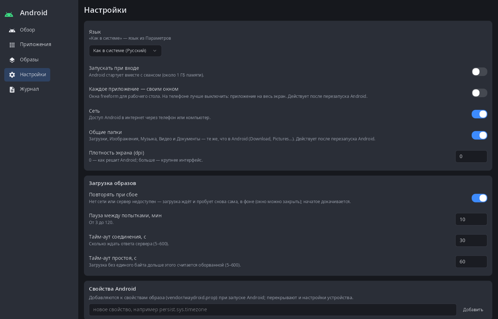
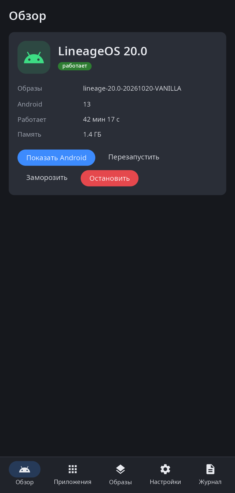

<div align="center">

# syndroid

**Android-приложения на рабочем столе synshell — контейнер LineageOS (образы Waydroid) со своим рантаймом, демон, окно управления и командная строка.**

[English](README.md) · [Сайт](https://alexeyev.dev/ru/synshell/) · [AUR: syndroid-bin](https://aur.archlinux.org/packages/syndroid-bin) · [AUR: syndroid-git](https://aur.archlinux.org/packages/syndroid-git)



</div>

## Возможности

- **Свой рантайм контейнера** — `syndroidd` запускает `/init` Android в своих пространствах имён и cgroup (без LXC и утилит Waydroid); образы system и vendor монтируются через loop + overlay, после остановки на хосте ничего не остаётся смонтированным.
- **Образы** — загрузка свежей LineageOS из OTA-канала Waydroid, с GApps или без; проверка обновлений; импорт OTA-архивов `.zip` или образов `.img`. Загрузка идёт в фоне с уведомлением о ходе, повторяется при сбое и докачивается.
- **Несколько Android** — каждый вариант образов — отдельный экземпляр со своими приложениями и данными; выбрать, сбросить данные или удалить экземпляр.
- **Приложения на рабочем столе** — установленные приложения Android появляются в меню программ synshell; открыть, остановить, очистить данные, удалить, установить APK. Каждое приложение своим окном или весь Android одним окном.
- **Связь с системой** — уведомления Android приходят в уведомления рабочего стола (нажатия — обратно), общие папки (Загрузки, Изображения, Музыка, Видео, Документы), сеть через мост с NAT, геймпады (USB/Bluetooth и экранный) и, на телефонах с источником датчиков, датчики устройства.
- **Заморозка** — Android можно заморозить, чтобы не занимал процессор, и мгновенно разморозить.
- **Настройки** — запуск вместе с сеансом, режим окон, сеть, плотность экрана, свойства Android, повторы и тайм-ауты загрузки; logcat с фильтром.
- **Телефон и компьютер** — на широком экране боковая панель, на телефоне навигация внизу.
- **14 языков** — как в системе или свой язык в настройках приложения.

| Образы | Настройки | Телефон |
|---|---|---|
|  |  |  |

На снимках — данные для примера.

## Установка

**Arch Linux (AUR)** — x86_64 и aarch64:

```sh
yay -S syndroid-bin      # готовые бинарники
yay -S syndroid-git      # сборка из исходников
sudo systemctl enable --now syndroid    # демон
```

Нужно ядро с binder Android (binderfs); для сети — `dnsmasq` и `iptables` (`iptables-legacy`, если есть). Образы (около 1 ГБ) скачиваются из окна или командой `syndroid image fetch`.

Весь рабочий стол: `yay -S synshell-bin`. **Из исходников:** `cargo build --release -p syn-droid` в репозитории [synshell](../../README.md).

## Командная строка

```sh
syndroid                          # окно управления
syndroid status
syndroid start | stop | restart
syndroid freeze | unfreeze
syndroid show                     # весь Android одним окном
syndroid image fetch              # скачать последний набор образов
syndroid image import system.zip vendor.zip
syndroid app list
syndroid app install app.apk
syndroid app launch org.lineageos.etar
syndroid shell getprop ro.build.version.release
syndroid logcat
syndroid --help                   # остальное
```

## Часть synshell

syndroid — одно из приложений [synshell](../../README.md): окружения рабочего стола для Wayland на Rust для компьютеров и телефонов, на UI-фреймворке [syngui](https://github.com/VitaminDB/syngui).

## Лицензия

GPL-3.0-only
