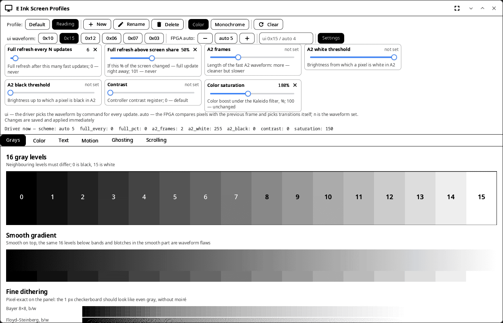
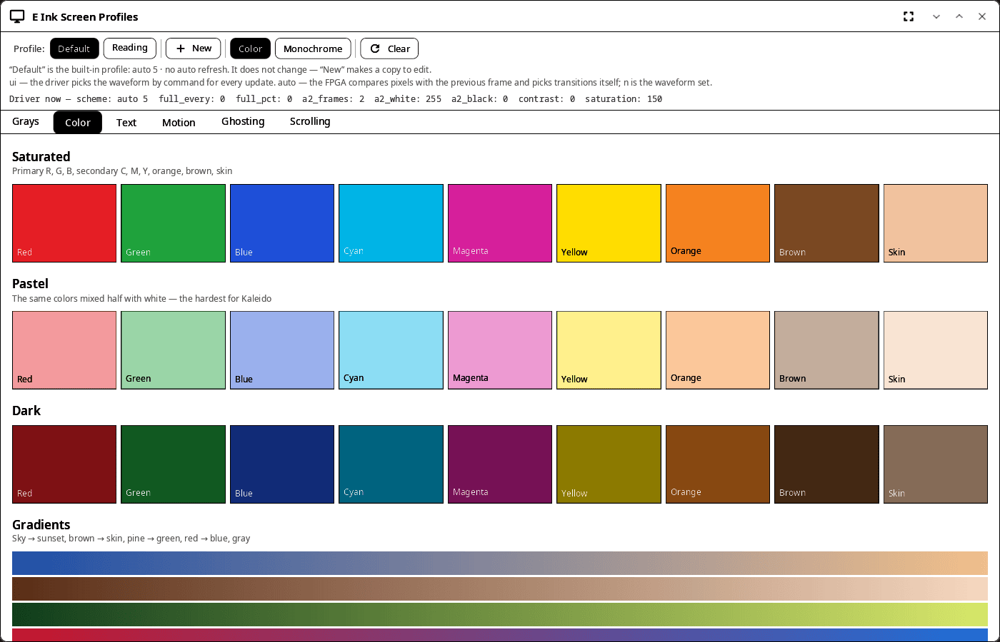
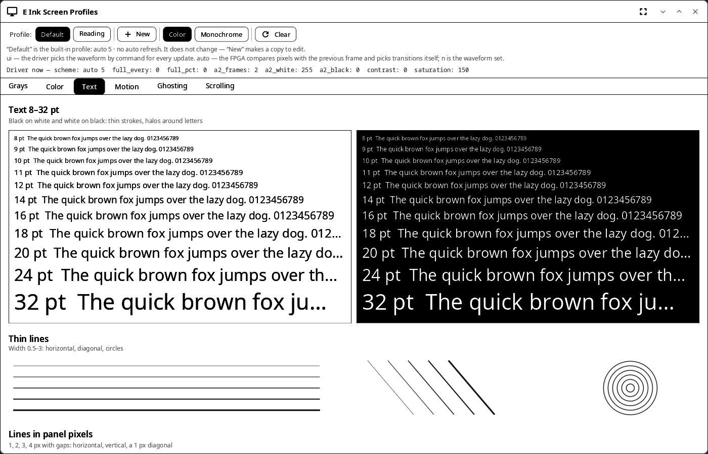

<div align="center">

# syn-epdtest

**E Ink screen profiles and test patterns for synshell on ONYX BOOX devices — a tool for developers and for tuning the panel.**

[Русский](README.ru.md) · [Website](https://alexeyev.dev/synshell/syn-epdtest/) · [AUR: syn-epdtest-bin](https://aur.archlinux.org/packages/syn-epdtest-bin) · [AUR: syn-epdtest-git](https://aur.archlinux.org/packages/syn-epdtest-git)



</div>

It works with the `onyx-tcon-fpga` driver (ONYX BOOX, for example Note Air 4C). On other hardware it shows the test patterns, but profiles are not applied.

## Features

- **Profiles** — named sets of driver settings: create, rename, delete; picking a profile applies it at once. Profiles are shared with the login screen, the quick settings and System Settings; the built-in “Default” profile does not change.
- **Profile editor** — waveform mode (`ui <set>` or FPGA `auto <n>`), full refresh every N updates and above a share of the screen, A2 frames and thresholds, contrast, color saturation; changes go to the driver and the profile file right away. Color or monochrome mode, full screen clear.
- **Tests** — 16 gray levels, gradients and dithering at panel pixel size; saturated, pastel and dark colors; text from 8 to 32 pt black on white and white on black; motion, ghosting and scrolling.

| Colors | Text |
|---|---|
|  |  |

The screenshots were taken on a computer with a stand-in driver directory.

## Install

**Arch Linux (AUR)** — x86_64 and aarch64:

```sh
yay -S syn-epdtest-bin      # prebuilt
yay -S syn-epdtest-git      # built from source
```

Depends on `synshell-core`; not part of the `synshell` metapackage. **From source:** `cargo build --release -p syn-epdtest` in the [synshell](../../README.md) repository.

## Command line

```sh
syn-epdtest                                   # open the window
SYNSHELL_SYSFS=/tmp/sys syn-epdtest           # stand-in sysfs for testing on a computer
syn-epdtest --screenshot shot.png --size 1400x900 --tab color --profile Reading
                                              # window snapshot (tabs: gray, color, text, motion, ghost, scroll)
```

## Part of synshell

syn-epdtest is one of the applications of [synshell](../../README.md) — a Wayland desktop environment in Rust for computers and phones, built on the [syngui](https://github.com/VitaminDB/syngui) UI framework.

## License

GPL-3.0-only
