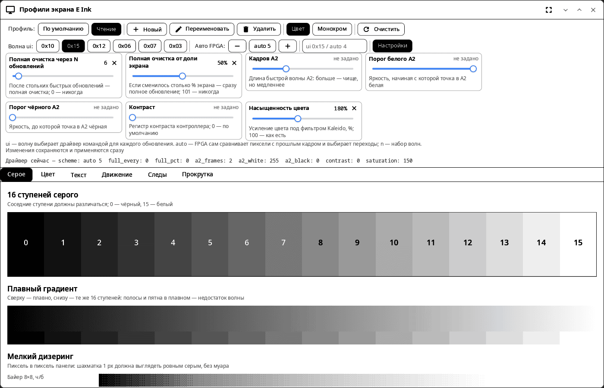
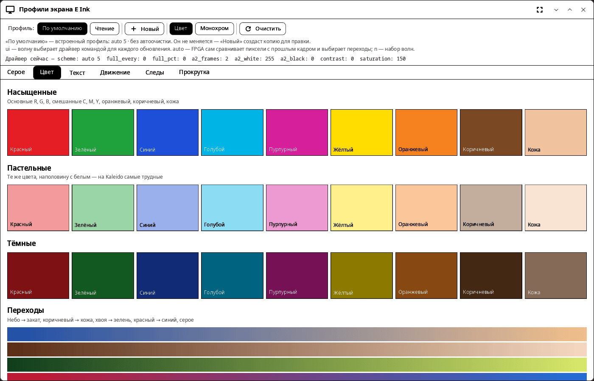
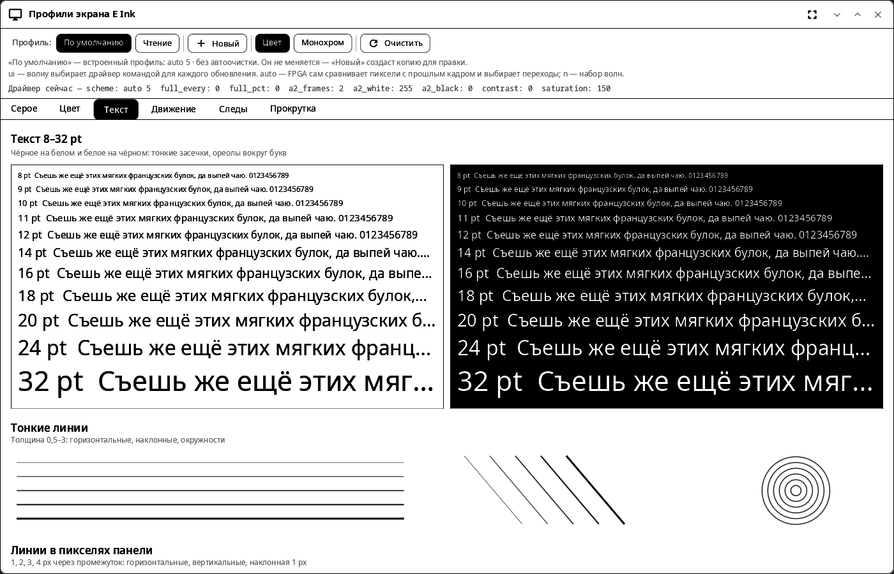

<div align="center">

# syn-epdtest

**Профили и тест экрана E Ink для synshell на устройствах ONYX BOOX — инструмент для разработчиков и для настройки панели.**

[English](README.md) · [Сайт](https://alexeyev.dev/ru/synshell/syn-epdtest/)



</div>

Работает с драйвером `onyx-tcon-fpga` (ONYX BOOX, например Note Air 4C). На другом оборудовании показывает тестовые картинки, но профили не применяются.

## Возможности

- **Профили** — именованные наборы настроек драйвера: создать, переименовать, удалить; выбранный профиль применяется сразу. Профили общие с экраном входа, шторкой и «Параметрами системы»; встроенный «По умолчанию» не меняется.
- **Редактор профиля** — режим волны (`ui <набор>` или авторежим FPGA `auto <n>`), полная очистка через N обновлений и от доли экрана, кадры и пороги A2, контраст, насыщенность цвета; правки сразу уходят в драйвер и в файл профилей. Цвет или монохром, полная очистка экрана.
- **Тесты** — 16 ступеней серого, градиенты и дизеринг в пиксель панели; насыщенные, пастельные и тёмные цвета; текст от 8 до 32 pt чёрным по белому и белым по чёрному; движение, следы и прокрутка.

| Цвет | Текст |
|---|---|
|  |  |

Снимки сделаны на компьютере с подставным каталогом драйвера.

## Установка

**Архив из выпуска** (в AUR нет — инструмент разработчика) — x86_64 и aarch64, из [v0.2.0](https://github.com/VitaminDB/synshell/releases/tag/v0.2.0):

```sh
curl -LO https://github.com/VitaminDB/synshell/releases/download/v0.2.0/syn-epdtest-0.2.0-$(uname -m).tar.zst
sudo tar -xpf syn-epdtest-0.2.0-$(uname -m).tar.zst -C /
```

Зависит от `synshell-core`; в метапакет `synshell` не входит. **Из исходников:** `cargo build --release -p syn-epdtest` в репозитории [synshell](../../README.md).

## Командная строка

```sh
syn-epdtest                                   # открыть окно
SYNSHELL_SYSFS=/tmp/sys syn-epdtest           # подставной sysfs для проверки на компьютере
syn-epdtest --screenshot shot.png --size 1400x900 --tab color --profile Чтение
                                              # снимок окна (вкладки: gray, color, text, motion, ghost, scroll)
```

## Часть synshell

syn-epdtest — одно из приложений [synshell](../../README.md): окружения рабочего стола для Wayland на Rust для компьютеров и телефонов, на UI-фреймворке [syngui](https://github.com/VitaminDB/syngui).

## Лицензия

GPL-3.0-only
