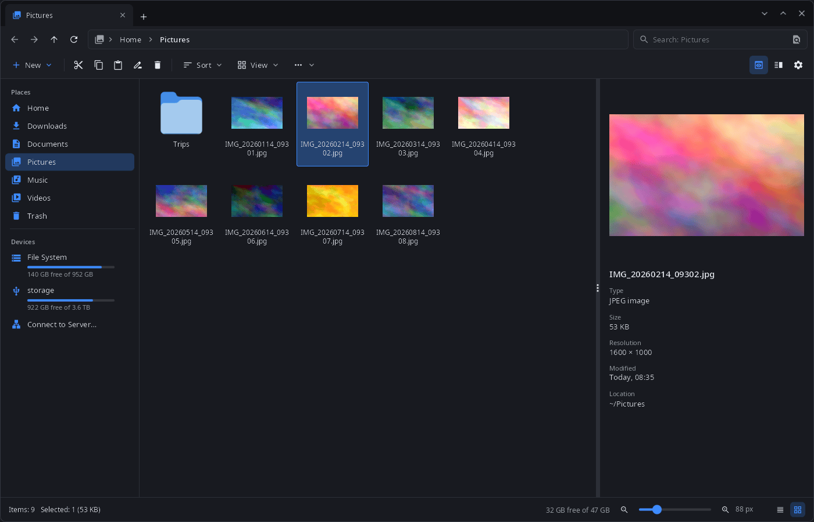
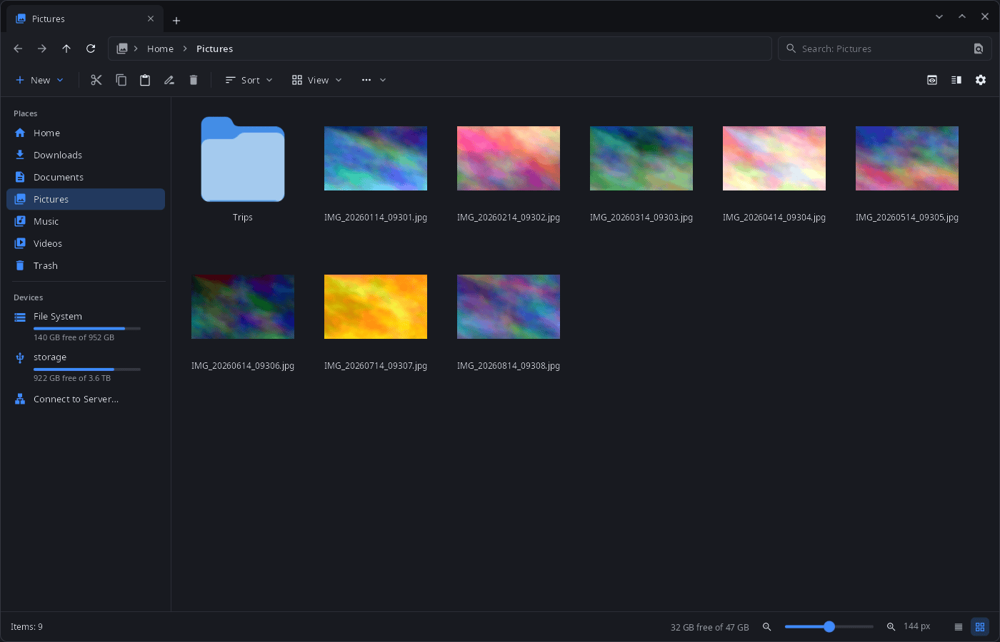
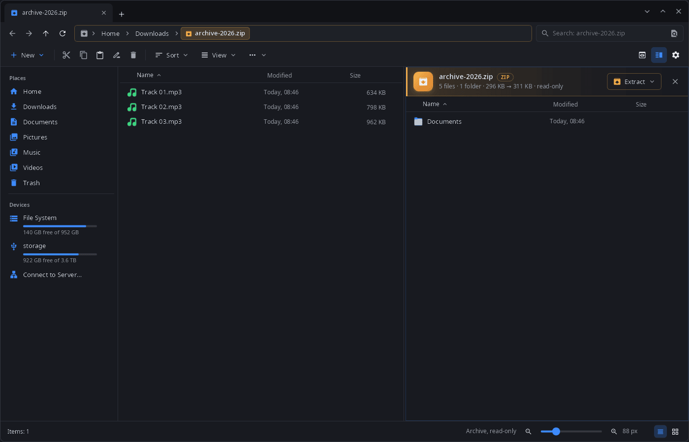

<div align="center">

# synfiles

**File manager for the synshell desktop — tabs, two panes, archives as folders, network locations, phones and drives, a built-in image viewer.**

[Русский](README.ru.md) · [Website](https://alexeyev.dev/synshell/syn-files/) · [AUR: synshell-core-bin](https://aur.archlinux.org/packages/synshell-core-bin) · [AUR: synshell-core-git](https://aur.archlinux.org/packages/synshell-core-git)



</div>

## Features

- **Tabs and two panes** — tabs in the title bar, a second pane with F3; the tabs of the last session come back on start.
- **Four views** — icons, tiles, list and details, icon size from a slider; thumbnails of images and videos (HEIC/AVIF too).
- **Preview panel** (F11) — a large preview with type, size, resolution, date and location.
- **Archives as folders** — zip, 7z, rar, tar.* and others open like a folder (read-only), including nested ones and password-protected archives; “Extract” in the archive bar.
- **File operations in the background** — progress, pause and cancel, a question on name conflicts, Ctrl+Z undoes the last operation; trash per the freedesktop spec, including trash on other drives.
- **Batch rename** — by template (`{name}`, `{ext}`, `{n}`), text or regex replacement, case change, with a preview; one Ctrl+Z undoes it.
- **Search** by name or by file contents, nearest results first.
- **Tags and ratings** in extended attributes, compatible with Dolphin.
- **Git status** of files and folders inside a repository.
- **Folder sizes** counted in the background.
- **Drives and devices** — USB drives and partitions (udisks), Android phones (MTP), cameras (PTP), iPhone, files of devices linked with synlink.
- **Network locations** — “Connect to Server…”: SFTP, SMB, FTP, WebDAV, NFS via gvfs, with password and host-key prompts.
- **Terminal panel** (F12) in the open folder.
- **Image viewer** — `synfiles --viewer`: zoom to the cursor, a thumbnail strip, all images of the folder, EXIF rotation, move to trash, “Open with”.
- **File chooser** for the synshell portal — “Open” and “Save” dialogs of other programs.
- **Phone layout** with touch control.
- **14 languages** — the UI follows the system or the language chosen in settings.

| Icons | Two panes, archive as a folder |
|---|---|
|  |  |

## Install

**Arch Linux (AUR)** — x86_64 and aarch64. synfiles is part of `synshell-core`, the base set of desktop programs (compositor, shell, settings, file manager, terminal, software center, screenshots):

```sh
yay -S synshell-core-bin      # prebuilt
yay -S synshell-core-git      # built from source
```

Optional: `shared-mime-info` (file types), `ffmpegthumbnailer` (video thumbnails), `libheif` (HEIC/HEIF/AVIF), `imagemagick` (rare image formats in the viewer), `udisks2` (USB drives and disks), `gvfs-mtp` / `gvfs-gphoto2` / `gvfs-afc` (Android phones, cameras, iPhone), `gvfs-smb` (Windows and Samba shares), `git` (git status), `fuse3` (archives as folders), `breeze-icons` (default icon theme).

The whole desktop: `yay -S synshell-bin`. **From source:** `cargo build --release -p syn-files` in the [synshell](../../README.md) repository.

## Command line

```sh
synfiles                                  # tabs of the last session, or the home folder
synfiles ~/Documents ~/Downloads          # each folder in its own tab
synfiles ~/Downloads/photos.zip           # an archive as a folder
synfiles trash:/                          # the trash
synfiles --select ~/Pictures/cat.jpg      # show a file in its folder
synfiles --view details --split ~/a ~/b   # view mode and two panes
synfiles --viewer ~/Pictures/cat.jpg      # image viewer
```

## Part of synshell

synfiles is one of the applications of [synshell](../../README.md) — a Wayland desktop environment in Rust for computers and phones, built on the [syngui](https://github.com/VitaminDB/syngui) UI framework.

## License

GPL-3.0-only
