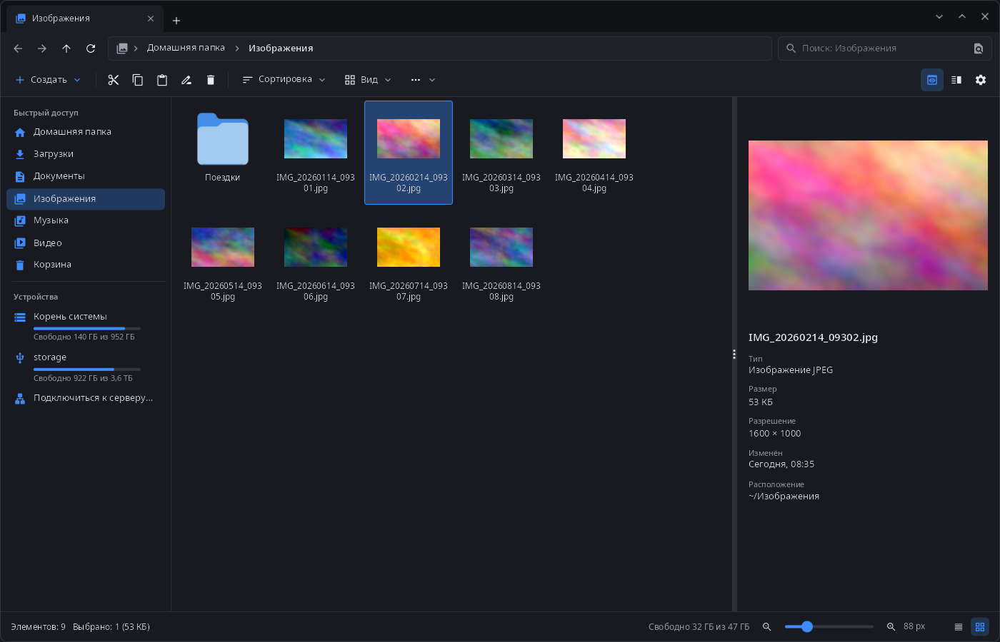
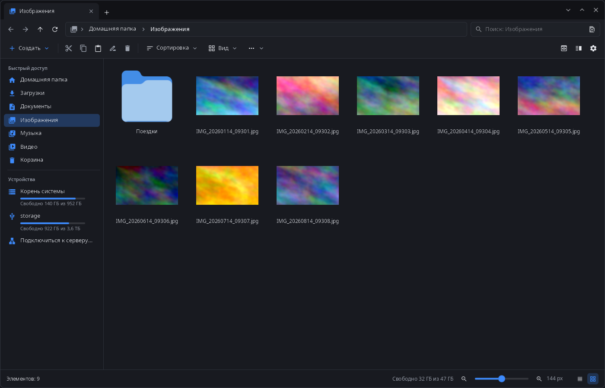
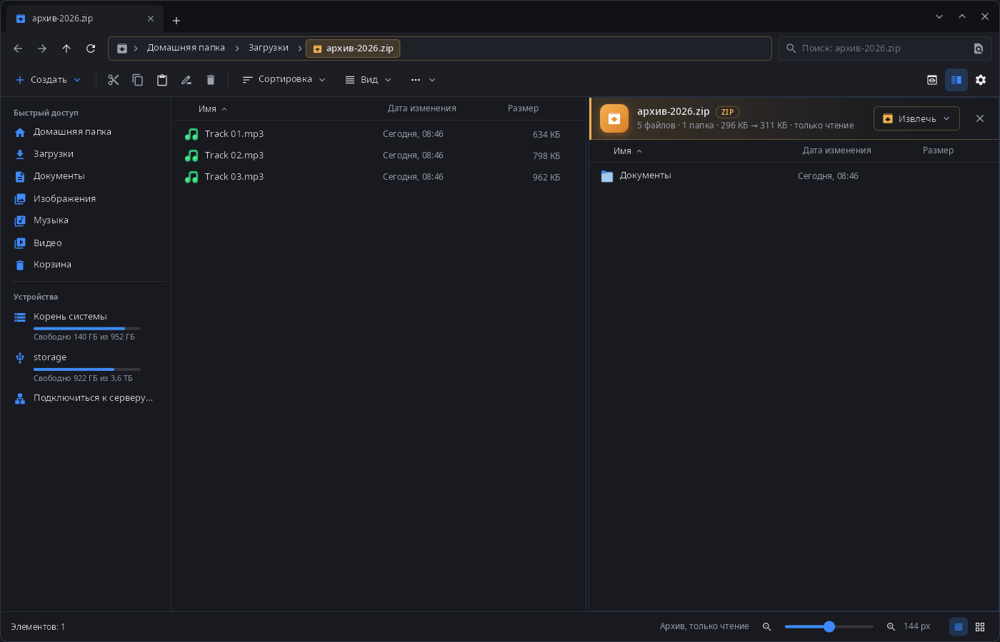

<div align="center">

# synfiles

**Проводник рабочего стола synshell — вкладки, две панели, архивы как папки, сетевые расположения, телефоны и диски, встроенный просмотр картинок.**

[English](README.md) · [Сайт](https://alexeyev.dev/ru/synshell/) · [AUR: synshell-core-bin](https://aur.archlinux.org/packages/synshell-core-bin) · [AUR: synshell-core-git](https://aur.archlinux.org/packages/synshell-core-git)



</div>

## Возможности

- **Вкладки и две панели** — вкладки в заголовке окна, вторая панель по F3; вкладки прошлого сеанса возвращаются при запуске.
- **Четыре вида** — значки, плитки, список и таблица, размер значков ползунком; миниатюры картинок и видео (в том числе HEIC/AVIF).
- **Панель просмотра** (F11) — крупное превью, тип, размер, разрешение, дата и расположение.
- **Архивы как папки** — zip, 7z, rar, tar.* и другие открываются как папка (только чтение), в том числе вложенные и с паролем; «Извлечь» в полосе архива.
- **Файловые операции в фоне** — ход, пауза и отмена, вопрос при совпадении имён, Ctrl+Z отменяет последнюю операцию; корзина по спецификации freedesktop, в том числе на других дисках.
- **Пакетное переименование** — по шаблону (`{name}`, `{ext}`, `{n}`), замена текста или регулярного выражения, смена регистра, с предпросмотром; отменяется одним Ctrl+Z.
- **Поиск** по имени или по тексту файлов, ближние результаты — первыми.
- **Метки и оценки** в расширенных атрибутах, совместимо с Dolphin.
- **Состояние git** у файлов и папок внутри репозитория.
- **Размеры папок** считаются в фоне.
- **Диски и устройства** — флешки и разделы (udisks), телефоны Android (MTP), камеры (PTP), iPhone, файлы устройств, связанных через synlink.
- **Сетевые расположения** — «Подключиться к серверу…»: SFTP, SMB, FTP, WebDAV, NFS через gvfs, с вопросами о пароле и ключе сервера.
- **Панель терминала** (F12) в открытой папке.
- **Просмотр картинок** — `synfiles --viewer`: масштаб к указателю, лента миниатюр, все картинки папки, поворот по EXIF, удаление в корзину, «Открыть с помощью».
- **Окно выбора файлов** для портала synshell — диалоги «Открыть» и «Сохранить» других программ.
- **Вид для телефона** с управлением касаниями.
- **14 языков** — как в системе или язык, выбранный в настройках.

| Значки | Две панели, архив как папка |
|---|---|
|  |  |

## Установка

**Arch Linux (AUR)** — x86_64 и aarch64. synfiles входит в пакет `synshell-core` — базовый набор программ рабочего стола (композитор, оболочка, параметры, проводник, терминал, установка программ, снимки экрана):

```sh
yay -S synshell-core-bin      # готовые бинарники
yay -S synshell-core-git      # сборка из исходников
```

Дополнительно: `shared-mime-info` (типы файлов), `ffmpegthumbnailer` (миниатюры видео), `libheif` (HEIC/HEIF/AVIF), `imagemagick` (редкие форматы картинок в просмотрщике), `udisks2` (флешки и диски), `gvfs-mtp` / `gvfs-gphoto2` / `gvfs-afc` (телефоны Android, камеры, iPhone), `gvfs-smb` (сетевые папки Windows и Samba), `git` (состояние git), `fuse3` (архивы как папки), `breeze-icons` (тема значков по умолчанию).

Весь рабочий стол: `yay -S synshell-bin`. **Из исходников:** `cargo build --release -p syn-files` в репозитории [synshell](../../README.md).

## Командная строка

```sh
synfiles                                  # вкладки прошлого сеанса или домашняя папка
synfiles ~/Документы ~/Загрузки           # каждая папка в своей вкладке
synfiles ~/Загрузки/фото.zip              # архив как папка
synfiles trash:/                          # корзина
synfiles --select ~/Изображения/кот.jpg   # показать файл в его папке
synfiles --view details --split ~/a ~/b   # вид и две панели
synfiles --viewer ~/Изображения/кот.jpg   # просмотр картинок
```

## Часть synshell

synfiles — одно из приложений [synshell](../../README.md): окружения рабочего стола для Wayland на Rust для компьютеров и телефонов, на UI-фреймворке [syngui](https://github.com/VitaminDB/syngui).

## Лицензия

GPL-3.0-only
