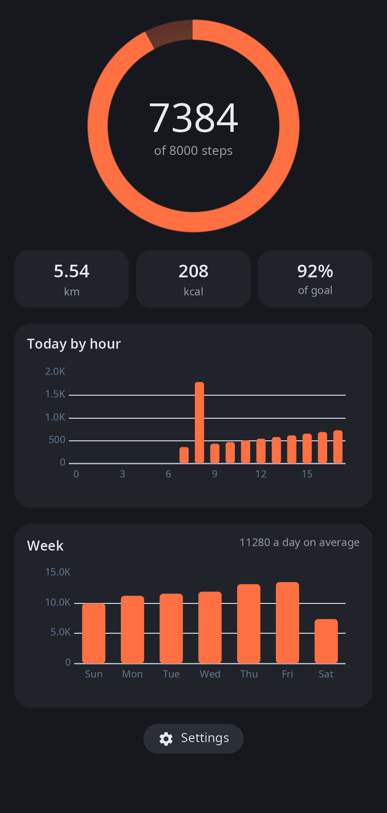
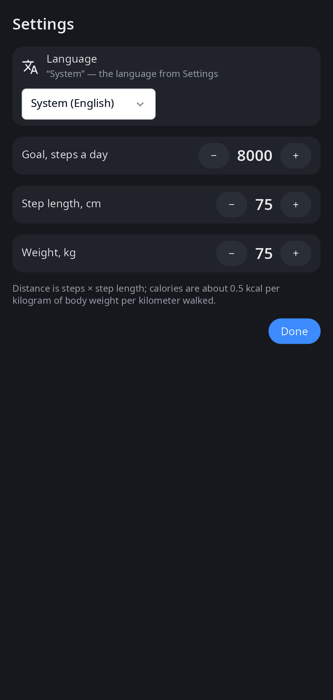

<div align="center">

# syn-health

**Steps and activity for synshell on phones — the phone's pedometer, distance, calories, by hour and by week.**

[Русский](README.ru.md) · [Website](https://alexeyev.dev/syndesktop/) · [AUR: synshell-mobile-bin](https://aur.archlinux.org/packages/synshell-mobile-bin) · [AUR: synshell-mobile-git](https://aur.archlinux.org/packages/synshell-mobile-git)



</div>

## Features

- **Today** — steps against the daily goal on a ring, distance, calories and percent of the goal.
- **By hour** — a chart of today's steps hour by hour.
- **Week** — steps for the last seven days and the daily average.
- **Background counting** — `syn-health --track` starts with the session and keeps counting while the app is closed; it exits by itself on devices without a pedometer.
- **Settings** — daily goal, step length and weight (distance = steps × step length; calories ≈ 0.5 kcal per kg of body weight per km), app language.
- **Local data** — history in `~/.local/share/synshell/health/steps.json`, settings in `~/.config/synshell/health.toml`; nothing leaves the phone.
- **14 languages** — follows the system or the language chosen in the app.

| Settings |
|---|
|  |

## Requirements

A phone with a Qualcomm SLPI pedometer, read through the platform's sensor source `/usr/lib/syndroid/sensors-source`. Without one the app shows the saved history and a note that there is no pedometer.

## Install

**Arch Linux (AUR)** — x86_64 and aarch64. syn-health is part of the `synshell-mobile` package (phone shell, modem, calls, SMS, NFC, compass):

```sh
yay -S synshell-mobile-bin      # prebuilt
yay -S synshell-mobile-git      # built from source
```

Depends on `synshell-core`. **From source:** `cargo build --release -p syn-health` in the [synshell](../../README.md) repository.

## Command line

```sh
syn-health                                  # the app
syn-health --track                          # background step counter (no window)
syn-health --screenshot out.png --settings  # window snapshot (main page or settings)
SYN_HEALTH_DEMO=1 syn-health                # writes a demo week of steps — use a separate XDG_DATA_HOME
```

## Part of synshell

syn-health is one of the applications of [synshell](../../README.md) — a Wayland desktop environment in Rust for computers and phones, built on the [syngui](https://github.com/VitaminDB/syngui) UI framework.

## License

GPL-3.0-only
