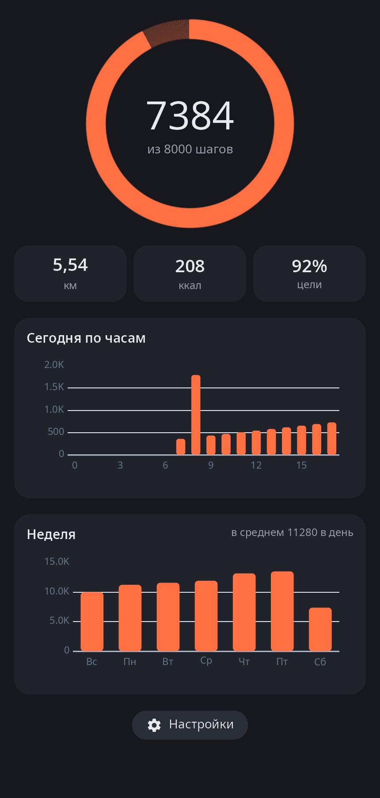

<div align="center">

# syn-health

**«Спорт и здоровье» synshell для телефонов — шагомер телефона, расстояние, калории, по часам и за неделю.**

[English](README.md) · [Сайт](https://alexeyev.dev/ru/syndesktop/) · [AUR: synshell-mobile-bin](https://aur.archlinux.org/packages/synshell-mobile-bin) · [AUR: synshell-mobile-git](https://aur.archlinux.org/packages/synshell-mobile-git)



</div>

## Возможности

- **Сегодня** — шаги относительно цели на кольце, расстояние, калории и процент цели.
- **По часам** — график сегодняшних шагов по часам.
- **Неделя** — шаги за последние семь дней и среднее в день.
- **Счёт в фоне** — `syn-health --track` запускается вместе с сеансом и считает шаги, пока программа закрыта; на устройствах без шагомера сразу завершается.
- **Настройки** — цель на день, длина шага и вес (расстояние = шаги × длина шага; калории — примерно 0,5 ккал на килограмм веса на километр), язык программы.
- **Данные на телефоне** — история в `~/.local/share/synshell/health/steps.json`, настройки в `~/.config/synshell/health.toml`; никуда не отправляются.
- **14 языков** — как в системе или свой язык в настройках программы.

| Настройки |
|---|
|  |

## Что нужно

Телефон с шагомером Qualcomm SLPI, который читается через источник датчиков платформы `/usr/lib/syndroid/sensors-source`. Без шагомера программа показывает сохранённую историю и сообщение, что шагомера нет.

## Установка

**Arch Linux (AUR)** — x86_64 и aarch64. syn-health входит в пакет `synshell-mobile` (оболочка телефона, модем, звонки, SMS, NFC, компас):

```sh
yay -S synshell-mobile-bin      # готовые бинарники
yay -S synshell-mobile-git      # сборка из исходников
```

Зависит от `synshell-core`. **Из исходников:** `cargo build --release -p syn-health` в репозитории [synshell](../../README.md).

## Командная строка

```sh
syn-health                                  # программа
syn-health --track                          # счётчик шагов в фоне (без окна)
syn-health --screenshot out.png --settings  # снимок окна (главная или настройки)
SYN_HEALTH_DEMO=1 syn-health                # записывает демо-неделю шагов — с отдельным XDG_DATA_HOME
```

## Часть synshell

syn-health — одно из приложений [synshell](../../README.md): окружения рабочего стола для Wayland на Rust для компьютеров и телефонов, на UI-фреймворке [syngui](https://github.com/VitaminDB/syngui).

## Лицензия

GPL-3.0-only
