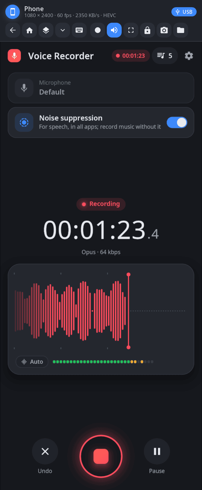
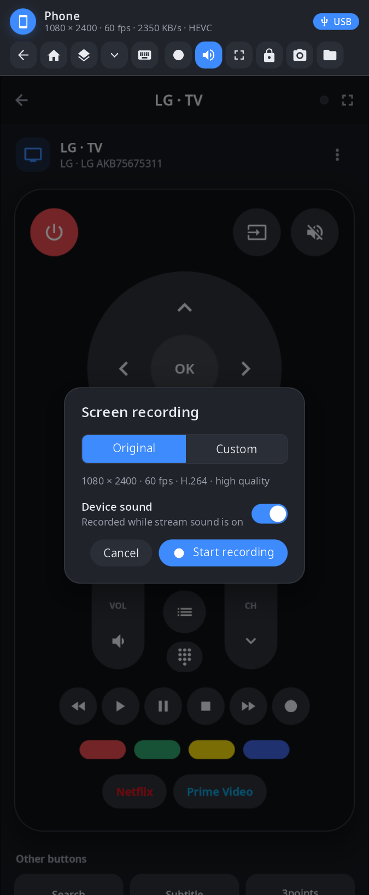
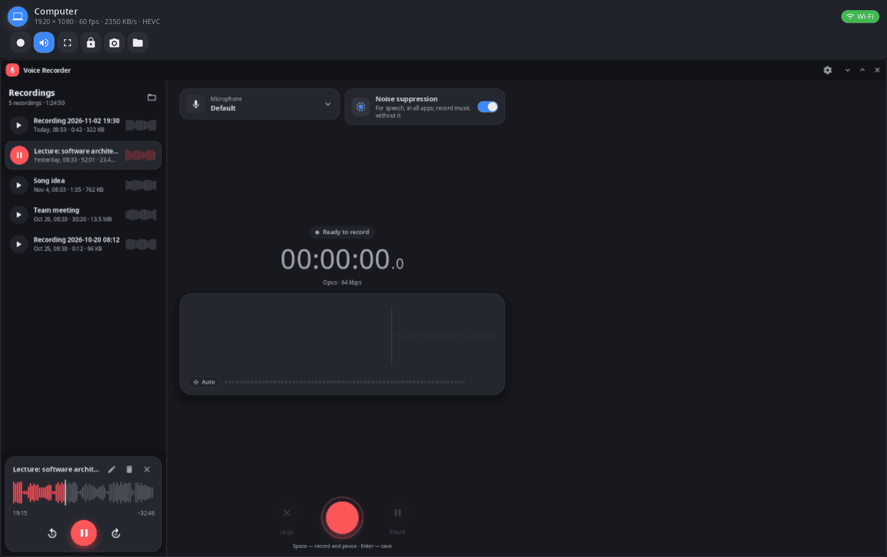

<div align="center">

# synlink-view

**The screen of a linked device in a window — watch and control your phone from the computer, or the computer from the phone.**

[Русский](README.ru.md) · [Website](https://alexeyev.dev/synshell/syn-link-view/) · [AUR: synshell-link-bin](https://aur.archlinux.org/packages/synshell-link-bin) · [AUR: synshell-link-git](https://aur.archlinux.org/packages/synshell-link-git)



</div>

## Features

- **Live screen** — only the changed areas are sent (zstd, lossless); when the ffmpeg libraries are installed here, video from the other side's hardware encoder (HEVC or H.264) with lossless patches on top. The status line shows resolution, frame rate, bitrate and codec.
- **Rotation** — when the phone rotates, the window swaps its width and height.
- **Input** — on a phone the mouse acts as a finger (right button — back, middle button — home); on a computer, mouse and touch act as the mouse; keys and text go as typed.
- **Phone buttons** — back, home, recent apps, notification shade, on-screen keyboard.
- **Sound** — the device's sound plays here, and the local microphone goes there as a virtual source.
- **Screen recording** — “Original” (native resolution, the screen's refresh rate, high quality) or custom height, frame rate, codec (H.264, HEVC, AV1), quality and MP4/MKV; with the device's sound; hardware encoder (NVENC, VAAPI) when available. Files go to `Videos/Записи экрана`.
- **Also** — lock the device, take a screenshot of it, open its files in the file manager, full screen (F11, Esc to leave; remembered).
- **USB or Wi-Fi** — whichever link synlink has, shown as a chip in the corner.

| Recording | Computer screen |
|---|---|
|  |  |

## Install

synlink-view comes with the `synshell-link` package (the synlink daemon and this window) — x86_64 and aarch64:

```sh
yay -S synshell-link-bin      # prebuilt
yay -S synshell-link-git      # built from source
```

Depends on `synshell-core`. Optional: `openssh` (ssh to linked devices), `fuse3` (files of linked devices in the file manager). Part of the `synshell` metapackage: `yay -S synshell-bin` installs the whole desktop. **From source:** `cargo build --release -p syn-link-view` in the [synshell](../../README.md) repository.

## Command line

```sh
synlink-view phone                                  # screen of the linked phone (name, id or “phone”)
synlink-view phone --record --out demo.mp4 --duration 30 --sound
                                                    # record without a window (JSON lines on stdout)
synlink-view phone --record --height 720 --fps 30 --codec hevc --quality medium --mkv
synlink-view --screenshot shot.png --kind phone --frame screen.png --page record
                                                    # window snapshot without a device (layout check)
```

`synlink mcp` uses `--record` for its screen recording tool.

## Part of synshell

synlink-view is one of the applications of [synshell](../../README.md) — a Wayland desktop environment in Rust for computers and phones, built on the [syngui](https://github.com/VitaminDB/syngui) UI framework.

## License

GPL-3.0-only
