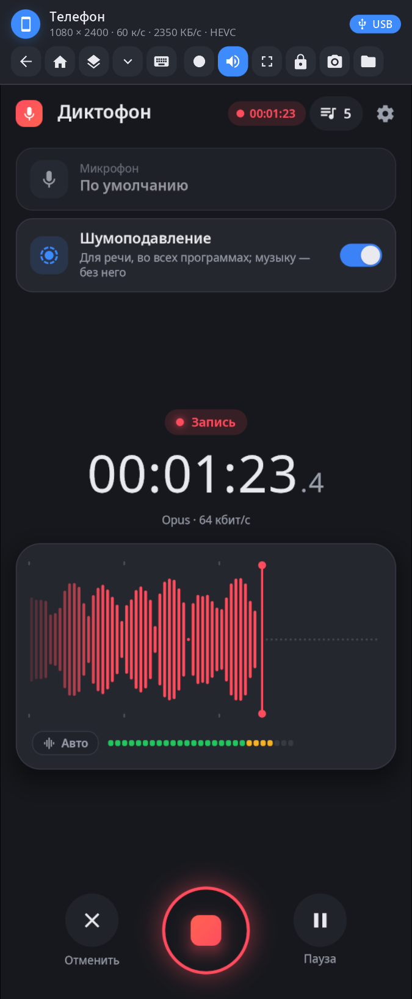
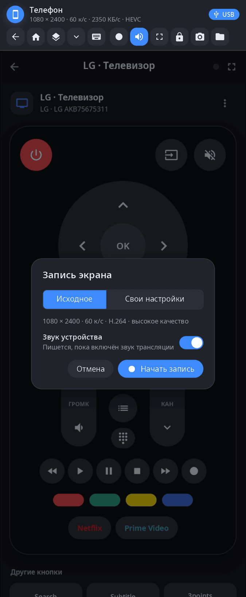
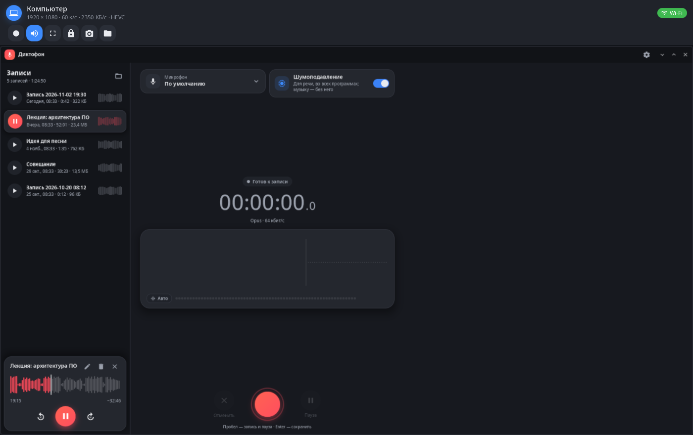

<div align="center">

# synlink-view

**Экран связанного устройства в окне — смотреть на телефон с компьютера и управлять им, или наоборот.**

[English](README.md) · [Сайт](https://alexeyev.dev/ru/synshell/syn-link-view/) · [AUR: synshell-link-bin](https://aur.archlinux.org/packages/synshell-link-bin) · [AUR: synshell-link-git](https://aur.archlinux.org/packages/synshell-link-git)



</div>

## Возможности

- **Живой экран** — передаются только изменившиеся места (zstd, без потерь); если здесь есть библиотеки ffmpeg — видео с аппаратного кодера той стороны (HEVC или H.264), поверх — точные куски без потерь. В строке состояния — разрешение, частота кадров, поток и кодек.
- **Поворот** — повернули телефон — окно меняет ширину и высоту местами.
- **Ввод** — на телефон мышь работает как палец (правая кнопка — «назад», средняя — «домой»); на компьютер мышь и касания идут как мышь; клавиши и текст — как есть.
- **Кнопки телефона** — «назад», «домой», недавние, шторка, экранная клавиатура.
- **Звук** — звук устройства играет здесь, а микрофон отсюда уходит туда виртуальным источником.
- **Запись экрана** — «Исходное» (родное разрешение, частота экрана, высокое качество) или свои высота, частота кадров, кодек (H.264, HEVC, AV1), качество и MP4/MKV; со звуком устройства; кодер аппаратный (NVENC, VAAPI), если есть. Файлы — в «Видео/Записи экрана».
- **Ещё** — блокировка устройства, снимок его экрана, его файлы в проводнике, полноэкранный режим (F11, выход — Esc; запоминается).
- **USB или Wi-Fi** — каким путём связан synlink, показывает значок в углу.

| Запись | Экран компьютера |
|---|---|
|  |  |

## Установка

synlink-view входит в пакет `synshell-link` (служба synlink и это окно) — x86_64 и aarch64:

```sh
yay -S synshell-link-bin      # готовые бинарники
yay -S synshell-link-git      # сборка из исходников
```

Зависит от `synshell-core`. Дополнительно: `openssh` (ssh на связанные устройства), `fuse3` (файлы связанных устройств в проводнике). Входит в метапакет `synshell`: `yay -S synshell-bin` ставит весь рабочий стол. **Из исходников:** `cargo build --release -p syn-link-view` в репозитории [synshell](../../README.md).

## Командная строка

```sh
synlink-view phone                                  # экран связанного телефона (имя, id или «phone»)
synlink-view phone --record --out demo.mp4 --duration 30 --sound
                                                    # запись без окна (строки JSON на stdout)
synlink-view phone --record --height 720 --fps 30 --codec hevc --quality medium --mkv
synlink-view --screenshot shot.png --kind phone --frame screen.png --page record
                                                    # снимок окна без устройства (проверка вёрстки)
```

Запись экрана в `synlink mcp` идёт через `--record`.

## Часть synshell

synlink-view — одно из приложений [synshell](../../README.md): окружения рабочего стола для Wayland на Rust для компьютеров и телефонов, на UI-фреймворке [syngui](https://github.com/VitaminDB/syngui).

## Лицензия

GPL-3.0-only
