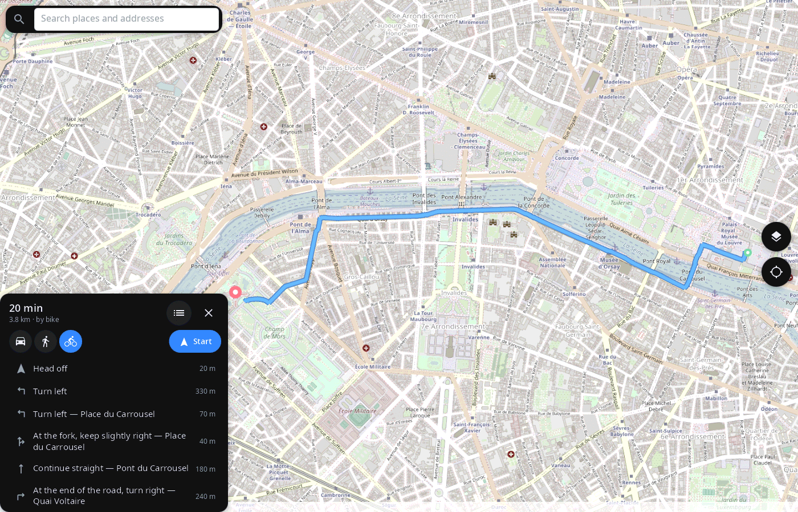
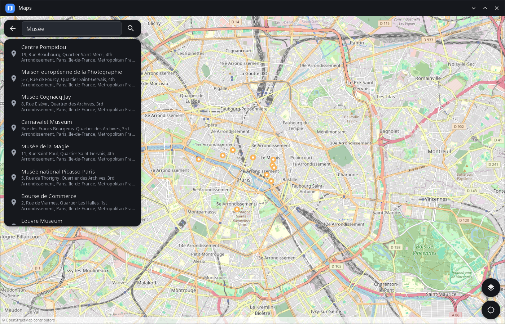
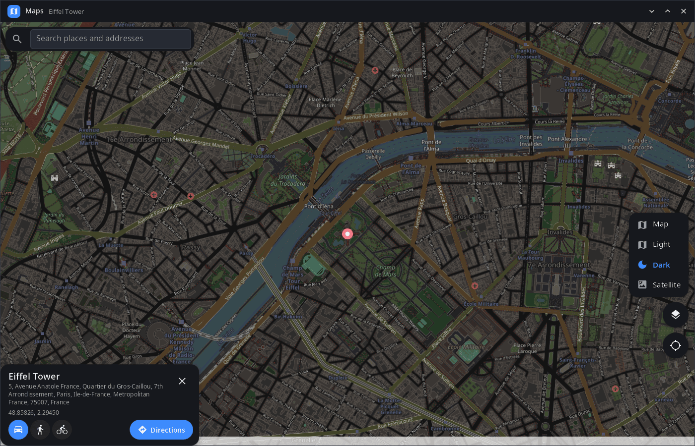

<div align="center">

# syn-maps

**Maps for the synshell desktop — OpenStreetMap with search, routes and your own location, on computers and phones.**

[Русский](README.ru.md) · [Website](https://alexeyev.dev/synshell/syn-maps/) · [AUR: syn-maps-bin](https://aur.archlinux.org/packages/syn-maps-bin) · [AUR: syn-maps-git](https://aur.archlinux.org/packages/syn-maps-git)



</div>

## Features

- **Map** — OpenStreetMap with smooth zoom by wheel, pinch and gestures; tiles are cached on disk.
- **Layers** — Map, Light and Dark (OpenStreetMap under a filter) and Satellite (Esri World Imagery).
- **Search** — places and addresses via Nominatim, nearest to the visible area first, names in the interface language.
- **Any point** — long press (right click with a mouse) drops a pin and looks up its address; the card shows coordinates.
- **Routes** — by car, on foot or by bike (OSRM servers of FOSSGIS): time, distance and a list of turns with street names; a tap on a turn shows it on the map.
- **Navigation** — “Start” follows your position and shows the next maneuver with the distance to it and to the end.
- **Your location** — from GeoClue (on a phone — satellites through the modem); the map follows you until you move it.
- **geo: links** — opens `geo:` links from other applications (`x-scheme-handler/geo`).
- **Phone and desktop layout** — full-width cards on a phone, a side column on a wide window; the last view and layer are remembered.
- **14 languages** — the UI follows the system or the language chosen in synshell.

| Search | Place, dark layer |
|---|---|
|  |  |

## Install

**Arch Linux (AUR)** — x86_64 and aarch64:

```sh
yay -S syn-maps-bin      # prebuilt
yay -S syn-maps-git      # built from source
```

Depends on `synshell-core`. Your own location needs `geoclue`. Map tiles, search and routes need an internet connection.

syn-maps is part of the `synshell` metapackage — the whole desktop: `yay -S synshell-bin`. **From source:** `cargo build --release -p syn-maps` in the [synshell](../../README.md) repository.

## Command line

```sh
syn-maps                                  # last view (or your location)
syn-maps 'geo:48.8584,2.2945?z=17'        # open a point
syn-maps --screenshot shot.png --size 1400x900 --page route   # render a view to PNG without a window
```

## Part of synshell

syn-maps is one of the applications of [synshell](../../README.md) — a Wayland desktop environment in Rust for computers and phones, built on the [syngui](https://github.com/VitaminDB/syngui) UI framework.

## License

GPL-3.0-only
