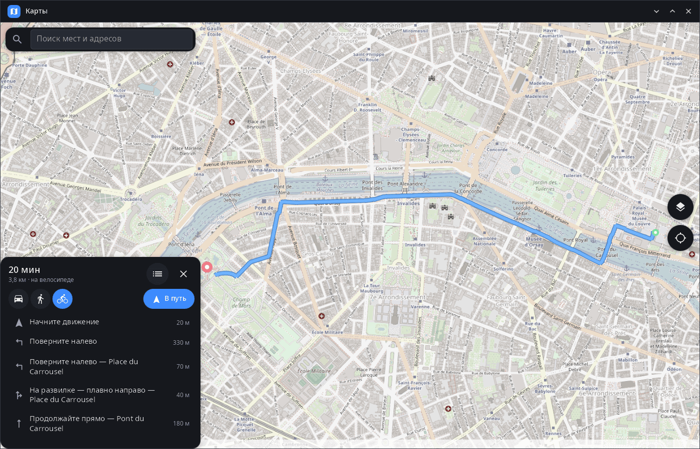
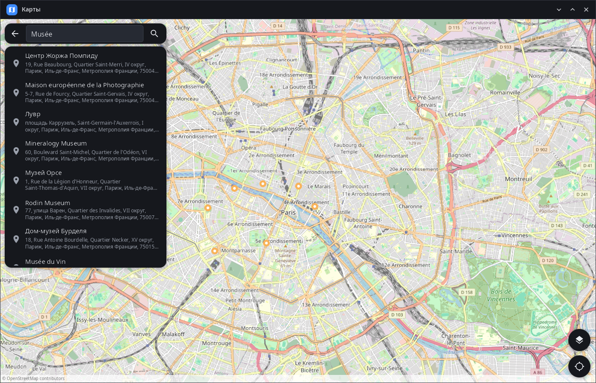
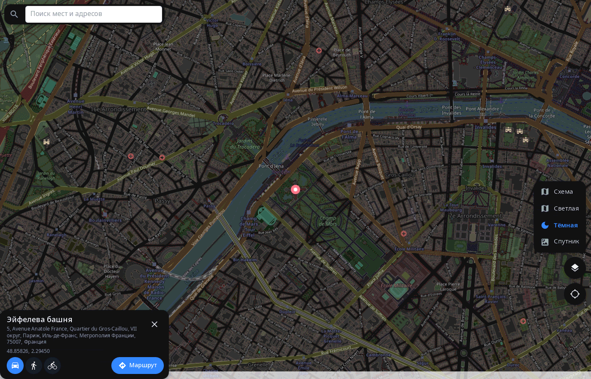

<div align="center">

# syn-maps

**Карты рабочего стола synshell — OpenStreetMap с поиском, маршрутами и своим местоположением, на компьютере и телефоне.**

[English](README.md) · [Сайт](https://alexeyev.dev/ru/synshell/) · [AUR: syn-maps-bin](https://aur.archlinux.org/packages/syn-maps-bin) · [AUR: syn-maps-git](https://aur.archlinux.org/packages/syn-maps-git)



</div>

## Возможности

- **Карта** — OpenStreetMap с плавным масштабом колесом, щипком и жестами; плитки хранятся в кэше на диске.
- **Слои** — «Схема», «Светлая» и «Тёмная» (OpenStreetMap под фильтром) и «Спутник» (Esri World Imagery).
- **Поиск** — места и адреса через Nominatim, сначала ближайшие к видимой части карты, названия на языке интерфейса.
- **Любая точка** — долгое нажатие (правая кнопка мыши) ставит метку и находит адрес; в карточке — координаты.
- **Маршруты** — на машине, пешком и на велосипеде (серверы OSRM FOSSGIS): время, расстояние и список поворотов с названиями улиц; нажатие на поворот показывает его на карте.
- **В пути** — «В путь» следит за положением и показывает следующий манёвр, расстояние до него и до конца.
- **Своё место** — от GeoClue (на телефоне — спутники через модем); карта следует за вами, пока её не сдвинуть.
- **Ссылки geo:** — открывает ссылки `geo:` из других программ (`x-scheme-handler/geo`).
- **Телефон и компьютер** — на телефоне карточки во всю ширину, в широком окне — столбцом сбоку; последний вид и слой запоминаются.
- **14 языков** — как в системе или язык, выбранный в synshell.

| Поиск | Место, тёмный слой |
|---|---|
|  |  |

## Установка

**Arch Linux (AUR)** — x86_64 и aarch64:

```sh
yay -S syn-maps-bin      # готовые бинарники
yay -S syn-maps-git      # сборка из исходников
```

Зависит от `synshell-core`. Для своего местоположения нужен `geoclue`. Плиткам, поиску и маршрутам нужен интернет.

syn-maps входит в метапакет `synshell` — весь рабочий стол: `yay -S synshell-bin`. **Из исходников:** `cargo build --release -p syn-maps` в репозитории [synshell](../../README.md).

## Командная строка

```sh
syn-maps                                  # последний вид (или своё место)
syn-maps 'geo:48.8584,2.2945?z=17'        # открыть точку
syn-maps --screenshot shot.png --size 1400x900 --page route   # вид в PNG без окна
```

## Часть synshell

syn-maps — одно из приложений [synshell](../../README.md): окружения рабочего стола для Wayland на Rust для компьютеров и телефонов, на UI-фреймворке [syngui](https://github.com/VitaminDB/syngui).

## Лицензия

GPL-3.0-only
