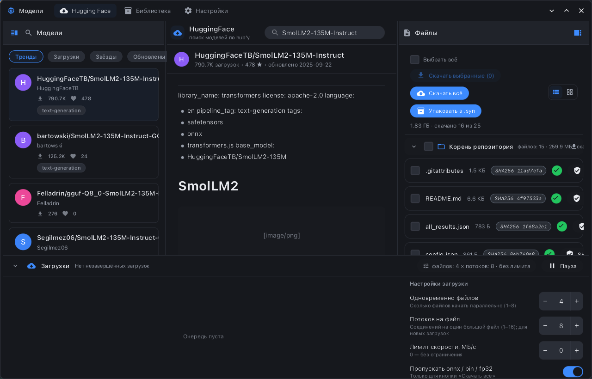
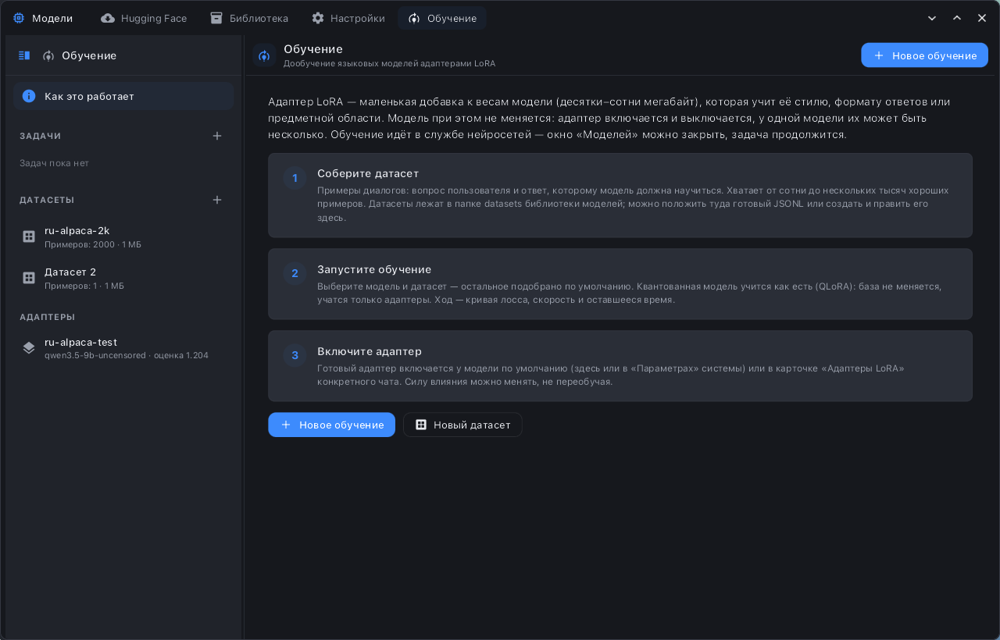
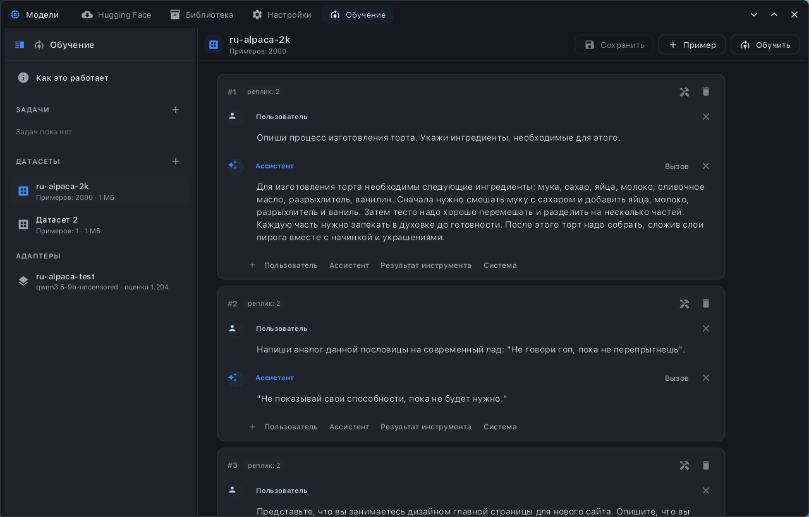
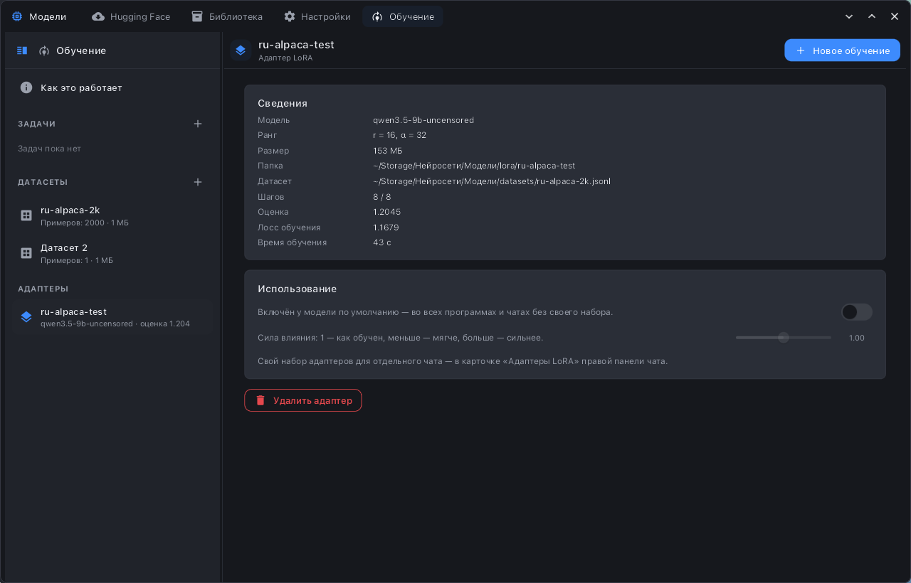
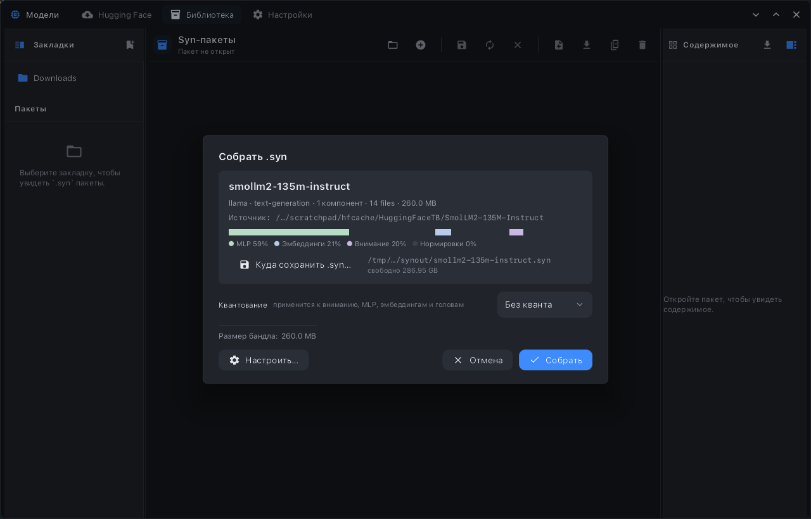
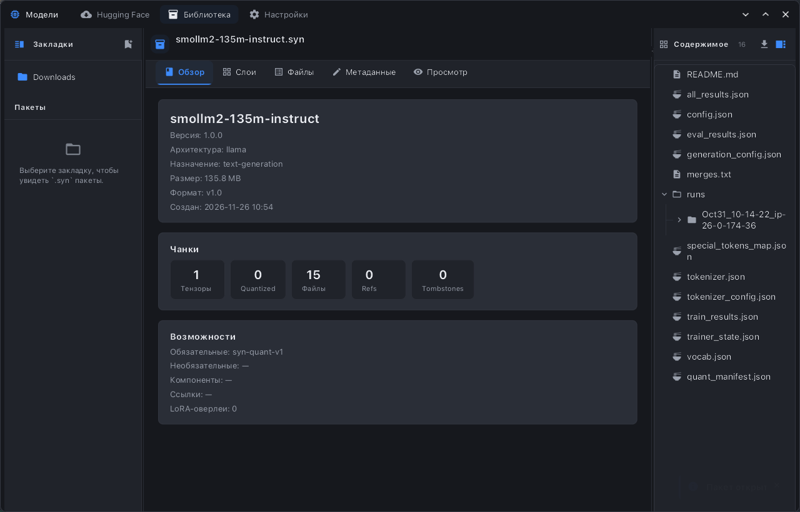
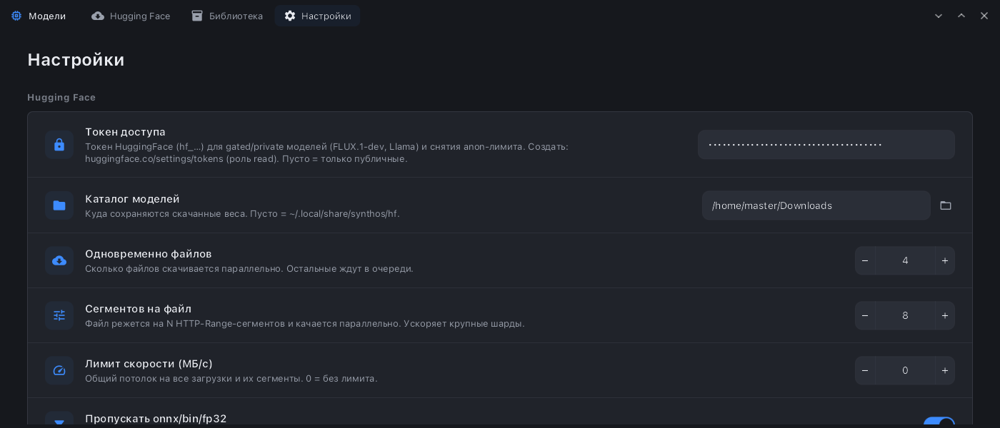

# syn-models

**Models for the synshell desktop — Hugging Face search and downloads, a library of `.syn` model packages, packing models into them and LoRA training (quantization and training run in the synaptixd neural service).**

[Русский](README.ru.md) · [Website](https://alexeyev.dev/synshell/syn-models/)

## Features

One window with four sections — tabs in the title bar, Ctrl+1 … Ctrl+4 (Hugging Face, Library, Settings, Training); `syn-models --page training` opens straight on Training.

- **Hugging Face** — search the Hub sorted by trending, downloads, likes or last update; the model's README and its file list with sizes and SHA256.
- **Download queue** — several files at once, up to 16 HTTP Range segments per file, one shared speed limit, pause; the queue continues after a restart, and every file is checked against its SHA256. “Download all” skips onnx, openvino, fp32 and `.bin` copies of the weights.
- **GGUF** — GGUF models download like any other and can be converted from `.gguf` to `.syn`.
- **Access token** — for gated and private models; the field stays hidden.
- **Library** — bookmarked folders with `.syn` packages; an opened package shows an overview (architecture, purpose, size, format), layers, files, metadata and a preview.
- **Packing into `.syn`** — a wizard shows what the model is made of and packs it with quantization (NVFP4, MXFP8, SQ8 / SQ6 / SQ5 and others). The quantization itself is computed on the GPU by the synshell neural service synaptixd.
- **One step from download to package** — “Pack into .syn” on a downloaded model opens the packing wizard in the Library right away.
- **Training** — fine-tuning language models with LoRA adapters: an overview of how it works, training jobs with a live loss chart, speed and time left, datasets with an editor and a check against the model's own tokenizer, and the adapters themselves — switch one on by default for a model, set its strength without retraining, delete it. A quantized model is trained as is (QLoRA). Training runs in the synaptixd service, so the window can be closed while a job runs. In synthos adapters are still switched on per chat in the chat's LoRA card, which links here.
- **Settings** — token, download cache, parallel files, segments per file, speed limit, formats to skip and the packages folder.
- **System Settings** — Neural networks → Model storage has an “Open Models” button.

| Training: how it works | Dataset editor | LoRA adapter |
|---|---|---|
|  |  |  |

Checked end to end: search for SmolLM2-135M-Instruct → download 260 MB → pack with MXFP8 into a 142 MB `.syn` → synaptixd loads the package and the model answers correctly.

| Packing wizard | Library | Settings |
|---|---|---|
|  |  |  |

Screenshots show the Russian interface.

## Install

The `syn-models` package belongs to the `synshell-apps` group and depends on `synshell-core`; the `synshell` metapackage installs it with the rest of the desktop. Packing with quantization needs the `synaptix` service. **From source:** `cargo build --release -p syn-models` in the [synshell](../../README.md) repository.

## Where it came from

The Hugging Face, Syn packages and LoRA training pages used to live inside [synthos](https://github.com/VitaminDB/synthos). They moved to synshell as this program; on first start it takes over the synthos settings and the unfinished download queue.

## Part of synshell

syn-models is one of the applications of [synshell](../../README.md) — a Wayland desktop environment in Rust for computers and phones, built on the [syngui](https://github.com/VitaminDB/syngui) UI framework.

## License

GPL-3.0-only
