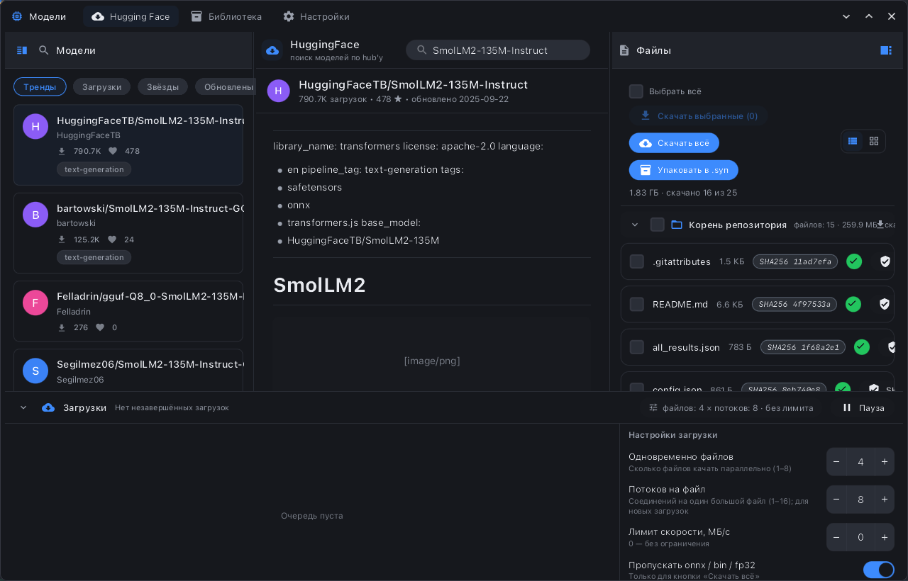
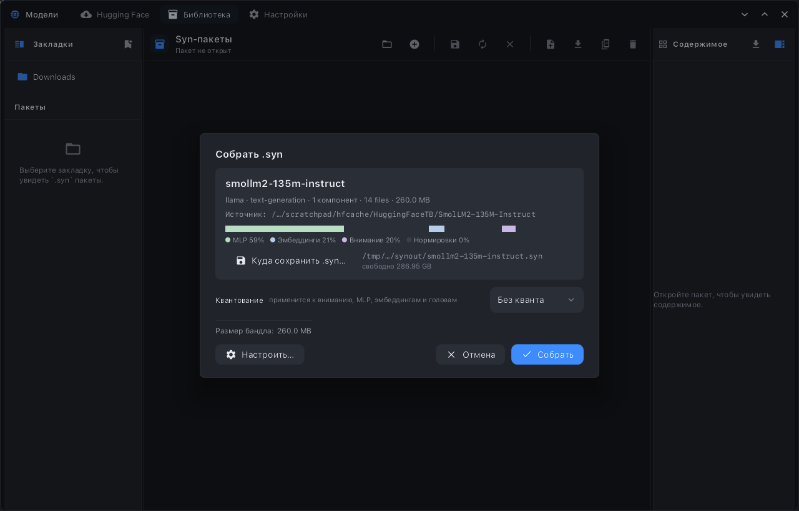
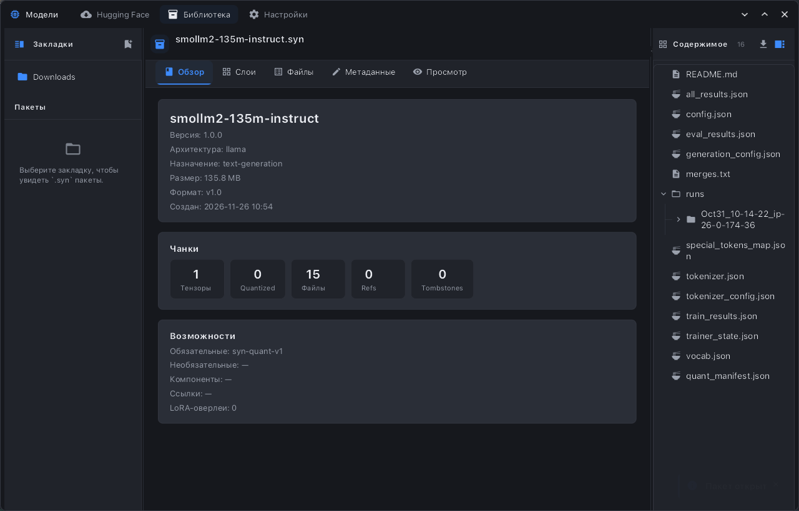
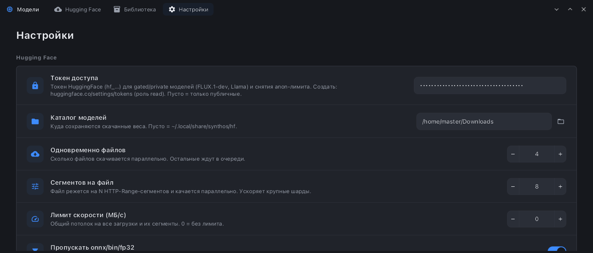

# syn-models

**«Модели» для рабочего стола synshell — поиск и загрузка моделей с Hugging Face, библиотека пакетов `.syn`, упаковка моделей в них и обучение LoRA (квантование и обучение считает служба нейросетей synaptixd).**

[English](README.md) · [Сайт](https://alexeyev.dev/ru/synshell/syn-models/)

## Возможности

Одно окно с четырьмя разделами — вкладки в заголовке, Ctrl+1 … Ctrl+4 (Hugging Face, Библиотека, Настройки, Обучение); `syn-models --page training` открывает сразу «Обучение».

- **Hugging Face** — поиск по Hub с сортировкой по трендам, загрузкам, звёздам или дате обновления; README модели и список файлов с размерами и SHA256.
- **Очередь загрузок** — несколько файлов одновременно, до 16 сегментов HTTP Range на файл, общий лимит скорости, пауза; после перезапуска очередь продолжается, каждый файл сверяется по SHA256. «Скачать всё» пропускает onnx, openvino, fp32 и копии весов в `.bin`.
- **GGUF** — модели GGUF скачиваются как остальные, и их можно перевести из `.gguf` в `.syn`.
- **Токен доступа** — для закрытых (gated) и частных моделей; поле скрыто.
- **Библиотека** — закладки папок с пакетами `.syn`; у открытого пакета — обзор (архитектура, назначение, размер, формат), слои, файлы, метаданные и просмотр.
- **Упаковка в `.syn`** — мастер показывает состав модели и собирает пакет с квантованием (NVFP4, MXFP8, SQ8 / SQ6 / SQ5 и другие). Само квантование считает на видеокарте служба нейросетей synshell — synaptixd.
- **От загрузки до пакета в один шаг** — кнопка «Упаковать в .syn» в карточке скачанной модели сразу открывает мастер упаковки в Библиотеке.
- **Обучение** — дообучение языковых моделей адаптерами LoRA: обзор того, как это устроено, задачи обучения с живым графиком лосса, скоростью и оставшимся временем, датасеты с редактором и проверкой токенизатором самой модели, и сами адаптеры — включение по умолчанию для модели, сила без повторного обучения, удаление. Квантованная модель обучается как есть (QLoRA). Обучение идёт в службе synaptixd, поэтому окно можно закрыть, задача продолжится. В synthos адаптеры по-прежнему включаются для отдельного чата в его карточке LoRA, оттуда кнопка ведёт сюда.
- **Настройки** — токен, кэш загрузок, сколько файлов качать параллельно, сегменты на файл, лимит скорости, пропускаемые форматы и папка пакетов.
- **«Параметры системы»** — в разделе Нейросети → Хранилище моделей есть кнопка «Открыть «Модели»».

Проверено целиком: поиск SmolLM2-135M-Instruct → загрузка 260 МБ → упаковка с MXFP8 в `.syn` на 142 МБ → synaptixd загружает пакет, модель отвечает верно.

| Мастер упаковки | Библиотека | Настройки |
|---|---|---|
|  |  |  |

## Установка

Пакет `syn-models` входит в группу `synshell-apps` и зависит от `synshell-core`; метапакет `synshell` ставит его вместе со всем рабочим столом. Для упаковки с квантованием нужна служба `synaptix`. **Из исходников:** `cargo build --release -p syn-models` в репозитории [synshell](../../README.ru.md).

## Откуда взялась

Страницы Hugging Face, Syn-пакетов и обучения LoRA раньше были внутри [synthos](https://github.com/VitaminDB/synthos). Они переехали в synshell отдельной программой; при первом запуске она забирает настройки и незавершённую очередь загрузок из synthos.

## Часть synshell

syn-models — одно из приложений [synshell](../../README.ru.md): окружения рабочего стола для Wayland на Rust для компьютеров и телефонов, на UI-фреймворке [syngui](https://github.com/VitaminDB/syngui).

## Лицензия

GPL-3.0-only
