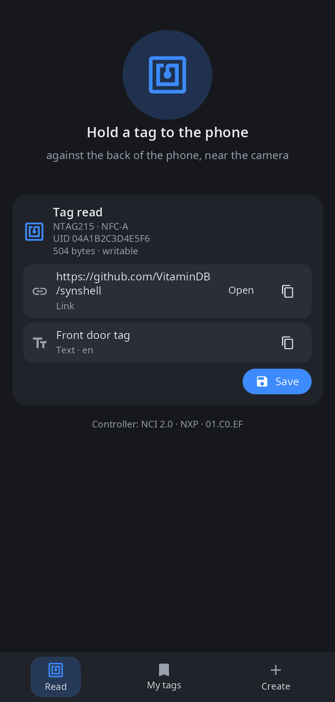
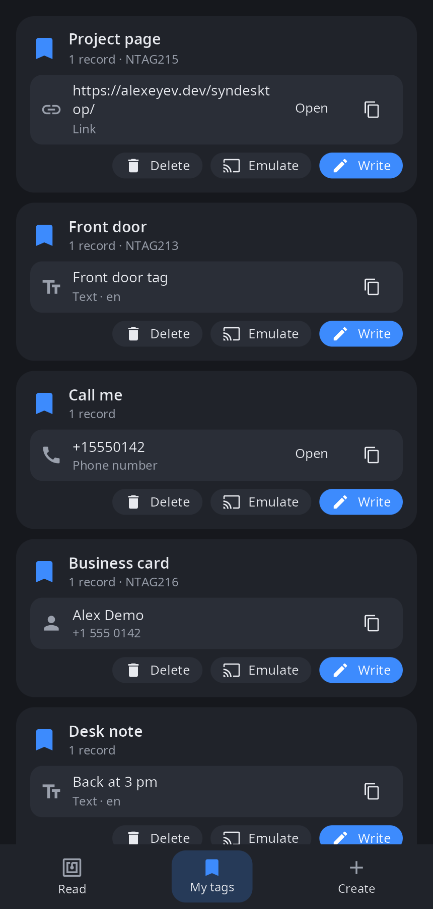
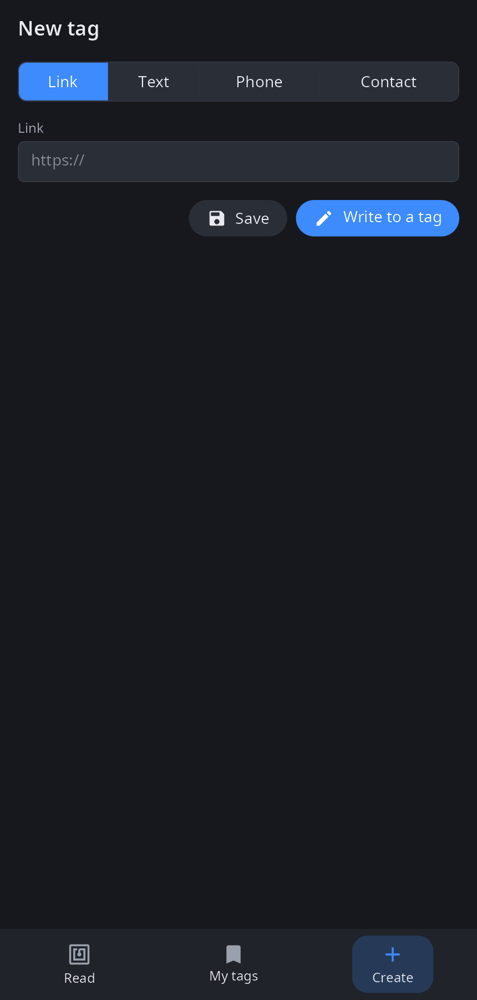

<div align="center">

# syn-nfc

**NFC app for synshell on phones — read tags, keep them, write your own and let the phone act as a tag.**

[Русский](README.ru.md) · [Website](https://alexeyev.dev/syndesktop/) · [AUR: synshell-mobile-bin](https://aur.archlinux.org/packages/synshell-mobile-bin) · [AUR: synshell-mobile-git](https://aur.archlinux.org/packages/synshell-mobile-git)



</div>

## Features

- **Read** — tag type, technology, UID, size and whether it is writable; NDEF records are shown as links, text, phone numbers, e-mail and contacts (vCard), with “Open” and “Copy”. MIFARE Classic cards show only the UID (their data is protected by keys).
- **My tags** — save a read tag under its own name; delete, write it to another tag or emulate it.
- **Create** — a new tag with a link, text, phone number or contact; save it or write it straight to a tag.
- **Write** — NDEF onto writable tags; the app waits for the tag and reports the result.
- **Emulation** — the phone answers a reader as an NFC Forum Type 4 tag while the app is open.
- **14 languages** — follows the system language.

| My tags | Create |
|---|---|
|  |  |

## Requirements

A phone with an NFC controller available as a character device (NXP `nfc_i2c`, `/dev/nq-nci` and similar). The chip is driven by `synnfcd`, the synshell NFC daemon with its own NCI stack (no Linux NFC subsystem needed). Without a controller the app reports “NFC controller not found”. Saved tags: `~/.local/share/synshell/nfc/tags.json`.

## Install

**Arch Linux (AUR)** — x86_64 and aarch64. syn-nfc is part of the `synshell-mobile` package together with `synnfcd` and its systemd unit `synnfc.service`:

```sh
yay -S synshell-mobile-bin      # prebuilt
yay -S synshell-mobile-git      # built from source
```

Depends on `synshell-core`. **From source:** `cargo build --release -p syn-nfc` in the [synshell](../../README.md) repository.

## Command line

```sh
syn-nfc                                     # the app
syn-nfc --screenshot out.png --tab 1        # window snapshot: 0 — read, 1 — my tags, 2 — create
SYN_NFC_DEMO=1 syn-nfc                      # without the daemon: a sample read tag
```

## Part of synshell

syn-nfc is one of the applications of [synshell](../../README.md) — a Wayland desktop environment in Rust for computers and phones, built on the [syngui](https://github.com/VitaminDB/syngui) UI framework.

## License

GPL-3.0-only
