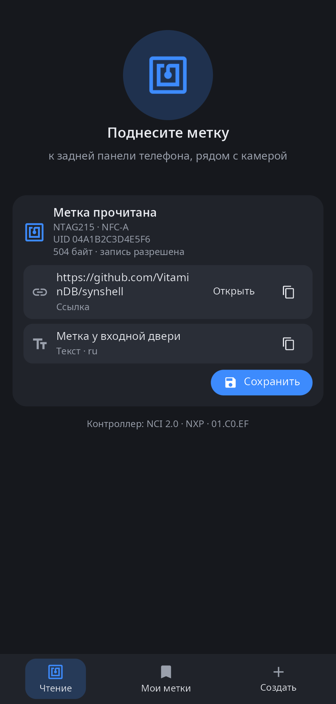
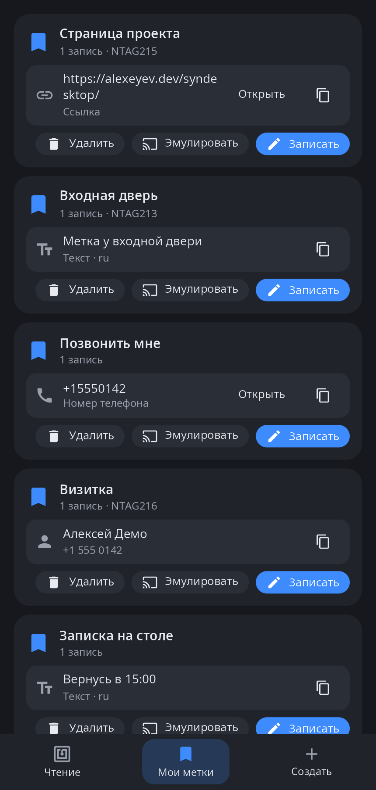
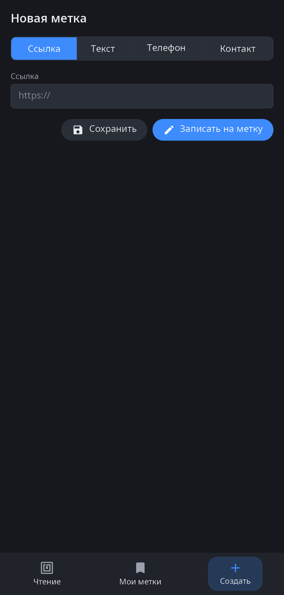

<div align="center">

# syn-nfc

**NFC в synshell для телефонов — чтение меток, свои сохранённые метки, запись и эмуляция метки телефоном.**

[English](README.md) · [Сайт](https://alexeyev.dev/ru/synshell/syn-nfc/) · [AUR: synshell-mobile-bin](https://aur.archlinux.org/packages/synshell-mobile-bin) · [AUR: synshell-mobile-git](https://aur.archlinux.org/packages/synshell-mobile-git)



</div>

## Возможности

- **Чтение** — тип метки, технология, UID, объём и можно ли на неё писать; записи NDEF показываются как ссылки, текст, номера телефонов, почта и контакты (vCard), с кнопками «Открыть» и «Копировать». У карт MIFARE Classic — только UID (данные защищены ключами).
- **Мои метки** — прочитанную метку можно сохранить под своим именем; удалить, записать на другую метку или эмулировать.
- **Создание** — новая метка со ссылкой, текстом, номером телефона или контактом; сохранить или сразу записать.
- **Запись** — NDEF на записываемые метки; программа ждёт метку и сообщает результат.
- **Эмуляция** — пока программа открыта, телефон отвечает считывателю как метка NFC Forum Type 4.
- **14 языков** — как в системе.

| Мои метки | Создание |
|---|---|
|  |  |

## Что нужно

Телефон с контроллером NFC, доступным как символьное устройство (NXP `nfc_i2c`, `/dev/nq-nci` и подобные). Чипом управляет `synnfcd` — демон NFC synshell со своим стеком NCI (подсистема NFC ядра Linux не нужна). Без контроллера программа сообщает «Контроллер NFC не найден». Сохранённые метки — `~/.local/share/synshell/nfc/tags.json`.

## Установка

**Arch Linux (AUR)** — x86_64 и aarch64. syn-nfc входит в пакет `synshell-mobile` вместе с `synnfcd` и его службой systemd `synnfc.service`:

```sh
yay -S synshell-mobile-bin      # готовые бинарники
yay -S synshell-mobile-git      # сборка из исходников
```

Зависит от `synshell-core`. **Из исходников:** `cargo build --release -p syn-nfc` в репозитории [synshell](../../README.md).

## Командная строка

```sh
syn-nfc                                     # программа
syn-nfc --screenshot out.png --tab 1        # снимок окна: 0 — чтение, 1 — мои метки, 2 — создание
SYN_NFC_DEMO=1 syn-nfc                      # без демона: пример прочитанной метки
```

## Часть synshell

syn-nfc — одно из приложений [synshell](../../README.md): окружения рабочего стола для Wayland на Rust для компьютеров и телефонов, на UI-фреймворке [syngui](https://github.com/VitaminDB/syngui).

## Лицензия

GPL-3.0-only
