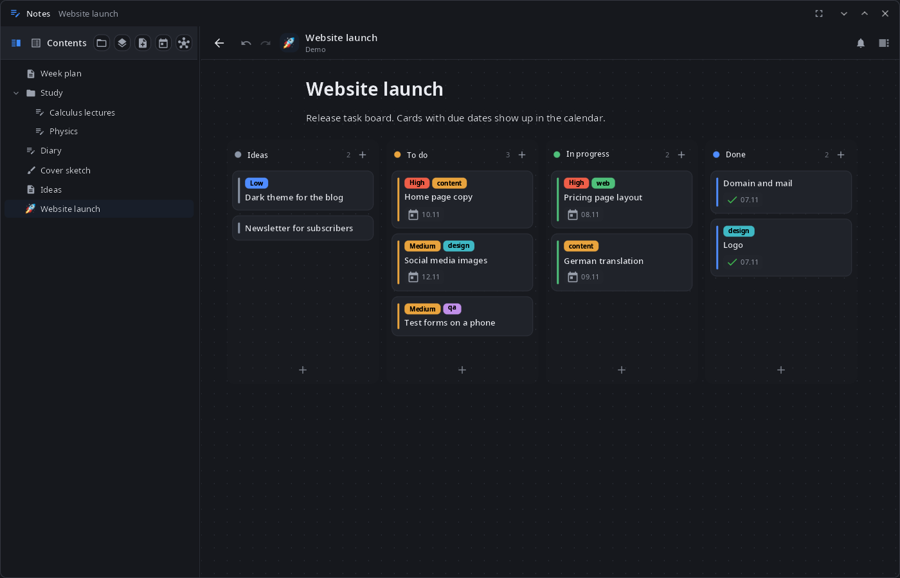
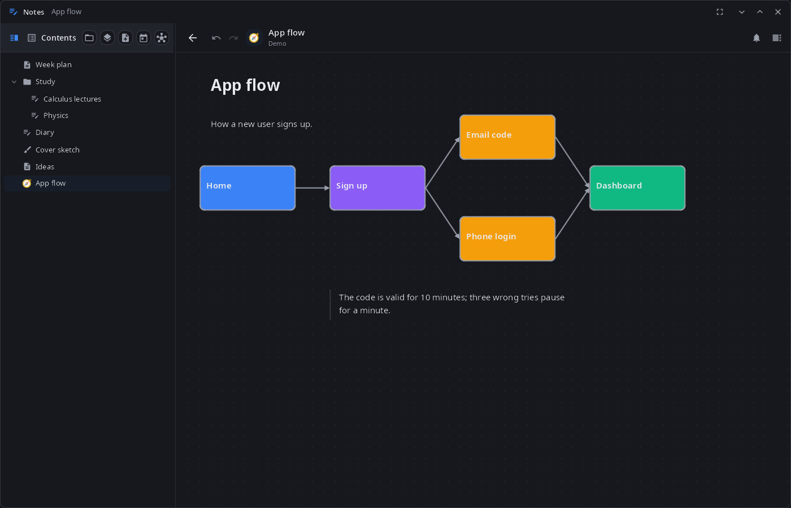
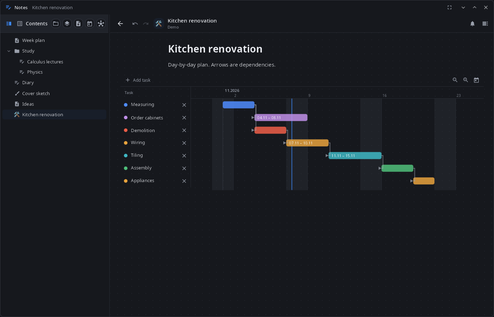
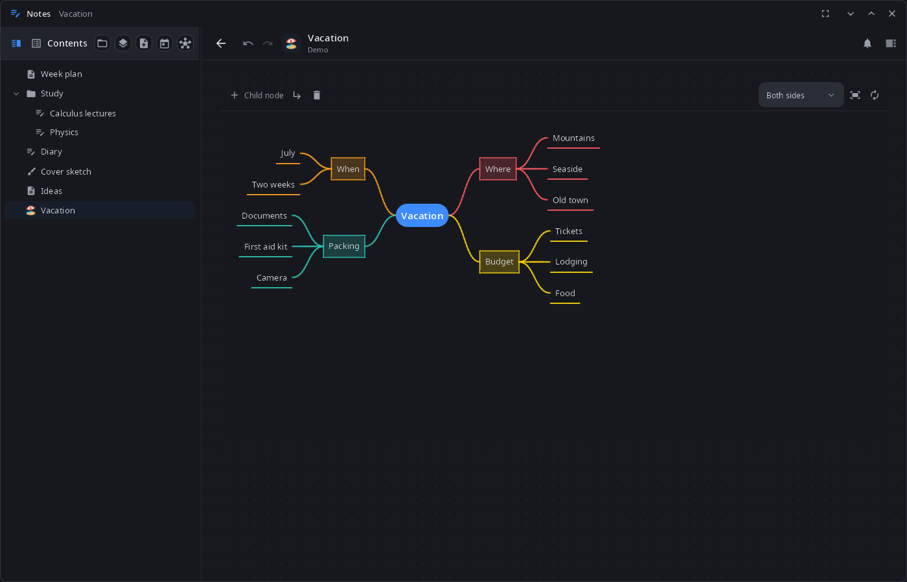
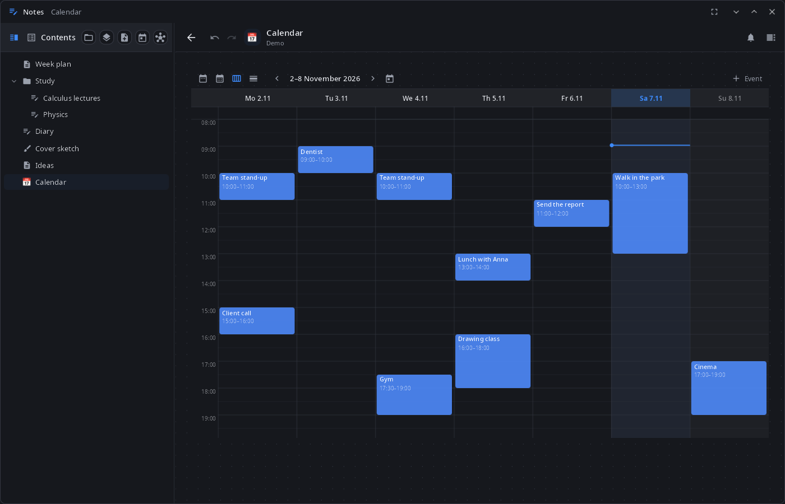

<div align="center">

# syn-notes

**Notes for the synshell desktop — pages and free canvases with kanban boards, Gantt charts, mind maps, a calendar and charts, handwriting and a book reader, all in one `.syn` project file.**

[Русский](README.ru.md) · [Website](https://alexeyev.dev/syndesktop/) · [AUR: syn-notes-bin](https://aur.archlinux.org/packages/syn-notes-bin) · [AUR: syn-notes-git](https://aur.archlinux.org/packages/syn-notes-git)



</div>

## Features

- **Projects** — a project is one `.syn` file with all its pages, objects and attachments; several projects can be open at once; changes are saved automatically. The home screen lists notebooks, drawings, books, documents and folders, with search by title.
- **Pages** — a block editor on top of Markdown: headings, lists, to-dos, toggles, callouts, quotes, code, tables, images, audio and video. Any page can become a free canvas: blocks anywhere, shapes and arrows, a grid with snapping.
- **Kanban boards** — columns and cards with priority, tags, due dates, repeats and attached files; an archive; column timers that archive or move old cards.
- **Gantt charts** — tasks with dependencies and zoom; board cards with dates can show up as chart rows.
- **Mind maps** — built from a list and turned back into one; layout to the right, left, both sides, down or radial; colors, icons, notes, links between nodes.
- **Calendar** — year, month, week and day views; events with repeats; card due dates and Gantt tasks on the same calendar.
- **Charts** — line, bar, pie, radar and gauge, also made from a table on the page.
- **Reminders** — card due dates and events come as system notifications with “Open”, “Done” and “In an hour”; they work while the window is closed (the app stays in the background with the session).
- **Handwriting** — notebooks with fixed-size pages and templates, endless drawings with layers; pen, eraser, lasso, shape recognition by holding the pen; tuned for E Ink screens.
- **Book reader** — PDF, EPUB, FB2, TXT and Markdown: table of contents, bookmarks, search, highlights with notes, pen marks over the page.
- **Links** — `[[wiki links]]` between pages, backlinks and a link graph; `![[Page]]` embeds another page.
- **Text files** — TXT, Markdown, source code and configs open in Notes for editing and are saved back in their original encoding and line endings.
- **Assistant** — the synshell assistant reads and edits pages, boards, charts and the calendar in the open window; its changes go to the project's change log, and a replaced page text can be undone with Ctrl+Z.
- **14 languages** — the UI follows the language of the system or the one chosen in System Settings.

| Canvas | Gantt chart | Mind map |
|---|---|---|
|  |  |  |



## Install

**Arch Linux (AUR)** — x86_64 and aarch64:

```sh
yay -S syn-notes-bin      # prebuilt
yay -S syn-notes-git      # built from source
```

Depends on `synshell-core`. Optional: `poppler-glib` (PDF in the reader). Part of the `synshell` metapackage: `yay -S synshell-bin` installs the whole desktop. **From source:** `cargo build --release -p syn-notes` in the [synshell](../../README.md) repository.

## Command line

```sh
syn-notes                          # show the window
syn-notes --background             # start without a window (done by the session: autosave, reminders)
syn-notes open "Week plan"         # open a page by title
syn-notes open ~/Notes/Work.syn    # open a project
syn-notes notes.md main.rs         # edit text files
syn-notes --screenshot shot.png --size 1400x900 --open kanban
                                   # window snapshot on a demo project in a temporary folder
                                   # (--open: canvas, kanban, gantt, mindmap, calendar, notebook, drawing, doc, settings)
```

A running copy receives the command and shows the page; the new process only passes it on and exits.

## Part of synshell

syn-notes is one of the applications of [synshell](../../README.md) — a Wayland desktop environment in Rust for computers and phones, built on the [syngui](https://github.com/VitaminDB/syngui) UI framework.

## License

GPL-3.0-only
