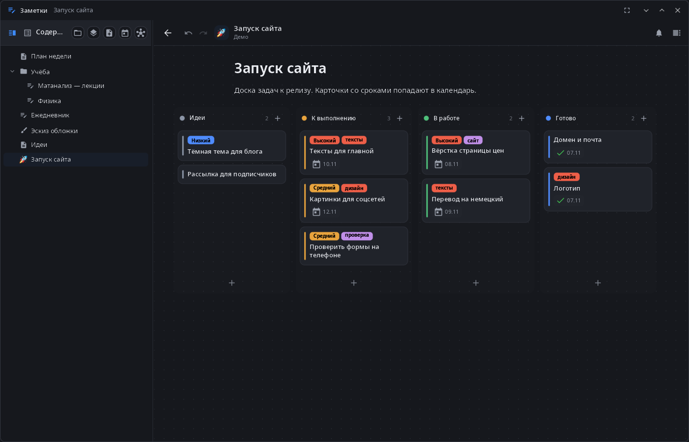
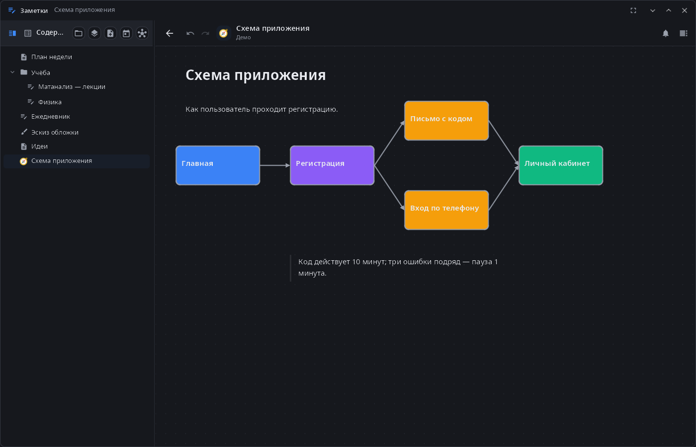
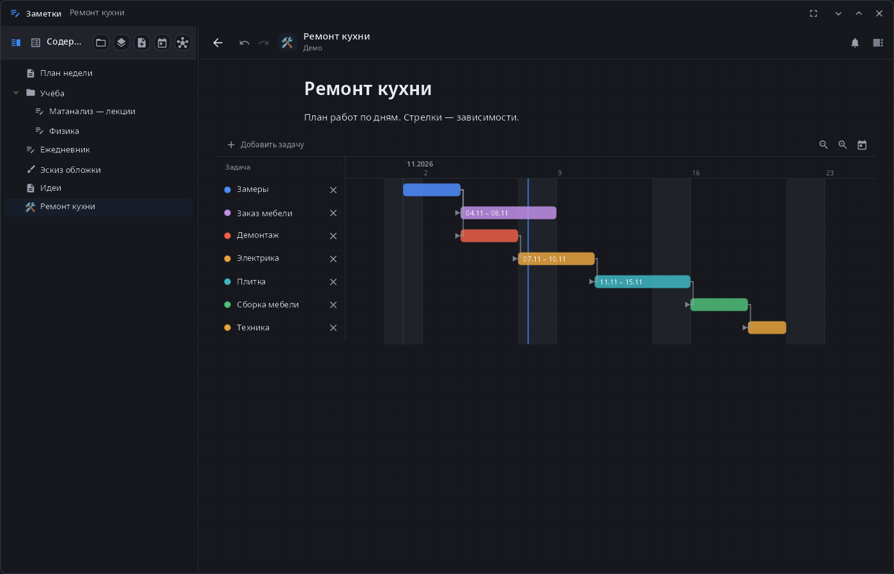
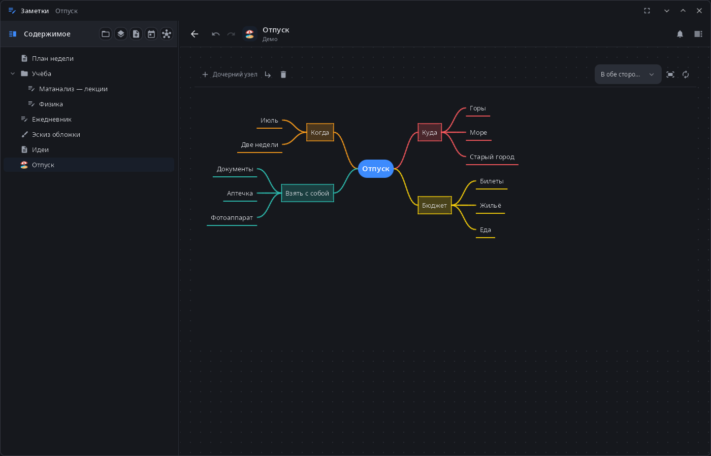
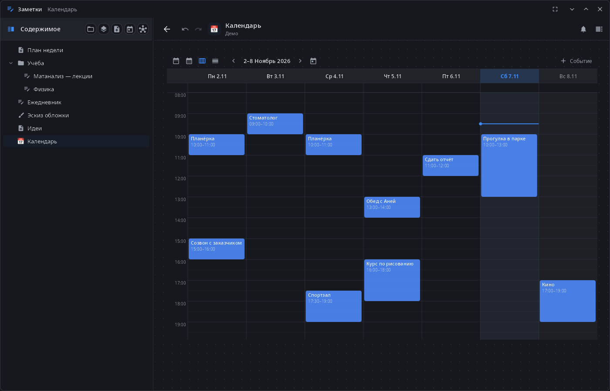

<div align="center">

# syn-notes

**Заметки рабочего стола synshell — страницы и свободные холсты с канбан-досками, диаграммами Ганта, картами мыслей, календарём и графиками, рукописный ввод и читалка книг в одном файле проекта `.syn`.**

[English](README.md) · [Сайт](https://alexeyev.dev/ru/synshell/) · [AUR: syn-notes-bin](https://aur.archlinux.org/packages/syn-notes-bin) · [AUR: syn-notes-git](https://aur.archlinux.org/packages/syn-notes-git)



</div>

## Возможности

- **Проекты** — проект целиком в одном файле `.syn`: страницы, объекты и вложения; открыто может быть несколько проектов сразу; изменения сохраняются сами. На главном экране — блокноты, рисунки, книги, документы и папки, поиск по названию.
- **Страницы** — блочный редактор поверх Markdown: заголовки, списки, задачи, раскрывающиеся блоки, выноски, цитаты, код, таблицы, картинки, звук и видео. Любую страницу можно сделать свободным холстом: блоки в любом месте, фигуры и стрелки, сетка с привязкой.
- **Канбан-доски** — колонки и карточки с приоритетом, метками, сроками, повторами и прикреплёнными файлами; архив; таймеры колонок, которые убирают в архив или переносят старые карточки.
- **Диаграммы Ганта** — задачи с зависимостями и масштабом; карточки досок со сроками могут стать строками диаграммы.
- **Карты мыслей** — из списка и обратно в список; раскладка вправо, влево, в обе стороны, вниз или по кругу; цвета, значки, заметки, связи между узлами.
- **Календарь** — год, месяц, неделя и день; события с повторами; сроки карточек и задачи Ганта в том же календаре.
- **Графики** — линии, столбцы, круговая, радар и шкала, в том числе из таблицы на странице.
- **Напоминания** — сроки карточек и события приходят системными уведомлениями с кнопками «Открыть», «Готово» и «Через час»; работают и при закрытом окне (программа остаётся в фоне на весь сеанс).
- **Рукописный ввод** — блокноты со страницами фиксированного формата и шаблонами, бесконечные рисунки со слоями; перо, ластик, лассо, распознавание фигур удержанием пера; рассчитано на экраны E Ink.
- **Читалка книг** — PDF, EPUB, FB2, TXT и Markdown: оглавление, закладки, поиск, выделения маркером с заметками, пометки пером поверх страницы.
- **Связи** — `[[вики-ссылки]]` между страницами, обратные ссылки и граф связей; `![[Страница]]` встраивает другую страницу.
- **Текстовые файлы** — TXT, Markdown, исходники и конфиги открываются в Заметках на редактирование и сохраняются обратно в исходной кодировке и с теми же концами строк.
- **Ассистент** — ассистент synshell читает и правит страницы, доски, графики и календарь прямо в открытом окне; его правки попадают в журнал изменений проекта, а заменённый текст страницы возвращается по Ctrl+Z.
- **14 языков** — как в системе или язык, выбранный в «Параметрах системы».

| Холст | Диаграмма Ганта | Карта мыслей |
|---|---|---|
|  |  |  |



## Установка

**Arch Linux (AUR)** — x86_64 и aarch64:

```sh
yay -S syn-notes-bin      # готовые бинарники
yay -S syn-notes-git      # сборка из исходников
```

Зависит от `synshell-core`. Дополнительно: `poppler-glib` (PDF в читалке). Входит в метапакет `synshell`: `yay -S synshell-bin` ставит весь рабочий стол. **Из исходников:** `cargo build --release -p syn-notes` в репозитории [synshell](../../README.md).

## Командная строка

```sh
syn-notes                          # показать окно
syn-notes --background             # запуск без окна (так запускает сеанс: автосохранение, напоминания)
syn-notes open "План недели"       # открыть страницу по названию
syn-notes open ~/Заметки/Работа.syn  # открыть проект
syn-notes notes.md main.rs         # править текстовые файлы
syn-notes --screenshot shot.png --size 1400x900 --open kanban
                                   # снимок окна на демо-проекте во временном каталоге
                                   # (--open: canvas, kanban, gantt, mindmap, calendar, notebook, drawing, doc, settings)
```

Уже запущенная копия получает команду и показывает страницу; новый процесс не остаётся.

## Часть synshell

syn-notes — одно из приложений [synshell](../../README.md): окружения рабочего стола для Wayland на Rust для компьютеров и телефонов, на UI-фреймворке [syngui](https://github.com/VitaminDB/syngui).

## Лицензия

GPL-3.0-only
