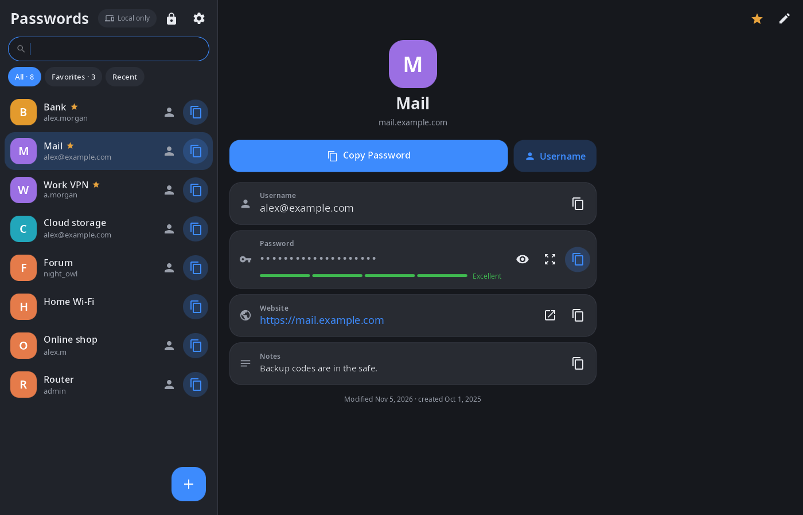
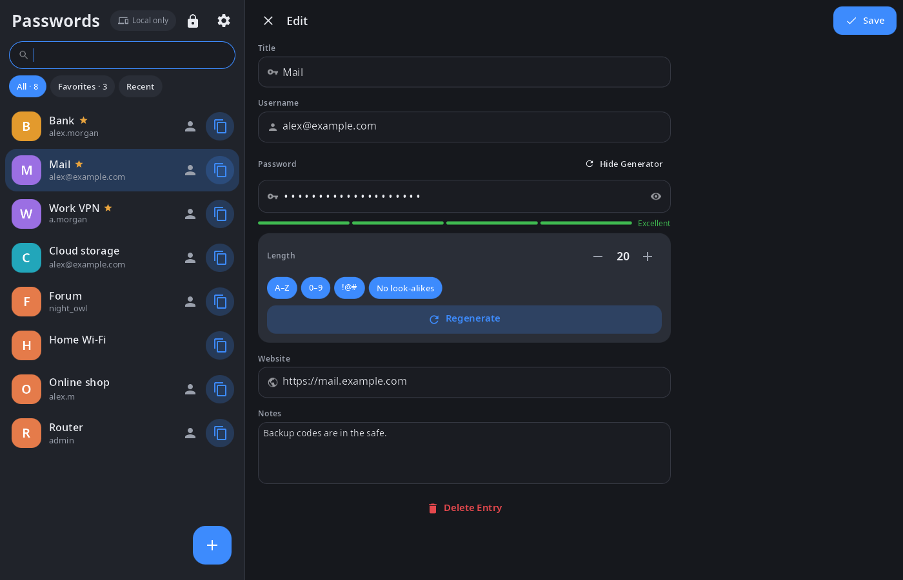
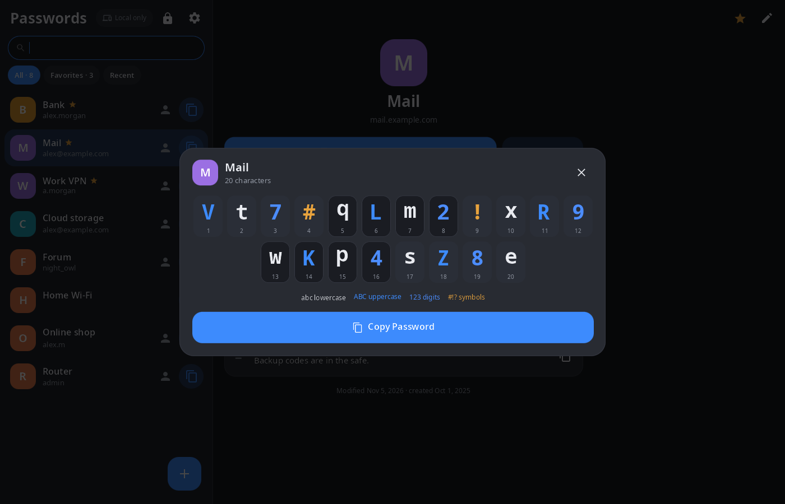
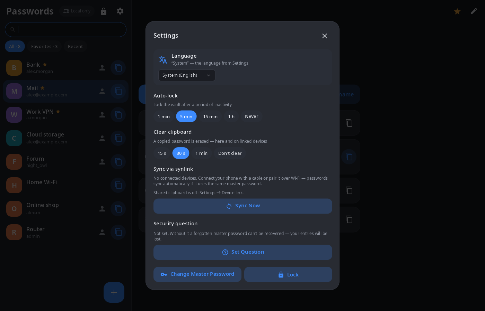

<div align="center">

# synpass

**Password manager for the synshell desktop — an encrypted vault under one master password, synced with your other synshell devices.**

[Русский](README.ru.md) · [Website](https://alexeyev.dev/syndesktop/) · [AUR: synpass-bin](https://aur.archlinux.org/packages/synpass-bin) · [AUR: synpass-git](https://aur.archlinux.org/packages/synpass-git)



</div>

## Features

- **Encryption** — the vault is one file (`~/.local/share/synpass/vault.json`): the key is derived from the master password with Argon2id, entries are encrypted with XChaCha20-Poly1305.
- **Entries** — title, username, password, website and notes; favorites, recently copied, search; copy the password or username in one click, open the website.
- **Generator** — length, uppercase letters, digits, symbols, no look-alike characters (0/O, 1/l/I); a strength meter.
- **Large view** — the password character by character with numbering and character classes, easy to type on another device.
- **Sync** — entries are merged with devices linked through synlink (phone, other computer) in both directions; deletions reach the other devices too. A copied password goes to the shared clipboard of linked devices.
- **Safety** — auto-lock after a period of inactivity, clipboard cleared after a set time (here and on linked devices), change of master password, an optional security question to recover access.
- **Computer and phone** — two columns on a wide window, list → entry on a phone; 14 languages.

| Editing with the generator | Large view | Settings |
|---|---|---|
|  |  |  |

The screenshots show a demo vault with made-up entries.

## Install

**Arch Linux (AUR)** — x86_64 and aarch64:

```sh
yay -S synpass-bin      # prebuilt
yay -S synpass-git      # built from source
```

Depends on `synshell-core`. Part of the `synshell` metapackage: `yay -S synshell-bin` installs the whole desktop. **From source:** `cargo build --release -p syn-pass` in the [synshell](../../README.md) repository.

## Command line

```sh
synpass                                             # open the window
SYNPASS_VAULT=~/other-vault.json synpass            # use another vault file
synpass --screenshot shot.png --size 1400x900 --view edit
                                                    # snapshot on a demo vault in memory
                                                    # (views: locked, list, edit, big, settings)
```

## Part of synshell

synpass is one of the applications of [synshell](../../README.md) — a Wayland desktop environment in Rust for computers and phones, built on the [syngui](https://github.com/VitaminDB/syngui) UI framework.

## License

GPL-3.0-only
