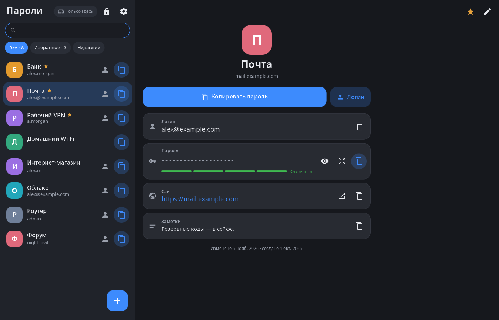
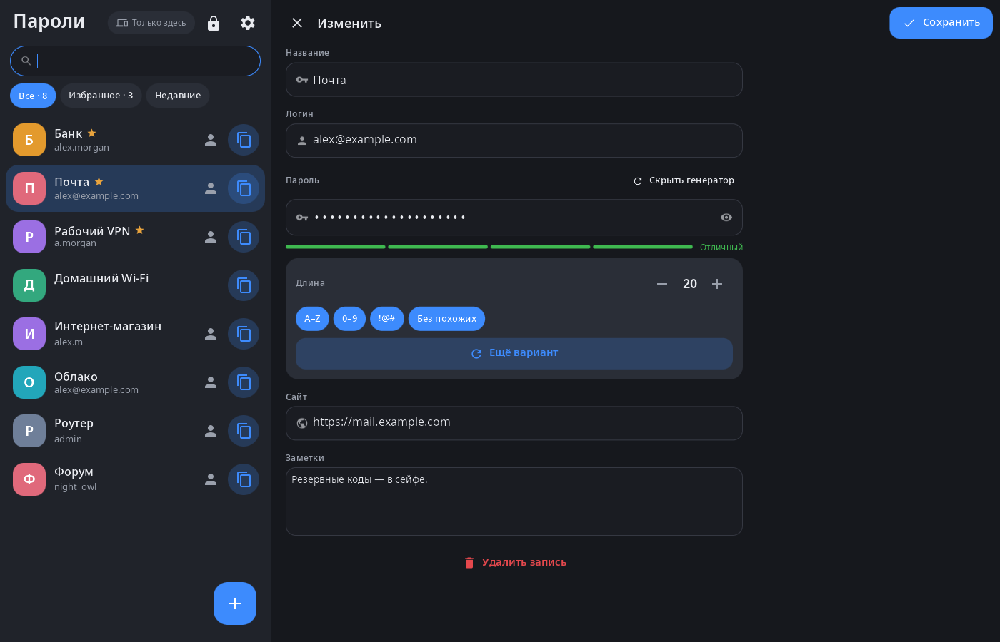
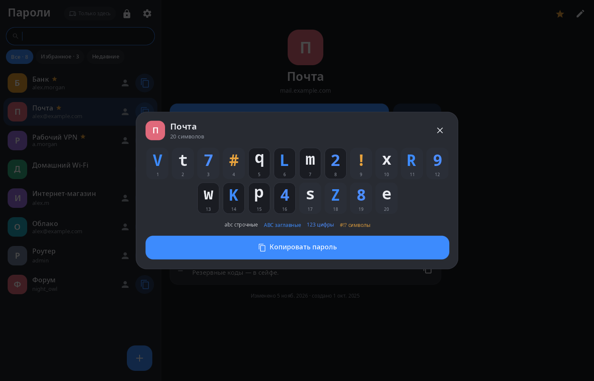
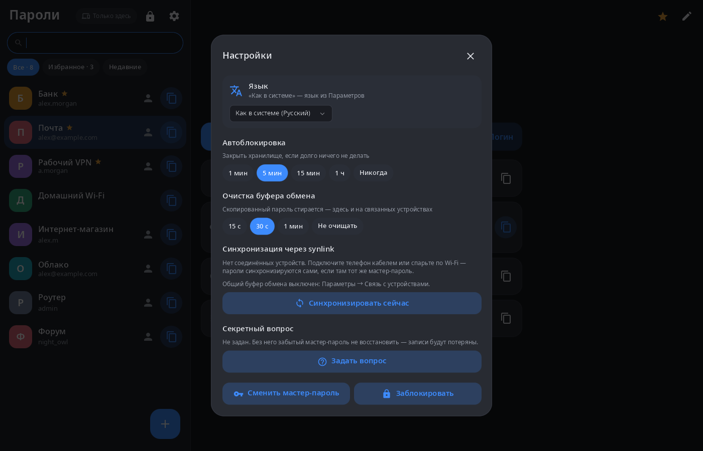

<div align="center">

# synpass

**Пароли рабочего стола synshell — зашифрованное хранилище под одним мастер-паролем с синхронизацией между вашими устройствами synshell.**

[English](README.md) · [Сайт](https://alexeyev.dev/ru/syndesktop/) · [AUR: synpass-bin](https://aur.archlinux.org/packages/synpass-bin) · [AUR: synpass-git](https://aur.archlinux.org/packages/synpass-git)



</div>

## Возможности

- **Шифрование** — хранилище в одном файле (`~/.local/share/synpass/vault.json`): ключ выводится из мастер-пароля через Argon2id, записи шифруются XChaCha20-Poly1305.
- **Записи** — название, логин, пароль, сайт и заметки; избранное, недавно скопированные, поиск; пароль или логин копируются одним нажатием, сайт открывается в браузере.
- **Генератор** — длина, заглавные буквы, цифры, символы, без похожих знаков (0/O, 1/l/I); оценка надёжности.
- **Крупный просмотр** — пароль по символам с нумерацией и видами знаков, удобно набирать на другом устройстве.
- **Синхронизация** — записи сливаются в обе стороны с устройствами, связанными через synlink (телефон, другой компьютер); удаление тоже доходит до них. Скопированный пароль попадает в общий буфер обмена связанных устройств.
- **Безопасность** — автоблокировка, если долго ничего не делать, очистка буфера обмена через заданное время (здесь и на связанных устройствах), смена мастер-пароля, секретный вопрос для восстановления доступа — по желанию.
- **Компьютер и телефон** — две колонки в широком окне, «список → запись» на телефоне; 14 языков.

| Правка с генератором | Крупный просмотр | Настройки |
|---|---|---|
|  |  |  |

На снимках — демо-хранилище с придуманными записями.

## Установка

**Arch Linux (AUR)** — x86_64 и aarch64:

```sh
yay -S synpass-bin      # готовые бинарники
yay -S synpass-git      # сборка из исходников
```

Зависит от `synshell-core`. Входит в метапакет `synshell`: `yay -S synshell-bin` ставит весь рабочий стол. **Из исходников:** `cargo build --release -p syn-pass` в репозитории [synshell](../../README.md).

## Командная строка

```sh
synpass                                             # открыть окно
SYNPASS_VAULT=~/other-vault.json synpass            # другой файл хранилища
synpass --screenshot shot.png --size 1400x900 --view edit
                                                    # снимок на демо-хранилище в памяти
                                                    # (виды: locked, list, edit, big, settings)
```

## Часть synshell

synpass — одно из приложений [synshell](../../README.md): окружения рабочего стола для Wayland на Rust для компьютеров и телефонов, на UI-фреймворке [syngui](https://github.com/VitaminDB/syngui).

## Лицензия

GPL-3.0-only
