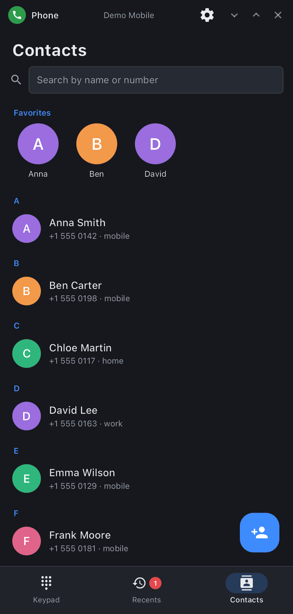

<div align="center">

# synphone

**synshell Phone — keypad, call log, contacts with photos, call recording and a call screen with live voice visualization, on top of the synshell modem daemon.**

[Русский](README.ru.md) · [Website](https://alexeyev.dev/synshell/syn-phone/) · [AUR: synshell-mobile-bin](https://aur.archlinux.org/packages/synshell-mobile-bin) · [AUR: synshell-mobile-git](https://aur.archlinux.org/packages/synshell-mobile-git)


</div>

## Features

- **Keypad** — on-screen keys or the keyboard; contact suggestions as you type digits, “Add to contacts” for a new number; long press on 0 gives “+”.
- **Call log** — grouped by day, with contact names and photos, a “Missed” filter, a mark on calls that were recorded. Tap to call back, tap the avatar for the contact card (or to add the number), the button opens the conversation in [synsms](../syn-sms/README.md).
- **Contacts** — search by name or number, favorites, alphabetical list; a card (call, message, all numbers, e-mail, note, recent calls) and an editor (photo from a file, numbers with types, e-mail, note, favorite). Stored as vCard (`~/.local/share/synshell/contacts`), shared with SMS and the shell; `.vcf` import and export with photos.
- **Call screen** — the caller's photo full-screen (or a large avatar), name and number type, timer; live voice visualization — the other party and you as running waves like in Voice Recorder (can be turned off); mute, speaker, DTMF keypad, recording, contact card, message. Incoming: answer, decline, reply with a message; a second call is shown separately.
- **Call recording** — with a button during the call or automatically for every call; Opus in “Music/Calls” (folder is configurable), a list of recordings with playback.
- **Runs in the background** — the process lives for the whole session: an incoming call shows the window at once (and hides it again afterwards if it was hidden), closing the window does not drop the call or the recording. The call on the lock screen (answer without unlocking) and the green call pill are drawn by the shell.
- **Settings** — visualization, caller photo, recording mode and folder, carrier services (call waiting, caller ID, call forwarding), contact import/export, clearing the log, start tab.
- **14 languages** — follows the system language.

| Recents | Contacts | Call |
|---|---|---|
|  |  |  |

## Requirements

Calls go through `synmodemd`, the synshell modem daemon (Qualcomm modems over QMI/QRTR). Call audio (mute, speaker) is handled by `palaudiod` of the phone platform; recording and voice visualization read its tap `/run/palaudio/voice-tap` (without it they are unavailable, calls still work). Recordings are encoded by `ffmpeg` (libopus). Without a modem the app opens, but shows “Modem unavailable”.

## Install

**Arch Linux (AUR)** — x86_64 and aarch64. synphone is part of the `synshell-mobile` package (phone shell, modem, SMS, NFC, compass, step counter):

```sh
yay -S synshell-mobile-bin      # prebuilt
yay -S synshell-mobile-git      # built from source
```

Depends on `synshell-core`. **From source:** `cargo build --release -p syn-phone` in the [synshell](../../README.md) repository.

## Command line

```sh
synphone                        # keypad
synphone +15550142              # number in the keypad
synphone --log                  # open the call log
synphone --contacts             # open contacts
synphone --background           # background process (session autostart)
synphone --screenshot out.png --page log   # window snapshot with made-up data
                                # (dial|log|contacts|contact|edit|settings|call|incoming)
```

## Part of synshell

synphone is one of the applications of [synshell](../../README.md) — a Wayland desktop environment in Rust for computers and phones, built on the [syngui](https://github.com/VitaminDB/syngui) UI framework.

## License

GPL-3.0-only
