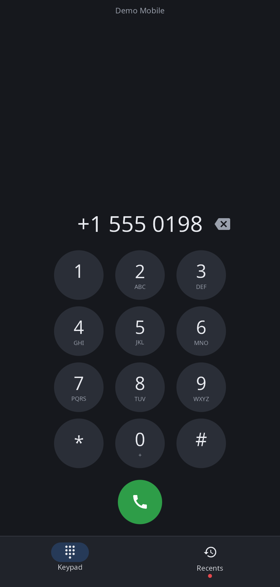

<div align="center">

# synphone

**Phone app for synshell on phones — keypad, call log and the in-call screen, on top of the synshell modem daemon.**

[Русский](README.ru.md) · [Website](https://alexeyev.dev/syndesktop/) · [AUR: synshell-mobile-bin](https://aur.archlinux.org/packages/synshell-mobile-bin) · [AUR: synshell-mobile-git](https://aur.archlinux.org/packages/synshell-mobile-git)



</div>

## Features

- **Keypad** — dial with the on-screen keys or the keyboard (digits, Backspace, Enter); long press on 0 gives “+”, long press on ⌫ clears the number.
- **Call log** — incoming, outgoing, missed and declined calls with time and duration; unseen missed calls are marked on the tab. A tap puts the number into the keypad; buttons call back or open the conversation in [synsms](../syn-sms/README.md).
- **In-call screen** — the window switches to it when a call comes in or goes out: answer / decline, call timer, mute, speaker, DTMF keypad, hang up; a second incoming call is shown as such.
- **Network line** — operator and roaming, or why calls are impossible: no modem, airplane mode, no network.
- **14 languages** — follows the system language.

| Recents | Call |
|---|---|
|  |  |

## Requirements

Calls go through `synmodemd`, the synshell modem daemon (Qualcomm modems over QMI/QRTR). Call audio (mute, speaker) is handled by `palaudiod` of the phone platform. Without a modem the app opens, but only shows “Modem unavailable”.

## Install

**Arch Linux (AUR)** — x86_64 and aarch64. synphone is part of the `synshell-mobile` package (phone shell, modem, SMS, NFC, compass, step counter):

```sh
yay -S synshell-mobile-bin      # prebuilt
yay -S synshell-mobile-git      # built from source
```

Depends on `synshell-core`. **From source:** `cargo build --release -p syn-phone` in the [synshell](../../README.md) repository.

## Command line

```sh
synphone                        # keypad
synphone +15550142              # number in the keypad
synphone --log                  # open the call log
synphone --screenshot out.png --page log   # window snapshot with made-up data (dial|log|call)
```

## Part of synshell

synphone is one of the applications of [synshell](../../README.md) — a Wayland desktop environment in Rust for computers and phones, built on the [syngui](https://github.com/VitaminDB/syngui) UI framework.

## License

GPL-3.0-only
