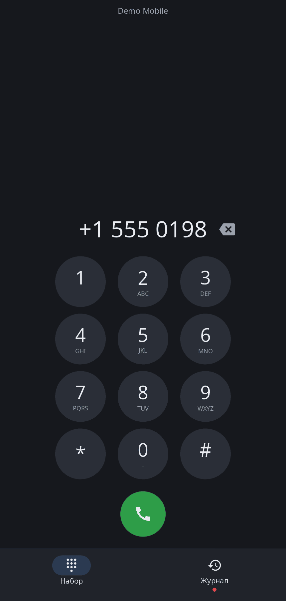
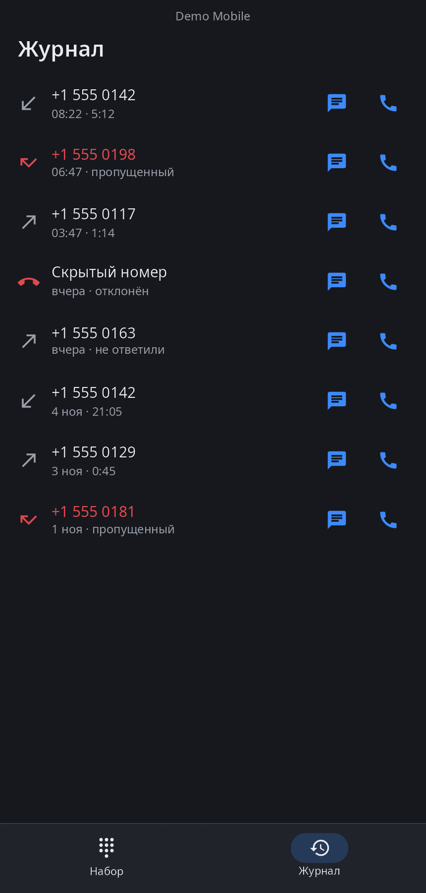

<div align="center">

# synphone

**«Телефон» synshell для телефонов — набор номера, журнал звонков и экран разговора поверх демона модема synshell.**

[English](README.md) · [Сайт](https://alexeyev.dev/ru/synshell/syn-phone/) · [AUR: synshell-mobile-bin](https://aur.archlinux.org/packages/synshell-mobile-bin) · [AUR: synshell-mobile-git](https://aur.archlinux.org/packages/synshell-mobile-git)



</div>

## Возможности

- **Набор номера** — экранными кнопками или с клавиатуры (цифры, Backspace, Enter); долгое нажатие на 0 — «+», на ⌫ — стереть номер.
- **Журнал звонков** — входящие, исходящие, пропущенные и отклонённые со временем и длительностью; непросмотренные пропущенные отмечены на вкладке. Касание переносит номер в набор, кнопки — перезвонить или открыть переписку в [synsms](../syn-sms/README.ru.md).
- **Экран разговора** — окно переключается на него при входящем и исходящем звонке: ответить / отклонить, таймер разговора, микрофон, громкая связь, тоновый набор, завершить; второй входящий вызов показывается отдельно.
- **Строка сети** — оператор и роуминг или причина, по которой звонить нельзя: нет модема, режим полёта, нет сети.
- **14 языков** — как в системе.

| Журнал | Разговор |
|---|---|
|  |  |

## Что нужно

Звонки идут через `synmodemd` — демон модема synshell (модемы Qualcomm по QMI/QRTR). Звуком разговора (микрофон, громкая связь) управляет `palaudiod` платформы телефона. Без модема программа открывается, но показывает только «Модем недоступен».

## Установка

**Arch Linux (AUR)** — x86_64 и aarch64. synphone входит в пакет `synshell-mobile` (оболочка телефона, модем, SMS, NFC, компас, шагомер):

```sh
yay -S synshell-mobile-bin      # готовые бинарники
yay -S synshell-mobile-git      # сборка из исходников
```

Зависит от `synshell-core`. **Из исходников:** `cargo build --release -p syn-phone` в репозитории [synshell](../../README.md).

## Командная строка

```sh
synphone                        # набор номера
synphone +15550142              # номер сразу в наборе
synphone --log                  # открыть журнал
synphone --screenshot out.png --page log   # снимок окна с придуманными данными (dial|log|call)
```

## Часть synshell

synphone — одно из приложений [synshell](../../README.md): окружения рабочего стола для Wayland на Rust для компьютеров и телефонов, на UI-фреймворке [syngui](https://github.com/VitaminDB/syngui).

## Лицензия

GPL-3.0-only
