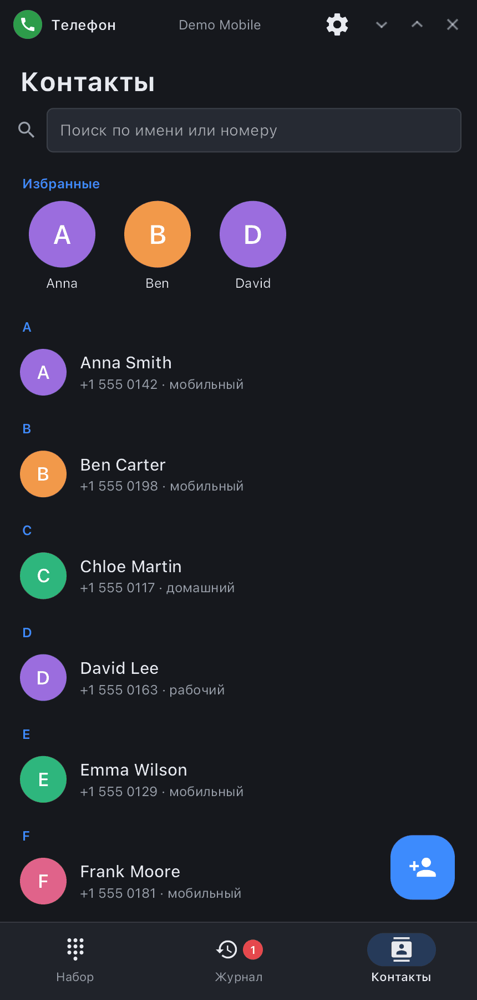

<div align="center">

# synphone

**«Телефон» synshell — набор, журнал, контакты с фото, запись разговоров и экран звонка с визуализацией голосов поверх демона модема synshell.**

[English](README.md) · [Сайт](https://alexeyev.dev/ru/synshell/syn-phone/) · [AUR: synshell-mobile-bin](https://aur.archlinux.org/packages/synshell-mobile-bin) · [AUR: synshell-mobile-git](https://aur.archlinux.org/packages/synshell-mobile-git)


</div>

## Возможности

- **Набор номера** — экранными кнопками или с клавиатуры; подсказки из контактов по набранным цифрам, «Добавить в контакты» для нового номера; долгое нажатие на 0 — «+».
- **Журнал звонков** — по дням, с именами и фото из контактов, фильтр «Пропущенные», значок у звонков с записью разговора. Касание — перезвонить, аватар — карточка контакта (или добавить номер в контакты), кнопка — переписка в [synsms](../syn-sms/README.ru.md).
- **Контакты** — поиск по имени и номеру, избранные, список по буквам; карточка (позвонить, написать, все номера, почта, заметка, последние звонки) и редактор (фото из файла, номера с типами, почта, заметка, избранное). Хранятся в vCard (`~/.local/share/synshell/contacts`), общие с SMS и оболочкой; импорт и экспорт `.vcf` с фото.
- **Экран звонка** — фото абонента на весь экран (или крупный аватар), имя и тип номера, таймер; живая визуализация голосов — собеседник и вы, бегущими волнами как в Диктофоне (отключается в настройках); микрофон, громкая связь, тоновый набор, запись, карточка контакта, сообщение. Входящий — «Ответить», «Отклонить», «Ответить сообщением»; второй вызов показывается отдельно.
- **Запись разговоров** — кнопкой в разговоре или автоматически каждого разговора; Opus в «Музыка/Звонки» (папку можно выбрать), список записей с прослушиванием.
- **Работа в фоне** — процесс живёт весь сеанс: входящий сразу показывает окно (и прячет его после звонка, если окно было спрятано), закрытое окно не обрывает разговор и запись. Звонок на экране блокировки (ответ без разблокировки) и зелёная плашка разговора показывает оболочка.
- **Настройки** — визуализация, фото абонента, режим и папка записи, услуги оператора (ожидание вызова, показ своего номера, переадресация), импорт и экспорт контактов, очистка журнала, начальная вкладка.
- **14 языков** — как в системе.

| Журнал | Контакты | Разговор |
|---|---|---|
|  |  |  |

## Что нужно

Звонки идут через `synmodemd` — демон модема synshell (модемы Qualcomm по QMI/QRTR). Звуком разговора (микрофон, громкая связь) управляет `palaudiod` платформы телефона; запись и визуализация голосов берут звук из его отвода `/run/palaudio/voice-tap` (если его нет — они недоступны, звонки работают). Запись кодирует `ffmpeg` (libopus). Без модема программа открывается, но показывает «Модем недоступен».

## Установка

**Arch Linux (AUR)** — x86_64 и aarch64. synphone входит в пакет `synshell-mobile` (оболочка телефона, модем, SMS, NFC, компас, шагомер):

```sh
yay -S synshell-mobile-bin      # готовые бинарники
yay -S synshell-mobile-git      # сборка из исходников
```

Зависит от `synshell-core`. **Из исходников:** `cargo build --release -p syn-phone` в репозитории [synshell](../../README.md).

## Командная строка

```sh
synphone                        # набор номера
synphone +15550142              # номер сразу в наборе
synphone --log                  # открыть журнал
synphone --contacts             # открыть контакты
synphone --background           # фоновый процесс (автозапуск сеанса)
synphone --screenshot out.png --page log   # снимок окна с придуманными данными
                                # (dial|log|contacts|contact|edit|settings|call|incoming)
```

## Часть synshell

synphone — одно из приложений [synshell](../../README.md): окружения рабочего стола для Wayland на Rust для компьютеров и телефонов, на UI-фреймворке [syngui](https://github.com/VitaminDB/syngui).

## Лицензия

GPL-3.0-only
