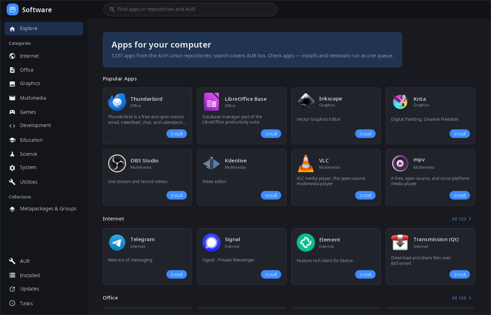
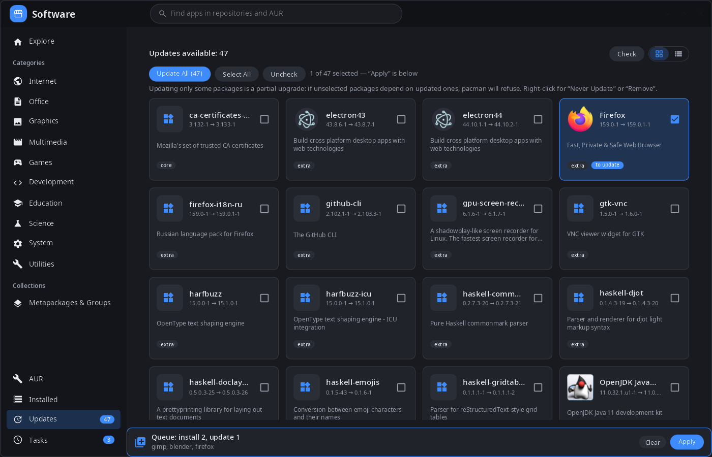
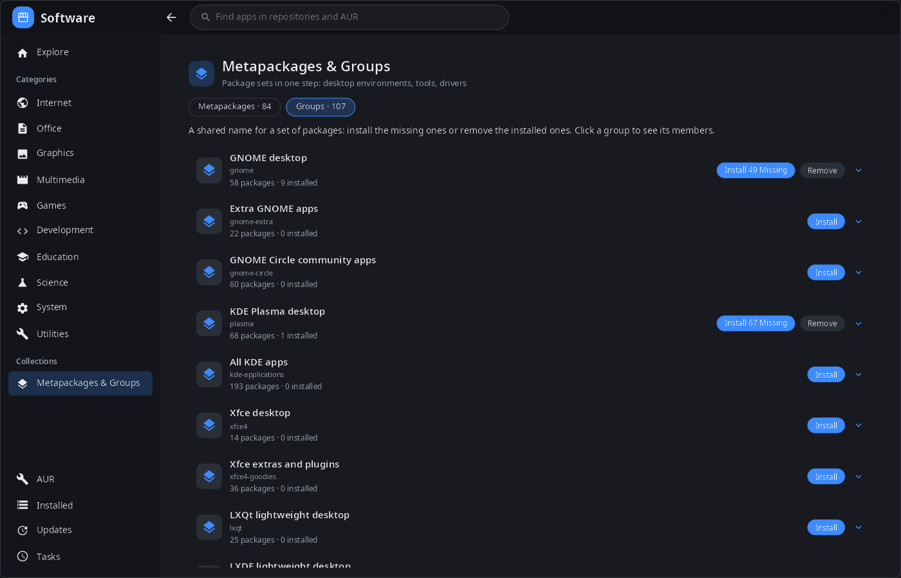

<div align="center">

# synpkg

**Software center for the synshell desktop — browse, install, remove and update programs from the Arch Linux repositories and AUR.**

[Русский](README.ru.md) · [Website](https://alexeyev.dev/synshell/syn-pkg/) · [AUR: synshell-core-bin](https://aur.archlinux.org/packages/synshell-core-bin) · [AUR: synshell-core-git](https://aur.archlinux.org/packages/synshell-core-git)



</div>

## Features

- **Catalog** — popular apps and ten categories from AppStream data (`archlinux-appstream-data`): icons, descriptions and screenshots in the interface language; programs without AppStream screenshots get them from Flathub.
- **One search** for the repositories and AUR.
- **Queue of changes** — “Install”, “Remove”, “Update” and checkboxes add to a queue (opposite actions cancel out), “Apply” runs it as one job: removal → pacman transaction → AUR builds. “Install now” and “Remove now” skip the queue.
- **Updates** — check without root (`checkupdates`), update all or selected packages, “Never update” for a package; AUR updates are listed separately.
- **AUR** — search, install and update; packages are built on this computer, the PKGBUILD can be viewed before installing.
- **Installed** — filter, all packages / programs / not from repositories / metapackages, cards or list.
- **Metapackages and groups** — install the missing members of a group or remove the installed ones in one step (GNOME, KDE Plasma, Xfce, drivers and so on).
- **Package details** — version, repository, license, sizes, dependencies and optional dependencies, file list, website.
- **Safe removal** — if other packages depend on the one being removed, it asks: cascade removal or forced removal.
- **Password prompt** — its own polkit agent window for pacman, no terminal needed.
- **Job log** — progress and pacman output of every job, cancel.
- **Desktop and phone** — three columns on a computer; list → package with bottom navigation on a phone.
- **14 languages** — the UI follows the system or the language chosen in settings.

| Updates | Metapackages & groups |
|---|---|
|  |  |

## Install

**Arch Linux (AUR)** — x86_64 and aarch64. synpkg is part of `synshell-core`, the base set of desktop programs (compositor, shell, settings, file manager, terminal, software center, screenshots):

```sh
yay -S synshell-core-bin      # prebuilt
yay -S synshell-core-git      # built from source
```

Optional: `archlinux-appstream-data` (categories, icons and screenshots), `polkit` (installing without running as root), `base-devel` (building AUR packages), `pacman-contrib` (update checks without root).

The whole desktop: `yay -S synshell-bin`. **From source:** `cargo build --release -p syn-pkg` in the [synshell](../../README.md) repository.

## Command line

```sh
synpkg                 # open the catalog
synpkg gimp            # open with a search
synpkg --screenshot out.png --tab explore --size 1400x900   # render to PNG without a window
                       # (--tab explore|aur|installed|updates|jobs, --select PACKAGE, --queue name:install,…)
```

## Part of synshell

synpkg is one of the applications of [synshell](../../README.md) — a Wayland desktop environment in Rust for computers and phones, built on the [syngui](https://github.com/VitaminDB/syngui) UI framework.

## License

GPL-3.0-only
