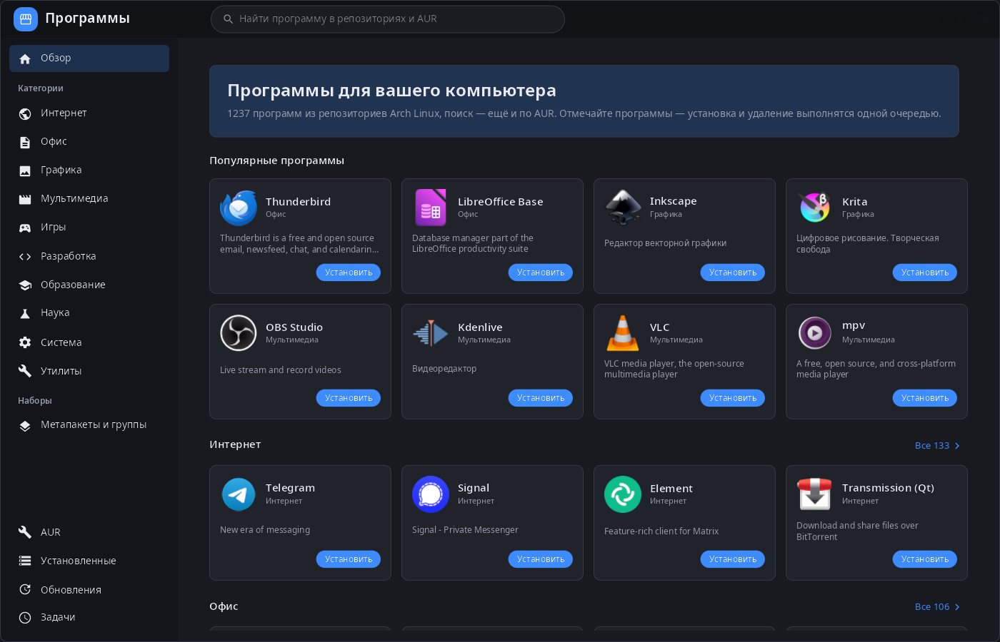
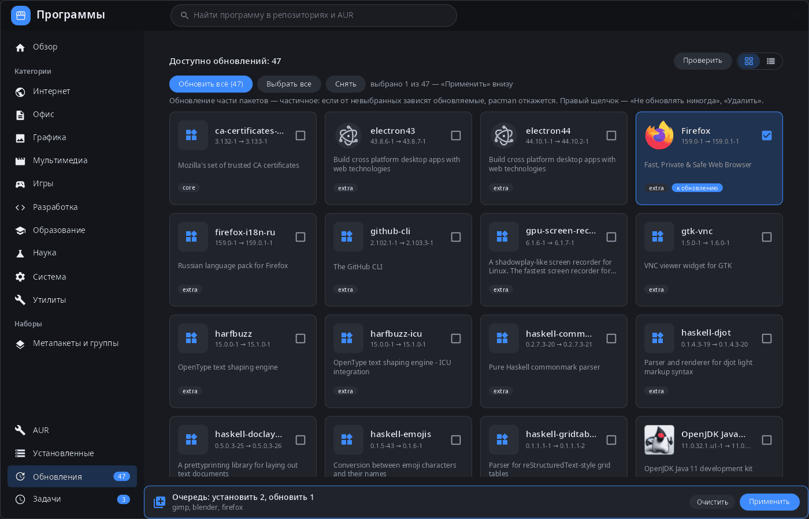
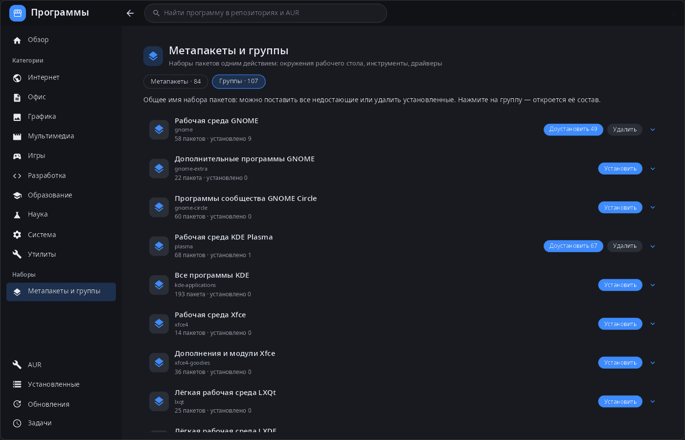

<div align="center">

# synpkg

**Установка программ для рабочего стола synshell — каталог, установка, удаление и обновление программ из репозиториев Arch Linux и AUR.**

[English](README.md) · [Сайт](https://alexeyev.dev/ru/synshell/) · [AUR: synshell-core-bin](https://aur.archlinux.org/packages/synshell-core-bin) · [AUR: synshell-core-git](https://aur.archlinux.org/packages/synshell-core-git)



</div>

## Возможности

- **Каталог** — популярные программы и десять разделов по данным AppStream (`archlinux-appstream-data`): значки, описания и снимки экрана на языке интерфейса; у программ без снимков в AppStream они берутся с Flathub.
- **Один поиск** по репозиториям и AUR.
- **Очередь изменений** — «Установить», «Удалить», «Обновить» и флажки ставят задачи в очередь (противоположные гасят друг друга), «Применить» выполняет её одним заданием: удаление → транзакция pacman → сборка из AUR. «Установить сейчас» и «Удалить сейчас» — мимо очереди.
- **Обновления** — проверка без прав root (`checkupdates`), обновить всё или выбранные пакеты, «Не обновлять никогда» для пакета; обновления AUR — отдельным списком.
- **AUR** — поиск, установка и обновление; пакеты собираются на этом компьютере, PKGBUILD можно посмотреть до установки.
- **Установленные** — фильтр, все пакеты / программы / не из репозиториев / метапакеты, карточки или список.
- **Метапакеты и группы** — поставить недостающие пакеты группы или удалить установленные одним действием (GNOME, KDE Plasma, Xfce, драйверы и т. д.).
- **Подробности пакета** — версия, репозиторий, лицензия, размеры, зависимости и необязательные зависимости, список файлов, сайт.
- **Аккуратное удаление** — если от удаляемого пакета зависят другие, спрашивает: удалить каскадом или принудительно.
- **Окно пароля** — свой агент polkit для pacman, терминал не нужен.
- **Журнал заданий** — ход и вывод pacman у каждого задания, отмена.
- **Компьютер и телефон** — три колонки на компьютере; на телефоне список → пакет с нижней навигацией.
- **14 языков** — как в системе или язык, выбранный в настройках.

| Обновления | Метапакеты и группы |
|---|---|
|  |  |

## Установка

**Arch Linux (AUR)** — x86_64 и aarch64. synpkg входит в пакет `synshell-core` — базовый набор программ рабочего стола (композитор, оболочка, параметры, проводник, терминал, установка программ, снимки экрана):

```sh
yay -S synshell-core-bin      # готовые бинарники
yay -S synshell-core-git      # сборка из исходников
```

Дополнительно: `archlinux-appstream-data` (разделы, значки и снимки экрана), `polkit` (установка без запуска от root), `base-devel` (сборка пакетов AUR), `pacman-contrib` (проверка обновлений без root).

Весь рабочий стол: `yay -S synshell-bin`. **Из исходников:** `cargo build --release -p syn-pkg` в репозитории [synshell](../../README.md).

## Командная строка

```sh
synpkg                 # открыть каталог
synpkg gimp            # открыть с поиском
synpkg --screenshot out.png --tab explore --size 1400x900   # снимок в PNG без окна
                       # (--tab explore|aur|installed|updates|jobs, --select ПАКЕТ, --queue имя:install,…)
```

## Часть synshell

synpkg — одно из приложений [synshell](../../README.md): окружения рабочего стола для Wayland на Rust для компьютеров и телефонов, на UI-фреймворке [syngui](https://github.com/VitaminDB/syngui).

## Лицензия

GPL-3.0-only
