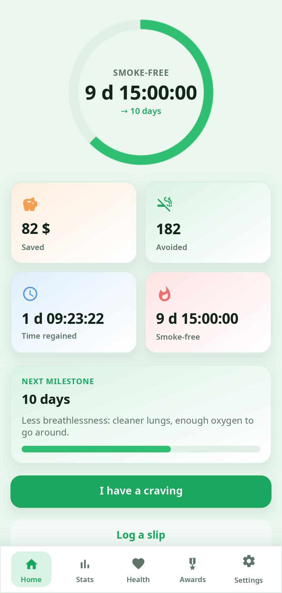
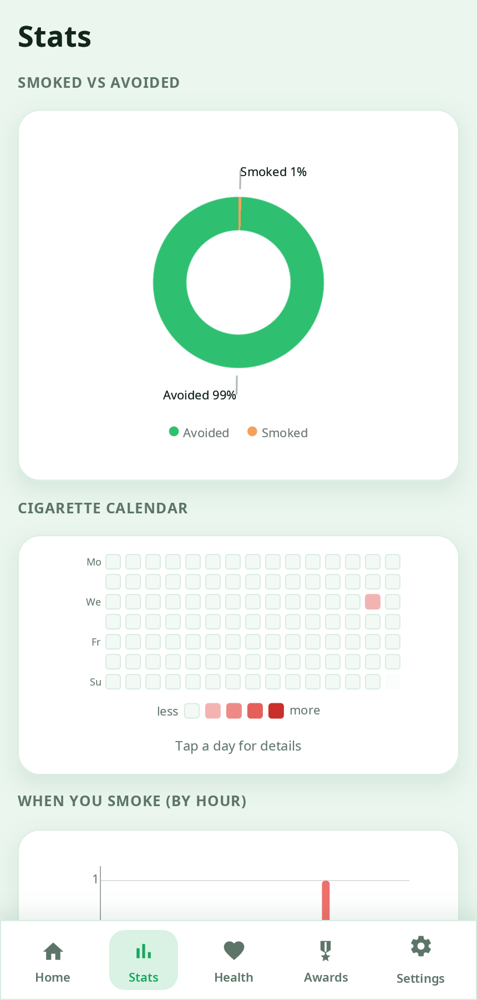
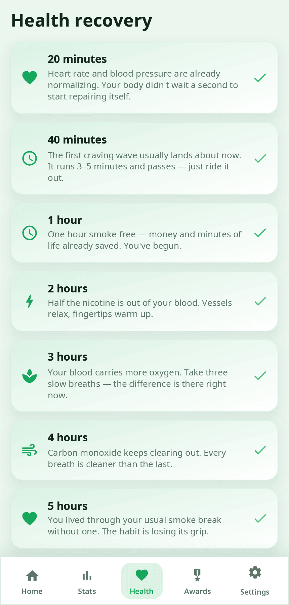
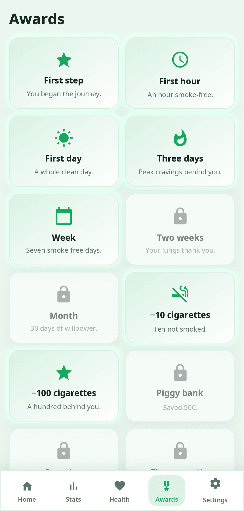

<div align="center">

# syn-quitsmoke

**QuitSmoke — a tracker for quitting smoking or vaping, all at once or gradually: smoke-free time, savings, health milestones, cravings and awards.**

[Русский](README.ru.md) · [Website](https://alexeyev.dev/synshell/syn-quitsmoke/) · [AUR: syn-quitsmoke-bin](https://aur.archlinux.org/packages/syn-quitsmoke-bin) · [AUR: syn-quitsmoke-git](https://aur.archlinux.org/packages/syn-quitsmoke-git)



</div>

## Features

- **Two ways to quit** — at once, or gradually: the interval between cigarettes grows over the program (the number of days is yours) until none are left; the home screen shows when the next one is allowed.
- **Home** — smoke-free time, money saved, cigarettes not smoked, time regained and the next milestone.
- **Cravings** — a 4-7-8 breathing exercise with an animated circle; log a slip if it happens.
- **Statistics** — smoked vs avoided, a calendar of cigarettes by day, when you smoke by hour.
- **Health timeline** — milestones from 20 minutes to one year with short general notes. They describe typical changes; this is not medical advice and does not promise a result.
- **Awards** — 12 awards for days, avoided cigarettes and money saved.
- **Vaping** — a separate counter with its own habits (pods, puffs), mode and awards, working alongside cigarettes.
- **Settings** — currency, dark theme, language; on Android, notifications with a countdown or progress bar in the shade.
- **Private** — the data stays in `~/.local/share/quitsmoke/quitsmoke.json` (on Android — inside the app).
- **14 languages** — the UI follows the system or the language chosen in the app.

| Statistics | Health | Awards |
|---|---|---|
|  |  |  |

The screenshots show made-up sample data.

## Install

**Arch Linux (AUR)** — x86_64 and aarch64:

```sh
yay -S syn-quitsmoke-bin      # prebuilt
yay -S syn-quitsmoke-git      # built from source
```

The whole desktop: `yay -S synshell-bin`. **From source:** `cargo build --release -p syn-quitsmoke` in the [synshell](../../README.md) repository.

## Android

An APK for Android 11 and newer (arm64) is attached to the [synshell releases](https://github.com/VitaminDB/synshell/releases) on GitHub: download it on the phone and open it to install. To build it yourself: `syngui build -t android -p syn-quitsmoke` (the [syngui](https://github.com/VitaminDB/syngui) tool).

## Command line

```sh
syn-quitsmoke                                             # open the app
syn-quitsmoke --screenshot home.png --page home           # screenshot with sample data
```

`--page` takes `home`, `stats`, `health`, `achievements`, `settings`, `craving`, `onboarding`; `--dark`, `--size` and `--scale` change the look and size.

## Part of synshell

syn-quitsmoke is one of the applications of [synshell](../../README.md) — a Wayland desktop environment in Rust for computers and phones, built on the [syngui](https://github.com/VitaminDB/syngui) UI framework.

## License

GPL-3.0-only
