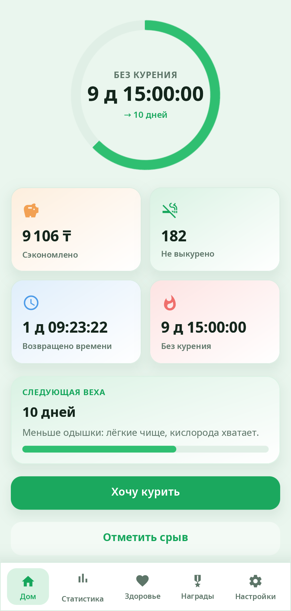
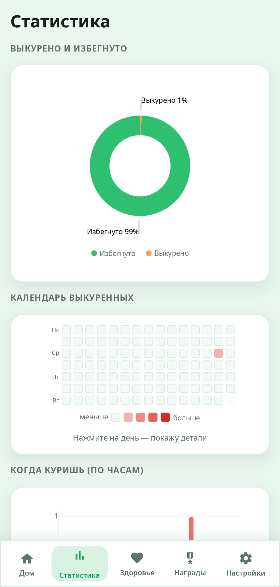
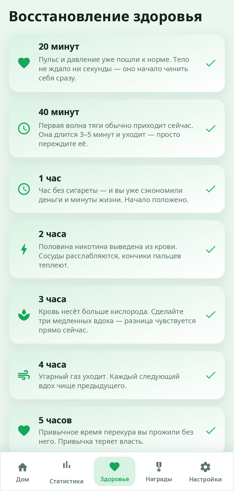
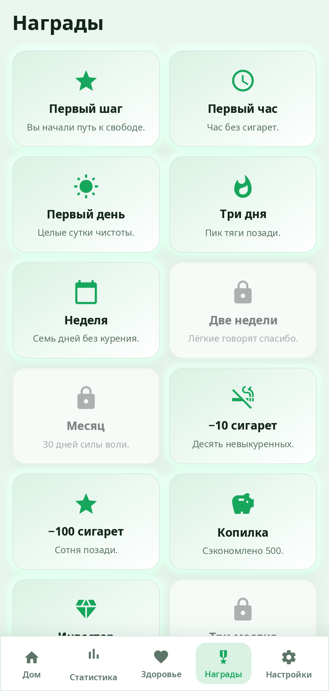

<div align="center">

# syn-quitsmoke

**QuitSmoke — помощник, чтобы бросить курить или вейп, сразу или постепенно: время без курения, экономия, вехи здоровья, тяга и награды.**

[English](README.md) · [Сайт](https://alexeyev.dev/ru/syndesktop/) · [AUR: syn-quitsmoke-bin](https://aur.archlinux.org/packages/syn-quitsmoke-bin) · [AUR: syn-quitsmoke-git](https://aur.archlinux.org/packages/syn-quitsmoke-git)



</div>

## Возможности

- **Два способа** — сразу или постепенно: интервал между сигаретами растёт на протяжении программы (число дней задаёте вы), пока сигарет не останется; на главной видно, когда можно следующую.
- **Главная** — время без курения, сэкономленные деньги, невыкуренные сигареты, возвращённое время и следующая веха.
- **Тяга** — дыхательное упражнение 4-7-8 с анимированным кругом; если сорвались — отметить срыв.
- **Статистика** — выкурено и избегнуто, календарь сигарет по дням, когда вы курите по часам.
- **Восстановление здоровья** — вехи от 20 минут до года с короткими общими пояснениями. Они описывают типичные изменения; это не медицинский совет и не обещание результата.
- **Награды** — 12 наград за дни, невыкуренные сигареты и сэкономленные деньги.
- **Вейп** — отдельный счётчик со своими привычками (картриджи, затяжки), режимом и наградами; работает вместе с сигаретами.
- **Настройки** — валюта, тёмная тема, язык; на Android — уведомления с отсчётом или полосой хода в шторке.
- **Данные у вас** — хранятся в `~/.local/share/quitsmoke/quitsmoke.json` (на Android — внутри приложения).
- **14 языков** — как в системе или свой язык в настройках приложения.

| Статистика | Здоровье | Награды |
|---|---|---|
|  |  |  |

На снимках — придуманные данные.

## Установка

**Arch Linux (AUR)** — x86_64 и aarch64:

```sh
yay -S syn-quitsmoke-bin      # готовые бинарники
yay -S syn-quitsmoke-git      # сборка из исходников
```

Весь рабочий стол: `yay -S synshell-bin`. **Из исходников:** `cargo build --release -p syn-quitsmoke` в репозитории [synshell](../../README.md).

## Android

APK для Android 11 и новее (arm64) — в [релизах synshell](https://github.com/VitaminDB/synshell/releases) на GitHub: скачайте его на телефоне и откройте, чтобы установить. Собрать самому: `syngui build -t android -p syn-quitsmoke` (утилита [syngui](https://github.com/VitaminDB/syngui)).

## Командная строка

```sh
syn-quitsmoke                                             # открыть программу
syn-quitsmoke --screenshot home.png --page home           # снимок на примере
```

`--page` — `home`, `stats`, `health`, `achievements`, `settings`, `craving`, `onboarding`; `--dark`, `--size` и `--scale` меняют вид и размер.

## Часть synshell

syn-quitsmoke — одно из приложений [synshell](../../README.md): окружения рабочего стола для Wayland на Rust для компьютеров и телефонов, на UI-фреймворке [syngui](https://github.com/VitaminDB/syngui).

## Лицензия

GPL-3.0-only
