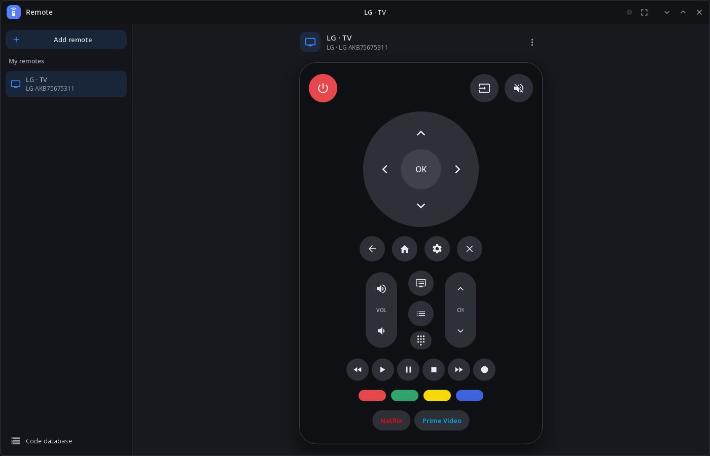
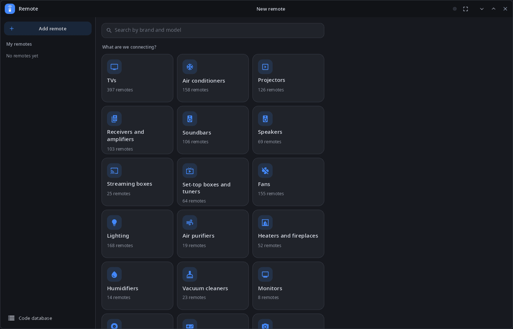
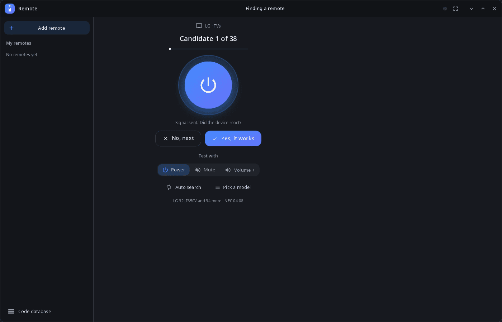
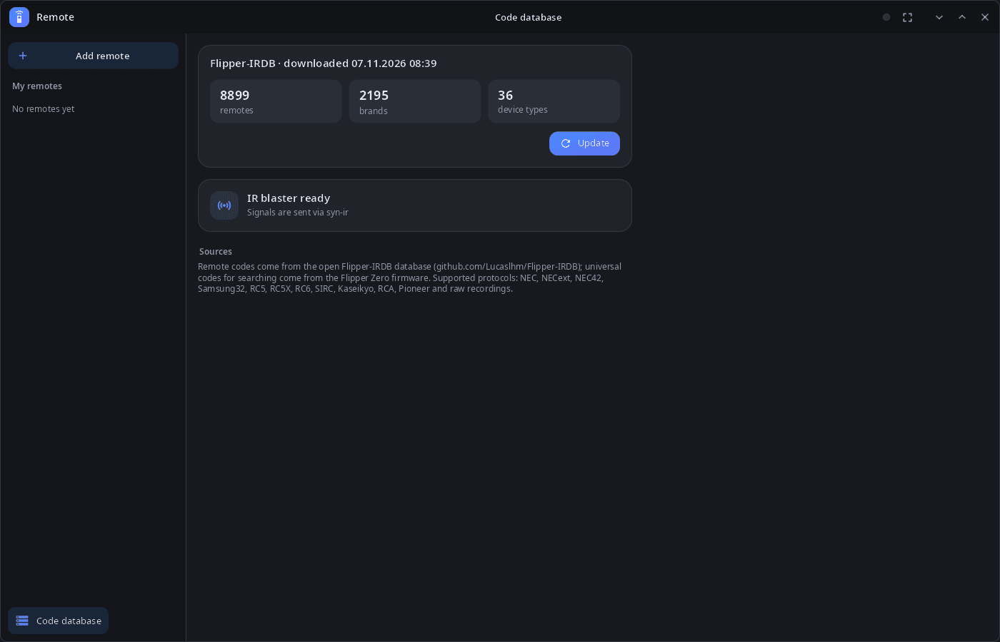

<div align="center">

# syn-remote

**IR remote control for the synshell desktop — a phone with an IR LED controls TVs, air conditioners, projectors and more.**

[Русский](README.ru.md) · [Website](https://alexeyev.dev/synshell/syn-remote/) · [AUR: syn-remote-bin](https://aur.archlinux.org/packages/syn-remote-bin) · [AUR: syn-remote-git](https://aur.archlinux.org/packages/syn-remote-git)



</div>

## Features

- **Code database** — about 9,000 remotes from the open [Flipper-IRDB](https://github.com/Lucaslhm/Flipper-IRDB), downloaded in the app (about 20 MB); universal codes from the Flipper Zero firmware.
- **Finding a remote** — pick the device type and brand (or “I don't know the brand”), point the phone and answer whether the device reacted; test with Power, Mute or Volume +; auto search sends a code every 3 seconds.
- **Search** — by brand and model, or pick a model from the list.
- **Remote layouts** — TVs and other media devices get a full remote (D-pad, volume and channels, playback, color keys, app keys); air conditioners, fans, lights and others get power, temperature where there is one, and a button grid; every other button of the remote is under “Other buttons”.
- **My remotes** — saved remotes, rename and delete.
- **Protocols** — NEC, NECext, NEC42, Samsung32, RC5, RC5X, RC6, SIRC, Kaseikyo, RCA, Pioneer and raw recordings.
- **Computer and phone** — sidebar on a wide window, pages on a phone; full screen (F11); 14 languages.

| New remote | Finding a remote | Code database |
|---|---|---|
|  |  |  |

Signals go out through the `syn-ir` program (phones with an IR LED). Without it the buttons only light up; `SYN_REMOTE_IR` can name another program with the same interface.

## Install

**Arch Linux (AUR)** — x86_64 and aarch64:

```sh
yay -S syn-remote-bin      # prebuilt
yay -S syn-remote-git      # built from source
```

Depends on `synshell-core`. Part of the `synshell` metapackage: `yay -S synshell-bin` installs the whole desktop. **From source:** `cargo build --release -p syn-remote` in the [synshell](../../README.md) repository.

## Command line

```sh
syn-remote --download                     # download the code database
syn-remote --send "LG · TV" power         # press a button of a saved remote (or of an .ir file)
syn-remote --timings remote.ir power      # print the pulse timings (µs) without sending
syn-remote --screenshot shot.png --size 1400x900 --scale 1 --page remote
                                          # window snapshot (pages: home, add, db, brands, remote, pick, found)
```

## Part of synshell

syn-remote is one of the applications of [synshell](../../README.md) — a Wayland desktop environment in Rust for computers and phones, built on the [syngui](https://github.com/VitaminDB/syngui) UI framework.

## License

GPL-3.0-only
