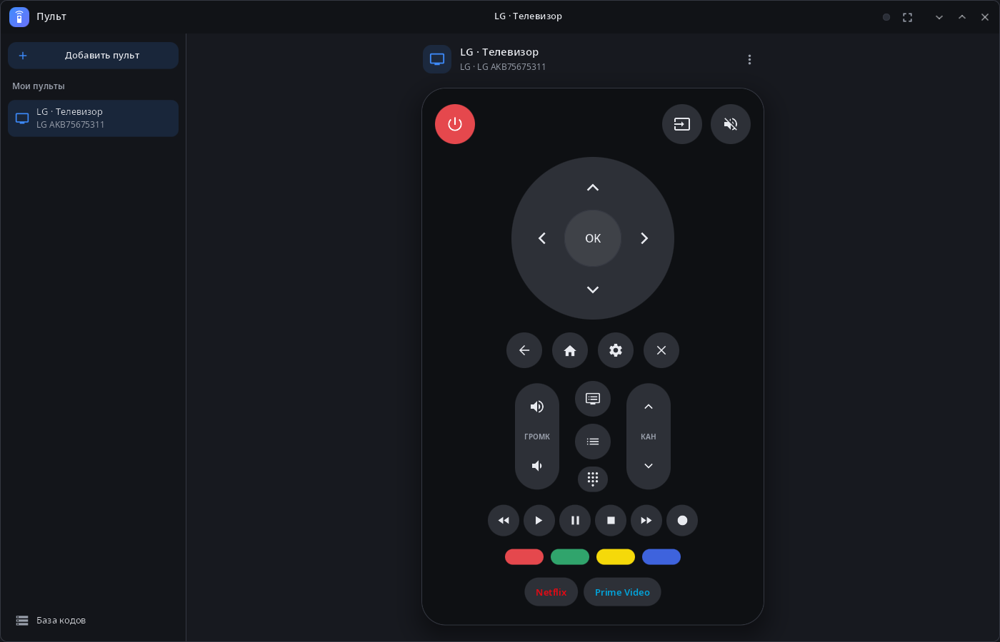
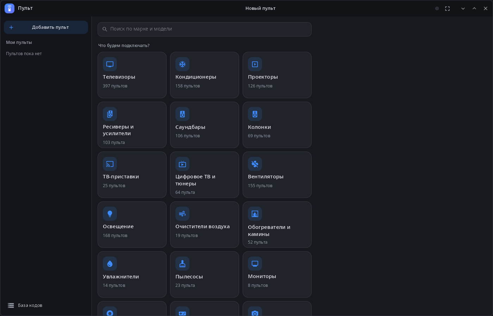
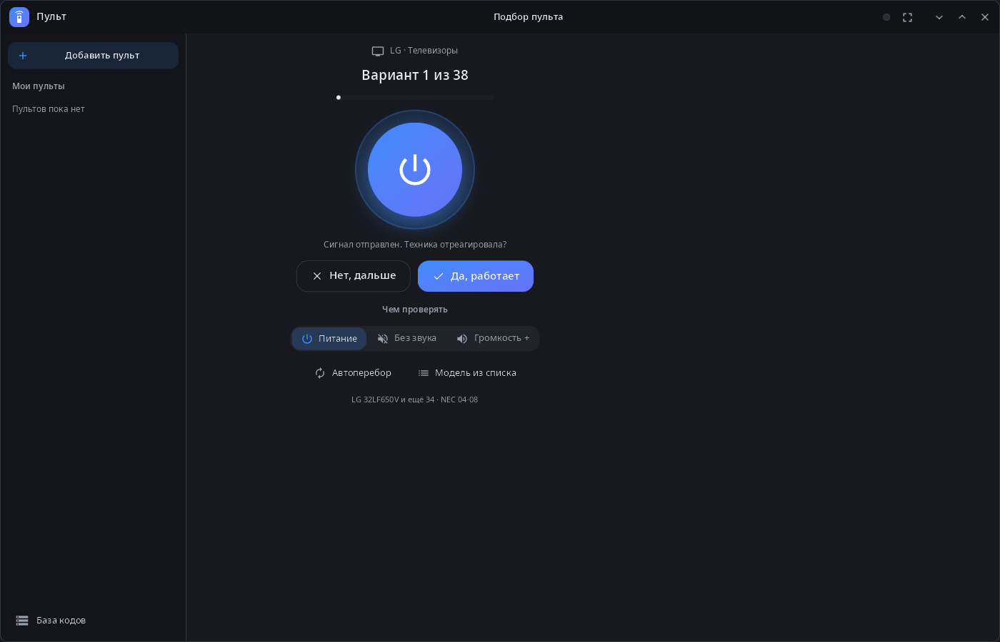
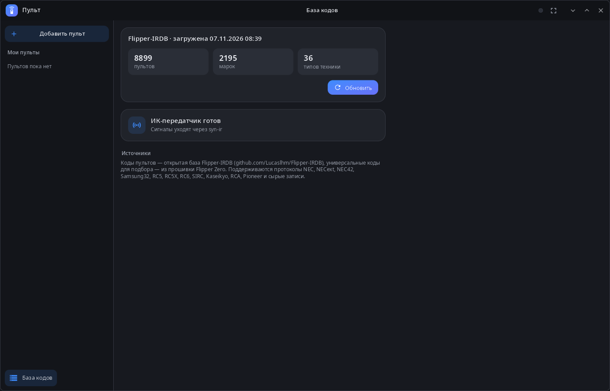

<div align="center">

# syn-remote

**ИК-пульт рабочего стола synshell — телефон с ИК-светодиодом управляет телевизорами, кондиционерами, проекторами и другой техникой.**

[English](README.md) · [Сайт](https://alexeyev.dev/ru/syndesktop/) · [AUR: syn-remote-bin](https://aur.archlinux.org/packages/syn-remote-bin) · [AUR: syn-remote-git](https://aur.archlinux.org/packages/syn-remote-git)



</div>

## Возможности

- **База кодов** — около 9 000 пультов из открытой базы [Flipper-IRDB](https://github.com/Lucaslhm/Flipper-IRDB), скачивается в программе (около 20 МБ); универсальные коды — из прошивки Flipper Zero.
- **Подбор пульта** — выберите вид техники и марку (или «Не знаю марку»), направьте телефон и отвечайте, отреагировала ли техника; проверка кнопками «Питание», «Без звука» или «Громкость +»; автоперебор посылает код каждые 3 секунды.
- **Поиск** — по марке и модели или выбор модели из списка.
- **Раскладки** — у телевизоров и другой медиатехники полный пульт (крестовина, громкость и каналы, воспроизведение, цветные кнопки, кнопки приложений); у кондиционеров, вентиляторов, света и прочего — питание, температура (если есть) и сетка кнопок; остальные кнопки пульта — в разделе «Другие кнопки».
- **Мои пульты** — сохранённые пульты, переименование и удаление.
- **Протоколы** — NEC, NECext, NEC42, Samsung32, RC5, RC5X, RC6, SIRC, Kaseikyo, RCA, Pioneer и сырые записи.
- **Компьютер и телефон** — на широком окне боковая панель, на телефоне — страницы; полноэкранный режим (F11); 14 языков.

| Новый пульт | Подбор пульта | База кодов |
|---|---|---|
|  |  |  |

Сигналы уходят через программу `syn-ir` (телефоны с ИК-светодиодом). Без неё кнопки только подсвечиваются; в `SYN_REMOTE_IR` можно указать другую программу с тем же интерфейсом.

## Установка

**Arch Linux (AUR)** — x86_64 и aarch64:

```sh
yay -S syn-remote-bin      # готовые бинарники
yay -S syn-remote-git      # сборка из исходников
```

Зависит от `synshell-core`. Входит в метапакет `synshell`: `yay -S synshell-bin` ставит весь рабочий стол. **Из исходников:** `cargo build --release -p syn-remote` в репозитории [synshell](../../README.md).

## Командная строка

```sh
syn-remote --download                     # скачать базу кодов
syn-remote --send "LG · Телевизор" power  # нажать кнопку сохранённого пульта (или файла .ir)
syn-remote --timings remote.ir power      # длительности посылки (мкс), без передачи
syn-remote --screenshot shot.png --size 1400x900 --scale 1 --page remote
                                          # снимок окна (страницы: home, add, db, brands, remote, pick, found)
```

## Часть synshell

syn-remote — одно из приложений [synshell](../../README.md): окружения рабочего стола для Wayland на Rust для компьютеров и телефонов, на UI-фреймворке [syngui](https://github.com/VitaminDB/syngui).

## Лицензия

GPL-3.0-only
