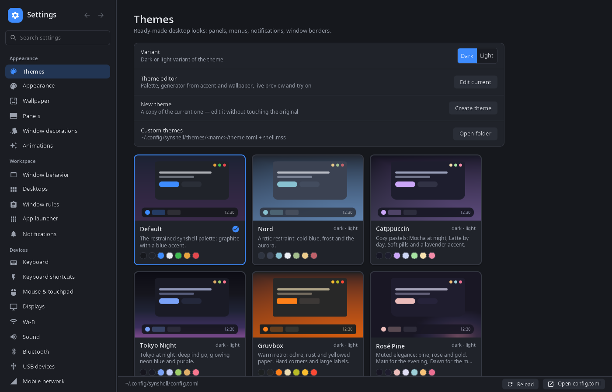
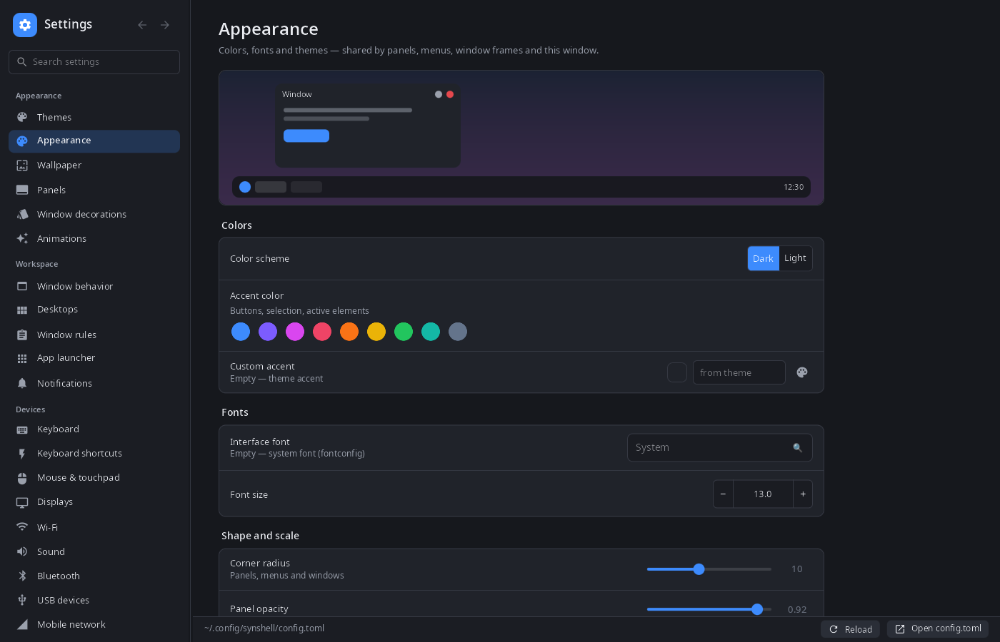
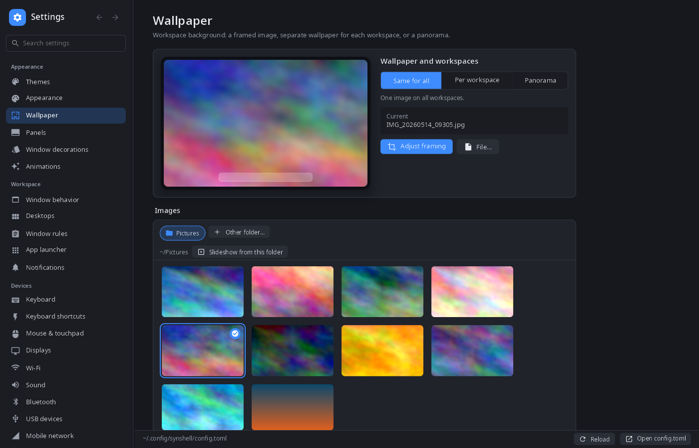
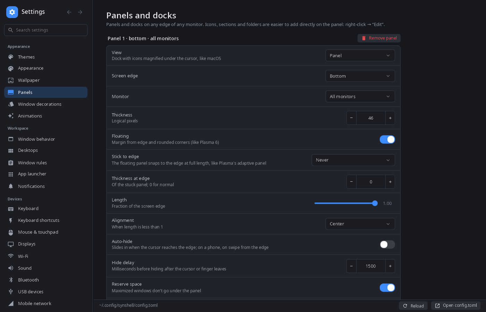

<div align="center">

# synsettings

**System settings for the synshell desktop — themes, wallpaper, panels, input, displays, network, sound and the rest of `config.toml` in one window.**

[Русский](README.ru.md) · [Website](https://alexeyev.dev/syndesktop/) · [AUR: synshell-core-bin](https://aur.archlinux.org/packages/synshell-core-bin) · [AUR: synshell-core-git](https://aur.archlinux.org/packages/synshell-core-git)



</div>

## Features

- **Edits `config.toml` in place** — only the changed keys are rewritten (comments and order stay), the compositor and shell pick up the file on their own; an external edit is re-read in the window.
- **Themes** — a gallery of built-in and custom themes with live previews, dark and light variants, “Edit current” and “Create theme” open the theme editor.
- **Appearance** — color scheme, accent color, interface font and size, corner radius, panel opacity, window decorations, animations.
- **Wallpaper** — one image for all workspaces, a separate one per workspace, or a panorama across them; a gallery of the Pictures folder with thumbnails, a framing editor (drag and zoom with mouse, wheel or fingers), slideshow from a folder, gradient colors.
- **Panels and docks** — any edge of any monitor, floating or stuck to the edge, auto-hide, length, alignment, reserved space.
- **Workspace** — window behavior, workspaces and their default layout, window rules, launcher, notifications.
- **Devices** — keyboard and layouts, shortcuts, mouse and touchpad, monitors (scale, HDR), Wi-Fi, Bluetooth, sound (outputs, inputs and per-app volume), USB devices, VPN (NetworkManager, WireGuard with key generation), device link (synlink), game mode, hardware overview with live sensors.
- **Phone** — mobile network, calls and SMS, modem info, gestures, vibration.
- **System** — power and CPU governors, neural networks and the assistant, location and camera permissions, language, date and time, lock and idle, autostart, default applications (written to `mimeapps.list`), session, “About”.
- **Search** across all pages, in the interface language and in Russian.
- **Phone layout** — on a narrow screen the page list and the page open one at a time.
- **14 languages** — the UI follows the system or the language chosen in settings.

| Appearance | Wallpaper | Panels |
|---|---|---|
|  |  |  |

## Install

**Arch Linux (AUR)** — x86_64 and aarch64. synsettings is part of `synshell-core`, the base set of desktop programs (compositor, shell, settings, file manager, terminal, software center, screenshots):

```sh
yay -S synshell-core-bin      # prebuilt
yay -S synshell-core-git      # built from source
```

Optional: `networkmanager` or `iwd` (Wi-Fi; VPN needs NetworkManager), `bluez` (Bluetooth), `wireplumber` (sound).

The whole desktop: `yay -S synshell-bin`. **From source:** `cargo build --release -p syn-settings` in the [synshell](../../README.md) repository.

## Command line

```sh
synsettings                       # open on “Appearance”
synsettings wifi                  # open a page (same as --page wifi)
synsettings --list-pages          # page ids and titles
synsettings --list-themes         # installed themes
synsettings --apply-theme nord    # apply a theme like the “Themes” page does, then exit
synsettings --config ./test.toml  # edit another config file
synsettings --screenshot out.png --page themes --size 1400x900   # render a page to PNG without a window
```

## Part of synshell

synsettings is one of the applications of [synshell](../../README.md) — a Wayland desktop environment in Rust for computers and phones, built on the [syngui](https://github.com/VitaminDB/syngui) UI framework.

## License

GPL-3.0-only
