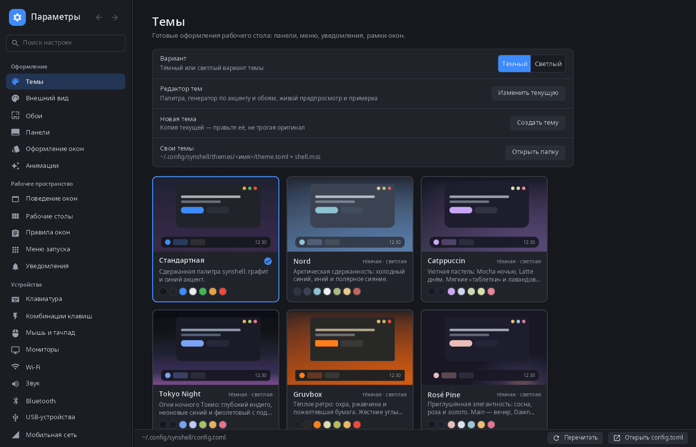
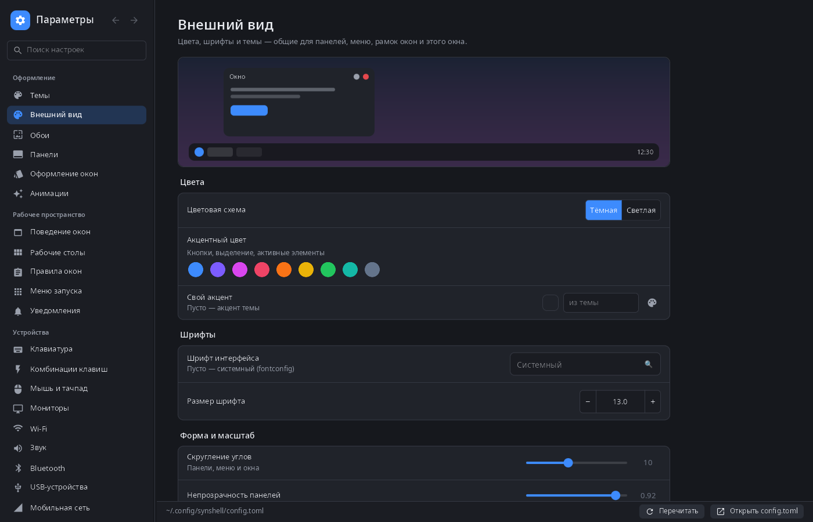
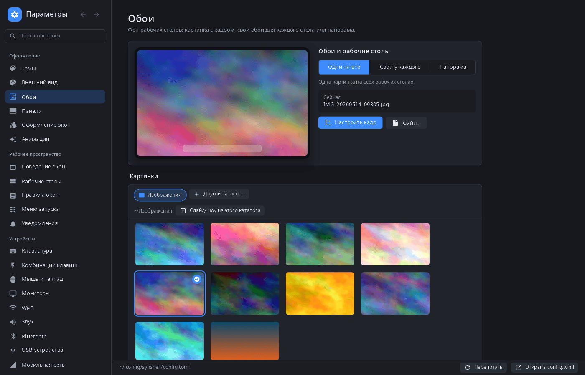
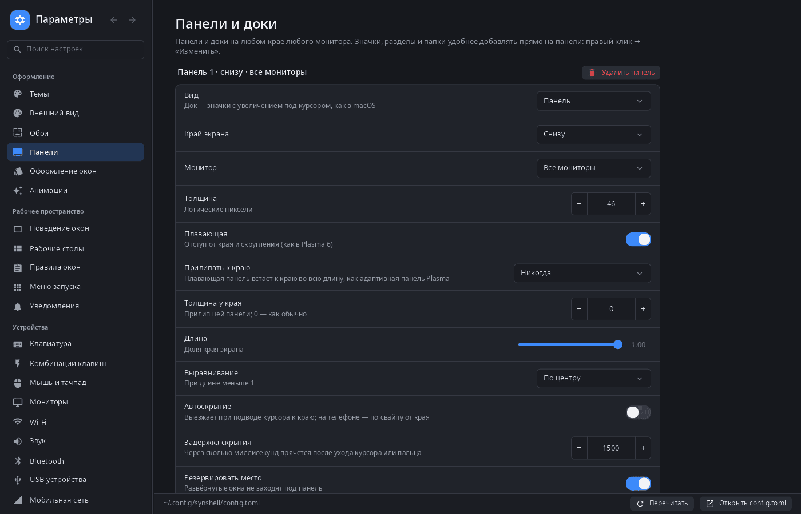

<div align="center">

# synsettings

**Параметры системы рабочего стола synshell — темы, обои, панели, ввод, мониторы, сеть, звук и остальной `config.toml` в одном окне.**

[English](README.md) · [Сайт](https://alexeyev.dev/ru/synshell/syn-settings/) · [AUR: synshell-core-bin](https://aur.archlinux.org/packages/synshell-core-bin) · [AUR: synshell-core-git](https://aur.archlinux.org/packages/synshell-core-git)



</div>

## Возможности

- **Точечная правка `config.toml`** — переписываются только изменённые ключи (комментарии и порядок остаются), композитор и оболочка подхватывают файл сами; правка снаружи перечитывается в окне.
- **Темы** — галерея встроенных и своих тем с живыми миниатюрами, тёмный и светлый вариант, «Изменить текущую» и «Создать тему» открывают редактор тем.
- **Внешний вид** — цветовая схема, акцентный цвет, шрифт и его размер, скругление углов, непрозрачность панелей, оформление окон, анимации.
- **Обои** — одна картинка на все рабочие столы, своя у каждого или панорама через все; галерея папки «Изображения» с миниатюрами, редактор кадра (сдвиг и масштаб мышью, колесом или пальцами), слайд-шоу из папки, цвета градиента.
- **Панели и доки** — у любого края любого монитора, плавающие или прилипшие к краю, автоскрытие, длина, выравнивание, резервирование места.
- **Рабочее пространство** — поведение окон, рабочие столы и раскладка по умолчанию, правила окон, меню запуска, уведомления.
- **Устройства** — клавиатура и раскладки, комбинации клавиш, мышь и тачпад, мониторы (масштаб, HDR), Wi-Fi, Bluetooth, звук (выходы, входы и громкость программ), USB-устройства, VPN (NetworkManager, WireGuard с созданием ключей), связь с устройствами (synlink), игровой режим, оборудование с живыми показаниями датчиков.
- **Телефон** — мобильная сеть, вызовы и SMS, сведения о модеме, жесты, вибрация.
- **Система** — питание и регуляторы частоты процессора, нейросети и ассистент, разрешения на местоположение и камеру, язык, дата и время, блокировка и простой, автозапуск, программы по умолчанию (запись в `mimeapps.list`), сеанс, «О системе».
- **Поиск** по всем страницам — на языке интерфейса и по-русски.
- **Вид для телефона** — на узком экране список разделов и страница открываются по очереди.
- **14 языков** — как в системе или язык, выбранный в настройках.

| Внешний вид | Обои | Панели |
|---|---|---|
|  |  |  |

## Установка

**Arch Linux (AUR)** — x86_64 и aarch64. synsettings входит в пакет `synshell-core` — базовый набор программ рабочего стола (композитор, оболочка, параметры, проводник, терминал, установка программ, снимки экрана):

```sh
yay -S synshell-core-bin      # готовые бинарники
yay -S synshell-core-git      # сборка из исходников
```

Дополнительно: `networkmanager` или `iwd` (Wi-Fi; для VPN нужен NetworkManager), `bluez` (Bluetooth), `wireplumber` (звук).

Весь рабочий стол: `yay -S synshell-bin`. **Из исходников:** `cargo build --release -p syn-settings` в репозитории [synshell](../../README.md).

## Командная строка

```sh
synsettings                       # открыть на «Внешнем виде»
synsettings wifi                  # открыть страницу (то же, что --page wifi)
synsettings --list-pages          # идентификаторы и названия страниц
synsettings --list-themes         # установленные темы
synsettings --apply-theme nord    # применить тему, как на странице «Темы», и выйти
synsettings --config ./test.toml  # править другой файл настроек
synsettings --screenshot out.png --page themes --size 1400x900   # страница в PNG без окна
```

## Часть synshell

synsettings — одно из приложений [synshell](../../README.md): окружения рабочего стола для Wayland на Rust для компьютеров и телефонов, на UI-фреймворке [syngui](https://github.com/VitaminDB/syngui).

## Лицензия

GPL-3.0-only
