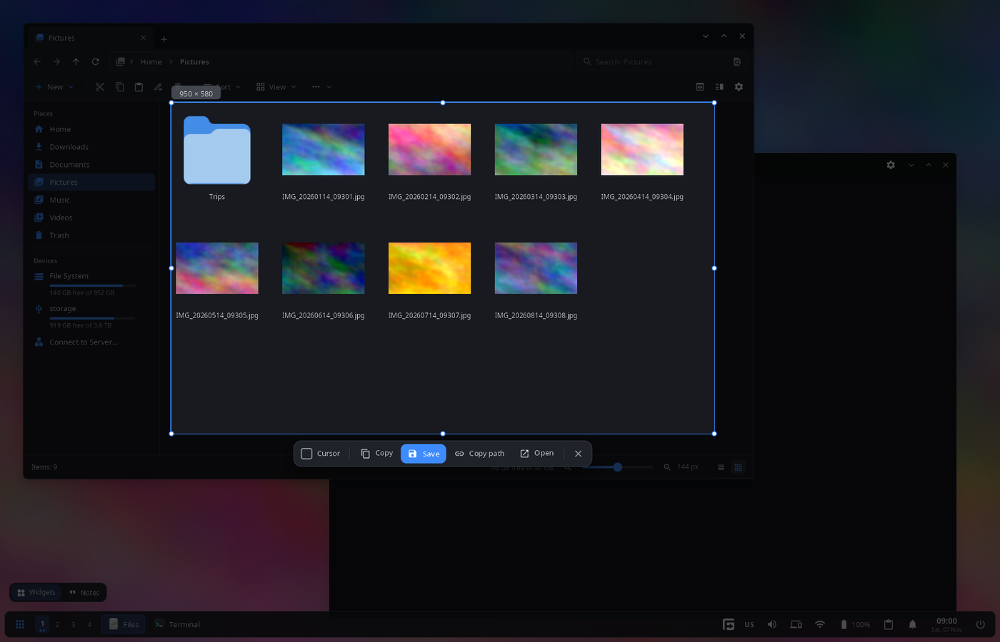
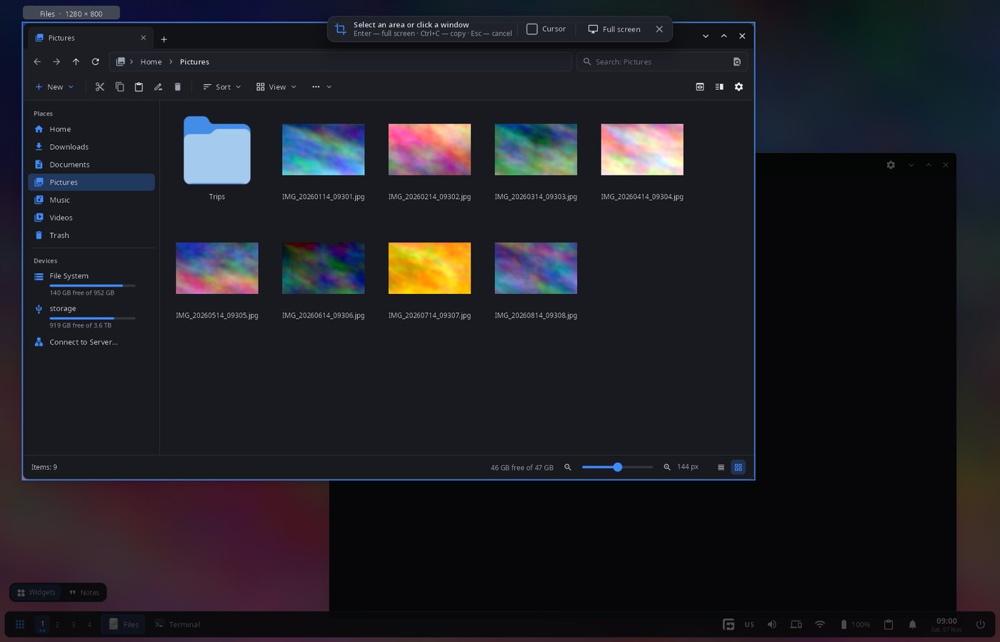

<div align="center">

# synshot

**Screenshots for the synshell desktop — the screen freezes, you select an area or click a window, then copy, save or open it.**

[Русский](README.ru.md) · [Website](https://alexeyev.dev/syndesktop/) · [AUR: synshell-core-bin](https://aur.archlinux.org/packages/synshell-core-bin) · [AUR: synshell-core-git](https://aur.archlinux.org/packages/synshell-core-git)



</div>

## Features

- **Frozen screen** — on Print the compositor (synwm) captures all monitors at once, so menus and tooltips stay in the picture.
- **Area, window or monitor** — drag a frame; or click: the window under the pointer is taken, or the whole monitor if there is no window. The candidate is highlighted with its name and size before the click.
- **Precise selection** — handles, moving the frame, size in pixels, a magnifier at the pointer; arrow keys move the frame by 1 px (Ctrl — by 10 px), Shift+arrows change its size.
- **Actions** — Copy (image to the clipboard), Save (PNG to the screenshots folder), Copy path, Open (in the default program); the shell shows a notification.
- **Keyboard** — Enter or Ctrl+S save (without a selection — the whole screen), Ctrl+C copy, Ctrl+Shift+C copy the path, Ctrl+O open, Ctrl+A the monitor under the pointer, Ctrl+Shift+A all monitors, Esc cancels.
- **Pointer** — the “Cursor” checkbox adds the mouse pointer to the picture.
- **Several monitors** — one overlay per monitor, the selection can span them.
- **14 languages** — the UI follows the system or the language chosen in settings.

| Window under the pointer |
|---|
|  |

## Install

**Arch Linux (AUR)** — x86_64 and aarch64. synshot is part of `synshell-core`, the base set of desktop programs (compositor, shell, settings, file manager, terminal, software center, screenshots):

```sh
yay -S synshell-core-bin      # prebuilt
yay -S synshell-core-git      # built from source
```

Optional: `wl-clipboard` (images and paths to the clipboard).

synshot works with the synshell compositor synwm: it asks synwm for the frames of the monitors.

The whole desktop: `yay -S synshell-bin`. **From source:** `cargo build --release -p syn-shot` in the [synshell](../../README.md) repository.

## Usage

| Keys | Action |
|---|---|
| Print | synshot: select an area or a window |
| Shift+Print | the whole screen at once (synwm) |
| Alt+Print | the active window at once (synwm) |

The keys are set in `[keybindings]` of `config.toml` (`screenshot-interactive`, `screenshot`, `screenshot-window`); the screenshots folder is `[general] screenshot_dir` (`~/Pictures/Screenshots` by default).

```sh
synshot          # freeze the screen now and select
```

## Part of synshell

synshot is one of the applications of [synshell](../../README.md) — a Wayland desktop environment in Rust for computers and phones, built on the [syngui](https://github.com/VitaminDB/syngui) UI framework.

## License

GPL-3.0-only
