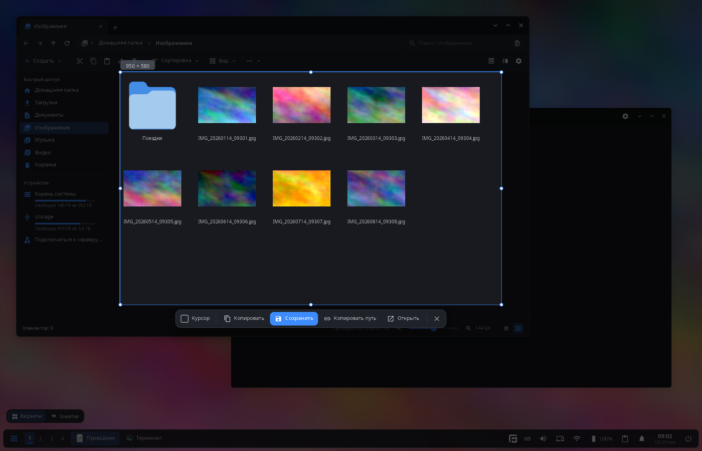
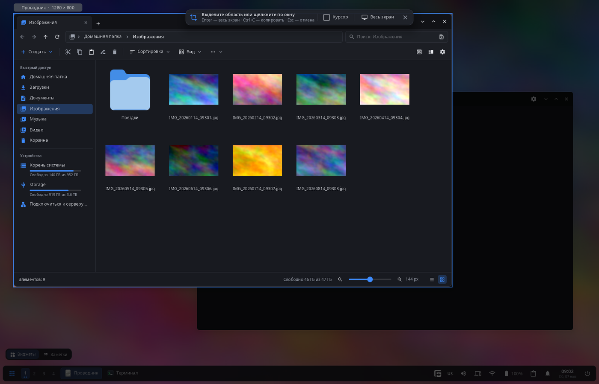

<div align="center">

# synshot

**Снимки экрана рабочего стола synshell — экран застывает, вы выделяете область или щёлкаете по окну, затем копируете, сохраняете или открываете снимок.**

[English](README.md) · [Сайт](https://alexeyev.dev/ru/syndesktop/) · [AUR: synshell-core-bin](https://aur.archlinux.org/packages/synshell-core-bin) · [AUR: synshell-core-git](https://aur.archlinux.org/packages/synshell-core-git)



</div>

## Возможности

- **Застывший экран** — по Print композитор (synwm) снимает все мониторы сразу, поэтому меню и подсказки остаются на снимке.
- **Область, окно или монитор** — тяните рамку или щёлкните: берётся окно под указателем, а если окна нет — весь монитор. До щелчка кандидат подсвечен, с названием и размером.
- **Точное выделение** — ручки, перенос рамки, размер в пикселях, лупа у указателя; стрелки сдвигают рамку на 1 px (с Ctrl — на 10 px), Shift+стрелки меняют её размер.
- **Действия** — «Копировать» (картинку в буфер обмена), «Сохранить» (PNG в папку снимков), «Копировать путь», «Открыть» (в программе по умолчанию); оболочка показывает уведомление.
- **Клавиши** — Enter или Ctrl+S сохраняют (без выделения — весь экран), Ctrl+C копирует, Ctrl+Shift+C копирует путь, Ctrl+O открывает, Ctrl+A — монитор под указателем, Ctrl+Shift+A — все мониторы, Esc — отмена.
- **Указатель** — флажок «Курсор» добавляет указатель мыши на снимок.
- **Несколько мониторов** — оверлей на каждом мониторе, выделение может проходить через несколько.
- **14 языков** — как в системе или язык, выбранный в настройках.

| Окно под указателем |
|---|
|  |

## Установка

**Arch Linux (AUR)** — x86_64 и aarch64. synshot входит в пакет `synshell-core` — базовый набор программ рабочего стола (композитор, оболочка, параметры, проводник, терминал, установка программ, снимки экрана):

```sh
yay -S synshell-core-bin      # готовые бинарники
yay -S synshell-core-git      # сборка из исходников
```

Дополнительно: `wl-clipboard` (картинки и пути в буфер обмена).

synshot работает с композитором synshell synwm: кадры мониторов он получает от synwm.

Весь рабочий стол: `yay -S synshell-bin`. **Из исходников:** `cargo build --release -p syn-shot` в репозитории [synshell](../../README.md).

## Использование

| Клавиши | Действие |
|---|---|
| Print | synshot: выделить область или окно |
| Shift+Print | весь экран сразу (synwm) |
| Alt+Print | активное окно сразу (synwm) |

Клавиши задаются в `[keybindings]` файла `config.toml` (`screenshot-interactive`, `screenshot`, `screenshot-window`); папка снимков — `[general] screenshot_dir` (по умолчанию `~/Pictures/Screenshots`).

```sh
synshot          # застыть сейчас и выделить
```

## Часть synshell

synshot — одно из приложений [synshell](../../README.md): окружения рабочего стола для Wayland на Rust для компьютеров и телефонов, на UI-фреймворке [syngui](https://github.com/VitaminDB/syngui).

## Лицензия

GPL-3.0-only
