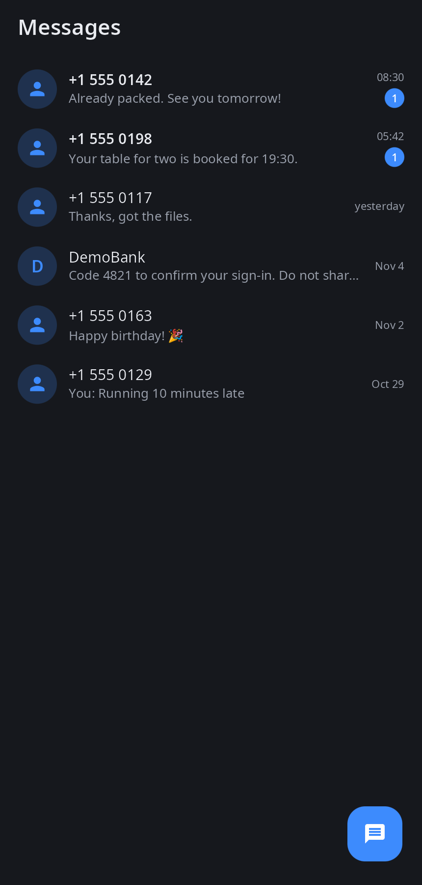
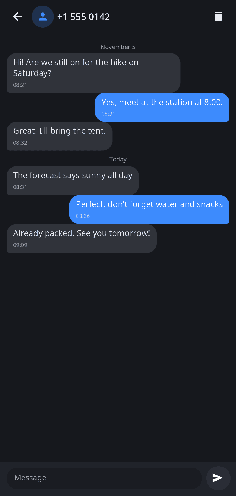
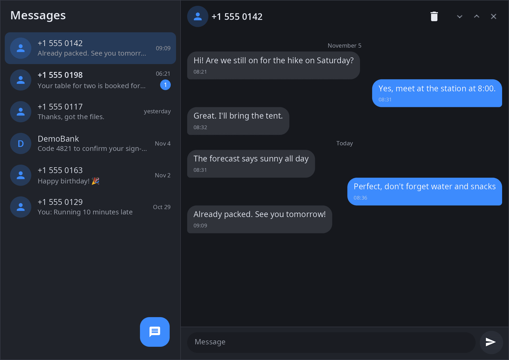

<div align="center">

# synsms

**Messages app for synshell — SMS conversations through the synshell modem daemon, laid out for a phone or a wide window.**

[Русский](README.ru.md) · [Website](https://alexeyev.dev/synshell/syn-sms/) · [AUR: synshell-mobile-bin](https://aur.archlinux.org/packages/synshell-mobile-bin) · [AUR: synshell-mobile-git](https://aur.archlinux.org/packages/synshell-mobile-git)



</div>

## Features

- **Conversations** — messages grouped by number (“+1…” and “8…” forms of one number are one conversation), newest first, with unread counters; letters for alphanumeric senders.
- **Chat** — bubbles grouped by day, time and delivery state (“sending…”, “not sent”); opening a conversation marks it as read.
- **New message** — to any number, from the round button.
- **Delete a conversation** — with confirmation.
- **Phone and wide layouts** — on a narrow screen a stack “conversations → chat” with Back/Esc, in a wide window two columns.
- **Network line** — says when sending is impossible (no modem, airplane mode) or messages will wait for the network.
- **14 languages** — follows the system language.

| Chat | Wide window |
|---|---|
|  |  |

## Requirements

SMS are sent, received and stored by `synmodemd`, the synshell modem daemon (Qualcomm modems over QMI/QRTR); long messages arrive already joined. Without a modem the app shows “Modem unavailable”.

## Install

**Arch Linux (AUR)** — x86_64 and aarch64. synsms is part of the `synshell-mobile` package (phone shell, modem, calls, NFC, compass, step counter):

```sh
yay -S synshell-mobile-bin      # prebuilt
yay -S synshell-mobile-git      # built from source
```

Depends on `synshell-core`. **From source:** `cargo build --release -p syn-sms` in the [synshell](../../README.md) repository.

## Command line

```sh
synsms                          # conversations
synsms --chat +15550142         # open the conversation with a number
synsms --new                    # new message
synsms --screenshot out.png --chat "+1 555 0142"   # window snapshot with a made-up conversation
```

## Part of synshell

synsms is one of the applications of [synshell](../../README.md) — a Wayland desktop environment in Rust for computers and phones, built on the [syngui](https://github.com/VitaminDB/syngui) UI framework.

## License

GPL-3.0-only
