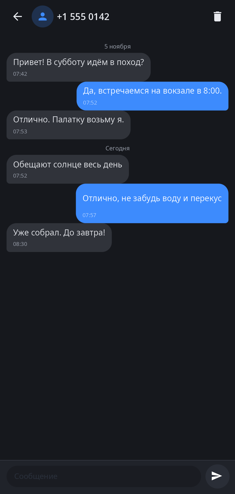
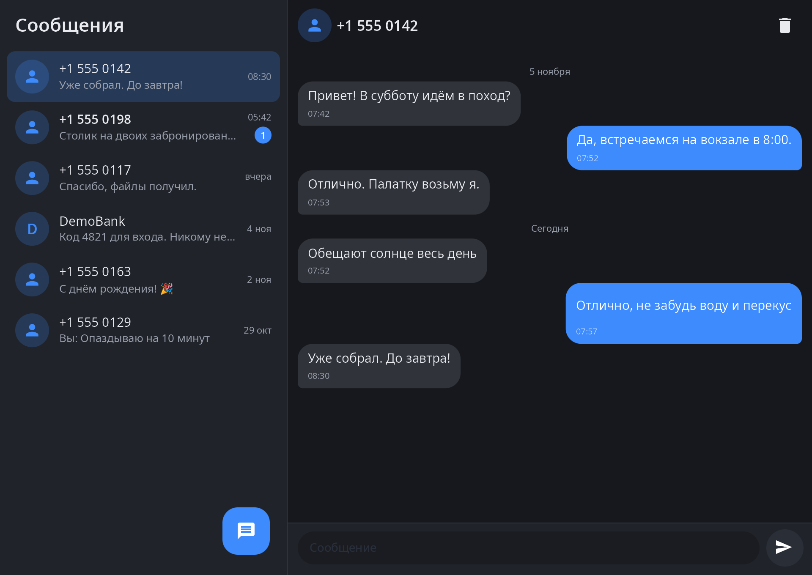

<div align="center">

# synsms

**«Сообщения» synshell — переписка по SMS через демон модема synshell, для телефона и широкого окна.**

[English](README.md) · [Сайт](https://alexeyev.dev/ru/synshell/) · [AUR: synshell-mobile-bin](https://aur.archlinux.org/packages/synshell-mobile-bin) · [AUR: synshell-mobile-git](https://aur.archlinux.org/packages/synshell-mobile-git)


</div>

## Возможности

- **Переписки** — сообщения сгруппированы по номеру («+7…» и «8…» одного номера — одна переписка), свежие сверху, со счётчиком непрочитанных; у буквенных отправителей — первая буква.
- **Чат** — сообщения по дням, время и состояние отправки («отправка…», «не отправлено»); открытая переписка отмечается прочитанной.
- **Новое сообщение** — на любой номер, круглой кнопкой.
- **Удаление переписки** — с подтверждением.
- **Телефон и широкое окно** — на узком экране стек «переписки → чат» с «Назад»/Esc, в широком окне — две колонки.
- **Строка сети** — подсказывает, когда отправить нельзя (нет модема, режим полёта) или сообщения уйдут, когда появится сеть.
- **14 языков** — как в системе.

| Чат | Широкое окно |
|---|---|
|  |  |

## Что нужно

Отправляет, принимает и хранит SMS `synmodemd` — демон модема synshell (модемы Qualcomm по QMI/QRTR); длинные сообщения приходят уже склеенными. Без модема программа показывает «Модем недоступен».

## Установка

**Arch Linux (AUR)** — x86_64 и aarch64. synsms входит в пакет `synshell-mobile` (оболочка телефона, модем, звонки, NFC, компас, шагомер):

```sh
yay -S synshell-mobile-bin      # готовые бинарники
yay -S synshell-mobile-git      # сборка из исходников
```

Зависит от `synshell-core`. **Из исходников:** `cargo build --release -p syn-sms` в репозитории [synshell](../../README.md).

## Командная строка

```sh
synsms                          # переписки
synsms --chat +15550142         # открыть переписку с номером
synsms --new                    # новое сообщение
synsms --screenshot out.png --chat "+1 555 0142"   # снимок окна с придуманной перепиской
```

## Часть synshell

synsms — одно из приложений [synshell](../../README.md): окружения рабочего стола для Wayland на Rust для компьютеров и телефонов, на UI-фреймворке [syngui](https://github.com/VitaminDB/syngui).

## Лицензия

GPL-3.0-only
